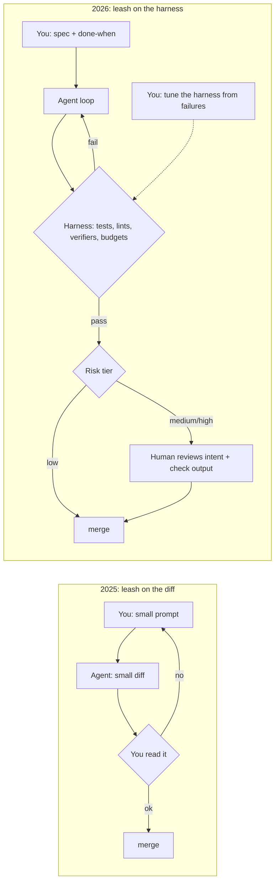

# 02: The leash moved from the diff to the harness

## The idea

In mid-2025 the best advice was to keep the AI on a tight leash: small requests, small diffs, and a human checking each one. By 2026, serious teams were running agents for hours unattended and merging most of their changes with at most one human in the loop. Those look like opposite positions. They aren't.

> **Synthesis:** the leash didn't go away. It moved. In 2025 the constraint was **you, reading each diff**. In 2026 the constraint is **the harness**: the tests, lints, verifiers, sandboxes, review agents, risk-tier rules and budgets that must say yes before an agent's work counts. The human's job moved from inspecting outputs to designing and tuning the checks, and to reviewing where the checks are weak.

This is the operational form of the thesis in [01](01-verifiability-thesis.md). Autonomy grew exactly as fast as the checks around it got stronger.

## Why it matters

If you take the 2025 advice into 2026, you become the bottleneck. Willison: "I can only focus on reviewing and landing one significant change at a time" ([Willison, parallel agents](https://simonwillison.net/2025/Oct/5/parallel-coding-agents/)). If you take the 2026 headline numbers without the harness behind them, you ship unreviewed code that nothing checked. Both failures come from reading one half of the evidence.

## How it works: the evidence trail

Read these in order. Each step adds autonomy, and each step adds a check that pays for it.

| When | Source | Where the leash is | What made it safe |
|---|---|---|---|
| Jun 2025 | Karpathy, "Software Is Changing (Again)" | The human, per diff: "To improve generation: Keep AI on tight leash." An **autonomy slider** per product (Cursor Tab → agent mode) | Fast human verification: GUIs, visual diffs, small chunks ([Latent Space notes](https://www.latent.space/p/s3)) |
| Oct 2025 | Karpathy on Dwarkesh | Agents "just not net useful" for nanochat's novel code; autocomplete instead | Nothing. With an off-distribution task and no oracle, the leash stays short ([Dwarkesh](https://www.dwarkesh.com/p/andrej-karpathy)) |
| Nov 2025 | Karpathy, "Verifiability" | Names the variable: you can automate what you can verify | Resettable, efficient, rewardable environments ([post](https://karpathy.bearblog.dev/verifiability/)) |
| Dec 2025 | Karpathy, recalled in the Sequoia 2026 summary | "a step change: the generated chunks got larger, more coherent, and more reliable." The unit becomes "macro actions" | Agents that run tests, runs and diffs as constant feedback ([Sequoia 2026](https://karpathy.bearblog.dev/sequoia-ascent-2026/)) |
| Feb 2026 | OpenAI, "Harness engineering" | "Humans steer. Agents execute." Zero manually written lines. Roughly 1M lines and about 1,500 merged PRs over about five months, with 3 engineers growing to 7. Single runs of "upwards of six hours". Human PR review optional | AGENTS.md as a map, a strict layered architecture enforced by custom lints with remediation text, per-worktree app instances and queryable logs and metrics, agent-to-agent review, and background cleanup agents ([OpenAI](https://openai.com/index/harness-engineering/)) |
| Feb 2026 | OpenAI, "Run long horizon tasks with Codex" | About 25 hours uninterrupted, about 13M tokens, about 30k lines, GPT-5.3-Codex at Extra High effort. "The result was not perfect or production-ready, but it was real and testable." | Durable spec, plan, runbook and status files, with validation after every milestone ([OpenAI dev blog](https://developers.openai.com/blog/run-long-horizon-tasks-with-codex)) |
| Feb 2026 | Stripe, "Minions" | "Over a thousand pull requests merged each week ... are completely minion-produced"; "they're human-reviewed" | Isolated pre-warmed devboxes (about 10 s), local lint on push, and "at most two rounds of CI" ([Stripe](https://stripe.dev/blog/minions-stripes-one-shot-end-to-end-coding-agents)) |
| Oct 2026 | Anthropic, "How the Claude Code team does code review" | Claude writes about 90% of Claude Code's code. Most PRs merge "with at most one human in the loop". Low-risk changes need zero human approvals | A risk-tier classifier ("The change sets the tier, not the author"), parallel bug hunters plus **verifier agents that vote** on each finding, a three-round cap, an agent approval that "never counts as a person's", and revert and incident rate as the guardrail ([Anthropic](https://claude.dev/blog/solving-code-review-at-anthropic/)) |

Note what the Anthropic post reports as outcomes, because this is the evidence that moving the leash worked rather than merely sped things up. From June to September, merged PRs "more than doubled while the share that had to be reverted fell by more than 40 percent". The share of PRs passing after one review-and-fix round went from 65% to 78%. The team defined its target as the least human review time that does not raise reverts or incidents, and it measures that.

Two cautions from the same sources keep this honest:
- OpenAI says its minimal merge gates work *because* throughput is very high. Short-lived PRs and re-run flakes are cheap there. That reasoning doesn't carry over to a team merging ten PRs a week.
- Anthropic still requires one or two humans on medium- and high-risk changes. The leash moved for low-risk changes, and it got *more* specific for high-risk ones.

### The before/after model



Your work in the 2026 picture is mostly on the dotted edge. Every escaped defect, every bad review comment and every stuck loop becomes a change to the harness rather than a one-off fix. [08-harness-engineering](../08-harness-engineering/README.md) is that module.

### Decision rules

1. **Move the leash only as far as the harness can hold.** For each check you'd stop doing by hand, name the automated check that replaces it. If you can't name one, keep doing it.
2. **Tier by change, not by author.** That includes agent authors. Docs and flagged additive changes are low risk. Caching, auth, money and migrations are high.
3. **Cap every automated loop.** Stripe caps CI at two rounds. Anthropic's reviewer asks the author to rethink after three, because one PR ran more than fifty review-and-fix rounds overnight before its author stopped it.
4. **Keep a guardrail metric you didn't optimize**, such as revert rate, incident rate or rework (see [05-measure-yourself](05-measure-yourself.md)). Without one you can't tell "faster" from "faster at shipping bugs".

## Worked example: the same change, two leashes

**Task.** Add a per-destination retry budget to `webhook-sender` (Go). The budget is at most 10% extra traffic from retries over a 60 s window, and when it is exhausted, failures go to the DLQ instead of being retried.

### 2025 leash (works, but you are the throughput limit)

```text
You:   Add a token-bucket retry budget type in internal/retry/budget.go. Just the type and its tests.
Agent: (diff, 80 lines)          You: read it, ok.
You:   Wire it into sender.go's retry path.
Agent: (diff, 40 lines)          You: read it, spot that it's per-process not per-destination, ask again.
...    six rounds, about 90 minutes of your attention
```

This is fine for one change. It doesn't scale to five in parallel, and your reading is the only check on "per-destination".

### 2026 leash (you design the checks once, then delegate)

The leash is now a set of files.

`SPEC.md` (excerpt):
```markdown
## Done when
- `go test ./internal/retry/... -race` passes, including:
  - TestBudgetPerDestination: two destinations, one saturated; the other still retries
  - TestBudgetRatio: 10k sends at 30% failure; retries <= 10% of sends (+/- 1%) per 60s window
  - TestExhaustedGoesToDLQ: exhausted budget -> message on DLQ topic, not dropped, not retried
- `make lint` clean (includes the forbid-global-state lint for internal/retry)
- No changes outside internal/retry/ and cmd/webhook-sender/sender.go
```

A Stop hook, so that the agent cannot declare itself done while the checks are red. In `.claude/settings.json`:
```json
{
  "hooks": {
    "Stop": [
      { "hooks": [ { "type": "command", "command": "./scripts/stop-gate.sh" } ] }
    ]
  }
}
```

`scripts/stop-gate.sh`:
```bash
#!/usr/bin/env bash
# Exit 2 tells Claude Code not to stop; stderr is fed back to the agent as the reason.
if ! out=$(go test ./internal/retry/... -race 2>&1 && make lint 2>&1); then
  echo "Checks failing. Fix before finishing:" >&2
  echo "$out" | tail -40 >&2
  exit 2
fi
if git diff --name-only origin/main | grep -vE '^(internal/retry/|cmd/webhook-sender/sender.go)'; then
  echo "Out-of-scope files changed (listed above). Revert them." >&2
  exit 2
fi
```

(Hook semantics, checked against [code.claude.com/docs/en/hooks](https://code.claude.com/docs/en/hooks) in Oct 2026: for `Stop`, exit code 2 "Prevents Claude from stopping, continues the conversation". A production hook should also read `stop_hook_active` from its stdin JSON and cap how many times it blocks. [07-loops](../07-loops/README.md) and [14-steering-and-guardrails](../14-steering-and-guardrails/README.md) cover this.)

A risk tier in `REVIEW.md`: `internal/retry/**` is **medium**, so one human reviews it. That human reads the SPEC's done-when and the test names and output, and spot-checks the per-destination keying. They don't read every line.

What you spent your attention on: about 20 minutes on SPEC.md and the test names, and about 10 minutes reviewing intent plus the check output. The agent's iterations happened against the harness and never reached you. If it comes back with a per-process budget, `TestBudgetPerDestination` fails, and the Stop hook sends it back without you.

**Why the 2026 version is not just "trust the agent":** each item you stopped checking by hand ("is it per-destination?", "did it touch other files?", "is it race-free?") was replaced by a named automated check. That is rule 1 above.

## Pitfalls

| Pitfall | How to detect it |
|---|---|
| **Copying the 2026 numbers without the 2026 harness** | List the checks that replace your review. If the list is "CI", you haven't moved the leash. You've let go of it. |
| **Counting an agent's approval as a human's** | Audit merged PRs: a high-risk path with only bot approvals is a policy bug. Anthropic forbids this explicitly. |
| **Unbounded review/fix loops** | Track rounds per PR. A long tail beyond 3 to 5 rounds means you need a round cap and a "rethink" escalation. |
| **No guardrail metric** | If you can't state your revert rate before and after, you can't claim the change was safe. |
| **Harness rot**: checks tuned for last quarter's model | Re-run the harness ablation on each model upgrade ([12-hill-climbing](../12-hill-climbing/README.md)). Scaffolds that compensated for old weaknesses become noise. |

## In your day job

- For your next delegated change, write the done-when as commands before you prompt, and wire one of them into a Stop hook or pre-PR gate.
- Write down your team's risk tiers, even informally. "Anything touching money, auth, migrations or caching gets two humans" is a fine start.
- Pick one guardrail metric (revert rate, or follow-up fix PRs within 14 days) and start recording it now, before you change how much you delegate.
- When an agent mistake reaches review, ask which check should have caught it, and add that check rather than a review comment.
