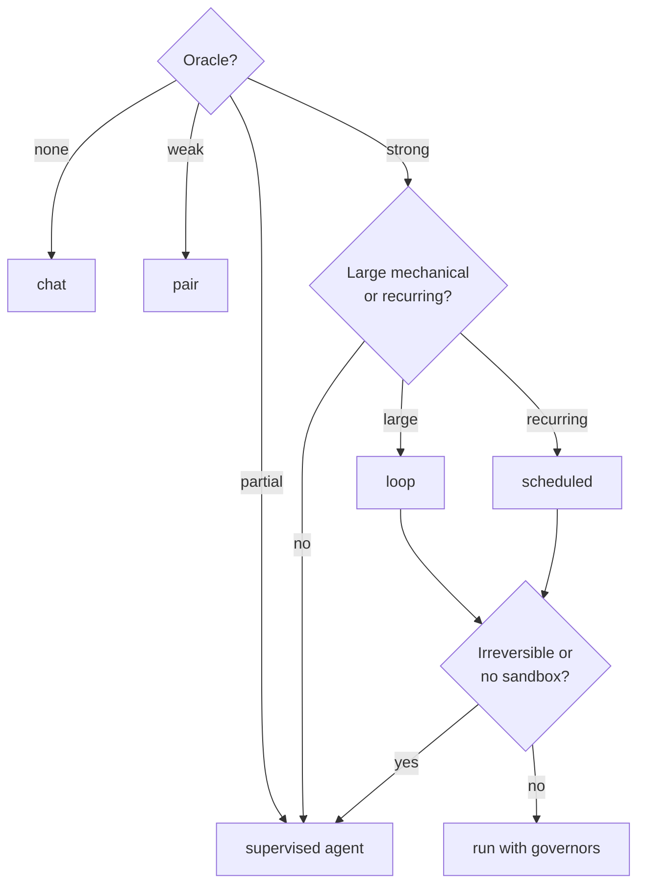

# 03: The autonomy dial

## The idea

Karpathy's "autonomy slider" is a property of *products*: Cursor goes from Tab to Cmd+K to agent mode, and Perplexity from search to deep research ([Latent Space notes](https://www.latent.space/p/s3)). This file turns it into a property of *tasks*. You choose a position per task, the same way you choose a consistency level per operation, based on what you can check.

There are five positions:

| Mode | Who acts | Who checks, and when | Typical tool surface |
|---|---|---|---|
| **chat** | The model proposes; you write and apply | You, on every idea. There is nothing else to check against | A chat window, read-only repo access |
| **pair** | The agent edits in your session | You approve each step and diff, in small chunks | IDE agent, Claude Code with per-edit approval |
| **supervised agent** | The agent plans and executes many steps, running tools and checks | You review the plan before code, then the diff plus the check output at the end | Claude Code / Codex session with tests it can run, in a worktree |
| **loop** | The agent iterates unattended against an oracle until done or budget | The oracle on every iteration; you at the PR | Ralph-style loop, `/goal`, Stop-hook gate, headless `claude -p` |
| **scheduled** | A trigger (cron, event) starts a run; results land in an inbox | The oracle per run; you asynchronously, from the inbox | Routines, scheduled agents, CI-triggered agents |

The dial rule is the thesis applied: **pick the rightmost mode your oracle can support, then apply caps for reversibility, containment and familiarity.**

## Why it matters

Running one mode for everything costs you either way.

- **Everything in chat or pair.** You stay the bottleneck on work a test suite could have judged. The 2026 evidence in [02](02-the-leash-moved.md) is mostly about moving well-checked work to the right.
- **Everything in an agent loop.** You get loops that hill-climb a weak oracle. Spotify calls a PR that passes CI but is functionally incorrect "the most serious error, as it erodes trust in our automation" ([Spotify, Honk part 3](https://engineering.atspotify.com/2025/12/feedback-loops-background-coding-agents-part-3)). Karpathy found coding agents "just not net useful" for his novel nanochat code and went back to autocomplete ([Dwarkesh](https://www.dwarkesh.com/p/andrej-karpathy)). That is the dial moving *left* for an off-distribution task, which is correct.

The course stance on loops follows the same rule ([research/01-gap-analysis.md](../research/01-gap-analysis.md)): loop hard where a strong oracle exists, such as ports, migrations and performance targets, and stay interactive where it doesn't.

## How it works

### Inputs

| Input | Values | How to decide quickly |
|---|---|---|
| **Oracle strength** | `none` / `weak` / `partial` / `strong` | *none*: only your judgment (an RFC, naming). *weak*: you can eyeball it, or manual QA. *partial*: tests or types exist but don't pin the behavior, or a calibrated judge. *strong*: a fast automated check that **fails on wrong output** |
| **Reversible** | yes / no | Can a revert undo it? Sent emails, dropped columns, published packages and money movement are not reversible |
| **Sandboxed** | yes / no | Could a mistake reach prod data, secrets or the network? |
| **On-distribution** | yes / no | Common stack and pattern, or novel code the model has rarely seen |
| **Large and mechanical** | yes / no | Many similar steps: 41 consumers, 30 services, 1,000 call sites |
| **Recurring** | yes / no | The same job every day or week |

### Rules (implemented in [`code/autonomy_dial.py`](code/autonomy_dial.py))

1. The oracle sets the ceiling: none → chat, weak → pair, partial → supervised agent, strong → supervised agent.
2. A strong oracle plus a large mechanical task → **loop**. A strong oracle plus a recurring task → **scheduled**. A strong oracle on a small one-off task stays a supervised agent, because building a loop costs more than it saves.
3. Off-distribution → step down one position.
4. Irreversible or unsandboxed → cap at supervised agent. A human approves before the irreversible step, and containment comes before unattended runs ([16-security-and-containment](../16-security-and-containment/README.md)).
5. Each mode comes with guards. Loops always get an iteration cap, a token or dollar budget, stall and repeat detection, and an oracle run before "done" ([07-loops](../07-loops/README.md)).

> **Synthesis:** the dial is deliberately conservative. Every cap moves left, and nothing except a stronger oracle moves right. The most useful output of the dial is often "to move right, build a check first."



### The distributed-systems reading

You already pick `ONE` vs `QUORUM` vs `ALL` per query, based on what a stale read costs. The dial is the same kind of per-operation trade-off. The variable is different, though: a consistency level is a *guarantee* the system enforces, while an oracle is a *measurement* that can be wrong, and an optimizing agent will push on exactly the places where it's wrong. That is why the dial has a "faithful" requirement and a step-down for unfamiliar code, which have no counterpart in consistency levels.

## Worked example: one week of tickets

**Bad version: one mode for everything.** A week where every ticket goes to "agent, go do it" (illustrative):

```text
PAY-501  RFC: partitioning for orders topic   -> agent wrote a 6-page RFC; picked key=customer_id
                                                 without asking about the hot-tenant problem. Rewritten.
PAY-503  Fix flaky test in ledger-service     -> agent added a retry decorator to the test. Green. Flake
                                                 is a real race; ships to prod.
PAY-507  Drop legacy column + backfill        -> agent ran the migration against staging it shared with QA.
```

Each failure comes from a mode set too far right for the oracle. The RFC had no oracle. The flake fix had a gameable one: green by retrying. The migration had an irreversible step and no sandbox.

**Good version: dial per task.** Below is the real output of `recommend()` for those tickets and a few more. The feature values were filled in by hand, as you would in a ticket:

```text
A RFC: partition strategy for the orders topic -> chat
   because oracle=none supports at most chat
   guards: you are the oracle: ask for options and trade-offs, then decide yourself;
           to move the dial right, build a check first (test, golden file, calibrated judge)
C Fix flaky integration test in ledger-service -> supervised_agent
   because oracle=partial supports at most supervised_agent
   guards: review the plan before code; review the diff and the check output
D Port 41 consumers from kafka-clients 2.8 to 3.7 (contract suite) -> loop
   because strong oracle: unattended work is possible
   because large mechanical task: a loop amortises setup
   guards: iteration cap; token/$ budget; stall + repeat detection; oracle runs before 'done'
E Weekly dependency bumps across 30 services -> scheduled
   guards: ...; idempotent runs (bookmarks, stable IDs); alert when a run cannot read its inputs
F Backfill + drop legacy column in payments DB -> supervised_agent
   because irreversible effect: a human approves before the irreversible step
   guards: ...; explicit approval gate on the irreversible action
G Custom consensus-log compaction (novel) -> supervised_agent
   because off-distribution code: step down one level (agents misread novel code)
H Same port as D, but agent runs on laptop with prod creds -> supervised_agent
   because no sandbox: unattended runs need containment first (see 16-security-and-containment)
```

What to take from it:

- **C (the flake).** `partial` is the honest label: the test exists, but "green" doesn't prove the race is gone. The useful step is to raise the oracle. Have the agent write a stress harness first (`go test -race -count=500 -run TestSettle`) that reproduces the flake on `main`. Once that harness reliably goes red, the oracle is strong and the fix itself can be delegated with confidence.
- **D vs H.** This is the same task with the same oracle. Only the containment differs, and that moves it two positions. You fix the environment, not the prompt.
- **F.** The backfill part can loop. The `DROP COLUMN` cannot. Split the ticket: loop the backfill against a row-count and checksum oracle in a sandbox, then a human runs the drop.

You can also let a model fill in the features from the ticket text. The rule still decides:

```bash
cd 00-orientation/code
PYTHONPATH=../../shared python autonomy_dial.py "Port the 41 consumers to kafka-clients 3.7; contract suite covers every behaviour"
```

The extractor is told to pick the conservative value when unsure, and any malformed reply falls back to `oracle=none, reversible=False, sandboxed=False`, which maps to chat. When the model is uncertain, the dial moves left.

## Pitfalls

| Pitfall | How to detect it |
|---|---|
| **Labelling an oracle "strong" because a test suite exists** | Strong means it fails on wrong output. Seed one bug. If nothing goes red, it's `partial` at best. |
| **Not splitting mixed tickets** (reversible bulk work plus one irreversible step) | Any ticket containing `DROP`, `DELETE`, "send", "publish" or "charge" gets split, so the irreversible part stays supervised. |
| **Dialing by mood**, going far right on a good day | Write the mode in the ticket before starting, and compare against your log ([05](05-measure-yourself.md)). |
| **Never moving right**: still pairing on work with a full contract suite | Look for tasks that went to pair or supervised but never failed review. They're candidates to move one position right. |
| **Loops without governors** | Grep your loop scripts for an iteration cap and a budget. Their absence is a finding. |

## In your day job

- Add a `mode:` line and an `oracle:` line to your ticket template. It makes the dial a habit and gives you data later.
- When the dial says chat or pair, ask "what check would move this right?" and file that check as its own ticket. It is often a better delegation target than the original.
- Split irreversible steps out of otherwise-loopable work.
- Revisit your defaults on each model upgrade. "Off-distribution" shrinks as models improve, and you only find out by trying a step to the right with the oracle in place.
