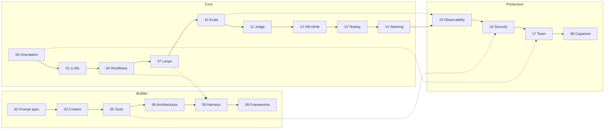

# 06: The course map

## The idea

The course has 19 modules, and each answers one version of the thesis question: *what can be checked here, how do you make it checkable, and how do you use the check?* This file maps all of them, gives the suggested tracks, and shows how to route through the material for a concrete goal.

## Why it matters

The course is large, roughly 80–110 files. Read it front to back and you'll spend weeks on frameworks before you've built an eval. Skip around and you'll hit hill-climbing (12) without the error-analysis habit from 10 that makes it meaningful. The tracks are ordered so that each module's check builds on the previous one's.

## How it works

### All modules

| # | Module | Track | The verifiability question it answers | DS anchor |
|---|---|---|---|---|
| 00 | [Orientation: going AI-native](README.md) | Core | Where should autonomy sit for this task, and is AI actually helping me? | Choosing consistency levels |
| 01 | [LLMs for systems engineers](../01-llms-for-systems-engineers/README.md) | Core | What properties of the model (sampling, context, jaggedness, hallucination incentives) limit what any check can catch? | An unreliable, nondeterministic remote dependency |
| 02 | [Prompting as specification](../02-prompting-as-specification/README.md) | Builder | Is the instruction precise enough that a violation is detectable? Are prompt changes gated like deploys? | API contracts, schema migrations |
| 03 | [Context engineering, retrieval & memory](../03-context-engineering/README.md) | Builder | Did the right information reach the window, and is retrieval grounded and evaluated? | Memory hierarchy, cache eviction |
| 04 | [Agentic coding workflows](../04-agentic-coding-workflows/README.md) | Core | How do explore → plan → implement → verify and SPEC.md make each step reviewable? | Change management, the RFC process |
| 05 | [Tools, MCP, skills, hooks & execution environments](../05-tools-mcp-skills-hooks/README.md) | Builder | Can the agent call tools correctly, and does the environment let it run checks safely? | API design for an unreliable client |
| 06 | [Agent architectures](../06-agent-architectures/README.md) | Builder | Which pattern keeps state consistent (single writer) and lets a clean-context reviewer check the work? | Single-writer principle, event sourcing, OCC |
| 07 | [Loops](../07-loops/README.md) | Core | Is there an oracle the loop can consume, has it been proven to fail, and what governs the loop? | Control loops, reconcilers, circuit breakers |
| 08 | [Harness engineering: agent-ready codebases](../08-harness-engineering/README.md) | Builder | Can an agent understand, verify and diagnose in this codebase unaided? Measured as an autonomy rate | Platform engineering, paved roads |
| 09 | [Frameworks: LangChain, LangGraph, LangSmith & the landscape](../09-frameworks-langchain-langgraph/README.md) | Builder | When does a framework's durability and tracing earn its cost? | Library vs framework, build vs buy |
| 10 | [Evals fundamentals](../10-evals-fundamentals/README.md) | Core | What fails, how often (error analysis), and which code graders catch it? | Test pyramid, SLIs |
| 11 | [LLM-as-judge](../11-llm-as-judge/README.md) | Core | When no code grader exists, can a judge be calibrated against human labels? | Validating your monitoring |
| 12 | [Hill-climbing](../12-hill-climbing/README.md) | Core | Is a change a real improvement beyond the noise, on held-out data? | Benchmarking with significance |
| 13 | [Testing agentic systems](../13-testing-agentic-systems/README.md) | Core | Are trajectories correct, and are failures real or infrastructure noise? | Jepsen, deterministic simulation |
| 14 | [Steering & guardrails](../14-steering-and-guardrails/README.md) | Core | Which checks block bad output at run time, and how do you recover drift? | Admission controllers, feedback control |
| 15 | [Observability & production](../15-observability-and-production/README.md) | Production | Is it still working in prod, at what cost and latency? | SRE: SLOs, canaries, rollbacks |
| 16 | [Security & containment](../16-security-and-containment/README.md) | Production | What can a wrong or hijacked agent reach, and is the blast radius bounded? | Zero trust, blast-radius reduction |
| 17 | [The AI-native engineer & team](../17-ai-native-engineer-and-team/README.md) | Production | How do review, measurement and hiring work at agent volume? | Running an org of fast, unreliable workers |
| 99 | [Capstone](../99-capstone/README.md) | Production | Can you take one system through every check above? A: a coding or ops agent. B: an LLM data pipeline | All of the above |

### Suggested tracks

- **Core track** (about 60% of the value, do it first): 00 → 01 → 04 → 07 → 10 → 11 → 12 → 13 → 14
- **Builder track:** 02 → 03 → 05 → 06 → 08 → 09
- **Production track:** 15 → 16 → 17 → 99

The dotted edges are the strongest cross-links. 08 depends on the loop and workflow habits from 04 and 07. 15 builds production monitoring on 10's tracing. 16's containment is the other side of 05's execution environments. 17 scales this module's self-measurement to a team.

### Threads that run through every module

| Thread | First appears | Comes back in |
|---|---|---|
| Oracle quality ("prove it can fail") | 00/01 (faithfulness) | 07, 10, 11, 13 |
| The autonomy dial | 00/03 | 04, 07, 14, 16 |
| Harness assumptions decay on model upgrades | 00/02 (harness rot) | 02, 08, 12 |
| Measure, don't feel | 00/04, 00/05 | 10, 12, 17 |
| Single writer, many readers | 06 | 07, 17 |

## Worked example: routing for a goal

**Bad routing.** "I want to build an on-call triage agent, so I'll start with 09 Frameworks and LangGraph." You'd have a well-architected agent with no eval, no oracle for "triaged correctly", and no containment around its access to production logs. That is the dial set to the right before any check exists.

**Good routing.** Start from what must be checkable, and work backward.

| Goal | Route | Why this order |
|---|---|---|
| **Ship an on-call triage agent in 6 weeks** | 00 → 01 → 07 → 10 → 11 → 05 → 16 → 14 → 15 | You need the loop (07), a dataset of past incidents with labelled root causes (10), a judge for free-text diagnoses (11), read-only tools (05), containment because it touches prod telemetry (16), blocking guardrails (14), then production monitoring (15). Frameworks are optional |
| **Make my team's monorepo agent-ready** | 00 → 04 → 07 → 08 → 13 → 17 | Workflows and loops first, so you know what agents need. Then the harness (08), measured by an autonomy rate. Then tests for agent-written code (13) and team review policy (17) |
| **Improve an existing LLM feature that "feels worse" since the model upgrade** | 00 → 01 → 10 → 11 → 12 → 02 | Error analysis before any change (10). A judge if needed (11). Then a hill-climb with a noise check and a held-out set (12). Prompt changes treated as deploys (02) |
| **Hill-climb an LLM data pipeline** (capstone B) | 00 → 01 → 03 → 10 → 11 → 12 → 99 | Retrieval and grounding (03) plus evals, judge and hill-climb, with no agent required |

Each route starts at 00. Every route depends on the dial and the self-measurement habit from this module.

## Pitfalls

| Pitfall | How to detect it |
|---|---|
| **Starting with frameworks** | If you can't state your eval's pass criterion, you're not ready for 09. |
| **Skipping 10 to get to 12** | Hill-climbing without error analysis optimizes a metric nobody validated. If your first 12 exercise has no labelled traces behind it, go back. |
| **Treating 16 as optional** for internal tools | If the agent can read secrets, run shell or reach the network, 16 is on your route. |
| **Reading without running** | Every module has `code/` with offline tests. Run `./run_all_tests.sh` from the course root. A module you've read but whose exercises you haven't done doesn't count. |

## In your day job

- Pick one route from the table, or write your own backward from a real goal, and put it in your weekly plan.
- Use the "verifiability question" column as a review checklist for any AI design doc that crosses your desk.
- Keep your [05](05-measure-yourself.md) log running across the course. The modules are interventions, and the log tells you which ones changed anything.
