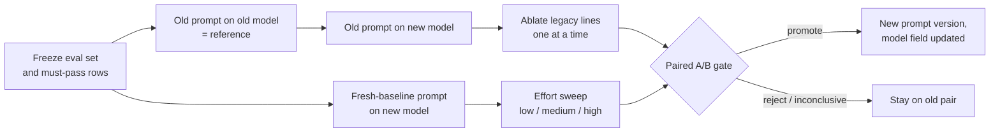

# 03: Outcome-first prompting, and techniques that expired

## The idea

Every prompt was tuned against some model, and it encodes that model's weaknesses. In 2025 a large share of prompt text was **process**: numbered procedures, "plan extensively before each call", "double-check your work", reminders to keep going. Those lines worked because the models of the time needed them. Current models plan, persist and verify on their own, and the same lines now get in the way.

**Outcome-first prompting** describes the destination and the constraints, then leaves the route to the model. You specify *what done looks like*, *who it is for*, *what must not happen* and *what shape to return*. You specify *how* only when the how is itself a requirement, such as a compliance step or a safety ordering, and even then a tool or hook usually enforces it better than prose.

The corollary is the habit this file teaches: **prompt advice expires, so re-test every prompt on every model upgrade.** Treat a prompt as code compiled against a particular runtime. When the runtime changes, you re-run the test suite, you don't assume compatibility.

## Why it matters

The evidence that process prompting was once right is solid. OpenAI's GPT-4.1 guide reported that three agentic "reminders" (persistence, tool use, and "You MUST plan extensively before each function call") "increased our internal SWE-bench Verified score by close to 20%", and that explicit planning alone added 4%. It also said GPT-4.1 follows instructions "more closely and more literally than its predecessors" ([OpenAI Cookbook, GPT-4.1 prompting guide](https://developers.openai.com/cookbook/examples/gpt4-1_prompting_guide), April 2025, now archived).

A year later, the same vendor says the opposite for the current family. The GPT-5.5 guide says "Legacy prompts often over-specify the process because earlier models needed more help staying on track", and that this can "add noise, narrow the model's search space, or lead to overly mechanical answers." Its advice is "For many tasks, describe the destination rather than every step", and "Begin migration with a fresh baseline instead of carrying over every instruction from an older prompt stack" ([OpenAI, prompt guidance for GPT-5.5](https://developers.openai.com/api/docs/guides/prompt-guidance?model=gpt-5.5)).

Anthropic says the same about verification. Opus 5 "verifies its own work without being told to". Instructions like "include a final verification step" or "use a subagent to verify" "cause over-verification on Claude Opus 5, and removing them reduces wasted tokens with no loss in quality" ([Anthropic, "Prompting Claude Opus 5"](https://platform.claude.com/docs/en/build-with-claude/prompt-engineering/prompting-claude-opus-5)).

> **Course stance** (from the gap analysis): *"Always give it a way to verify"* and *"don't tell it to verify"* are both right. Put the check in the environment (a test it can run, a validator, a schema) rather than an instruction to double-check in the prompt. Then re-measure on each model.

## How it works

### The outcome-first template

```xml
<!-- 1. Destination: the reader, the decision the output feeds, what "done" means -->
Write the summary that opens our incident postmortem. Its readers were not on the call.
After reading it they should know: user impact, duration, current best explanation, and what is unknown.

<!-- 2. Inputs, delimited -->
<timeline>{{timeline}}</timeline>

<!-- 3. Constraints that are real requirements, each with its reason -->
<constraints>
- 150 words at most, because it is pasted into the weekly digest.
- Separate what the timeline shows from what you infer.
</constraints>

<!-- 4. Output contract -->
<output_format>Three short paragraphs headed Impact, Cause, Open questions.</output_format>
```

What is missing on purpose: the persona, the numbered procedure, "think step by step", "read every line", and "double-check". Each was a patch for a weakness the current model doesn't have. If it does have one of them for your task, your eval will show it, and you add back exactly that line, with a changelog entry naming the failure.

### When process belongs in the prompt

Keep process instructions when the process is the product:

- **Ordered safety steps.** "Run the migration with `--dry-run` and show the plan before applying it." Even then, prefer a tool that won't apply without a plan ID, or a hook ([Module 14](../14-steering-and-guardrails/README.md)).
- **Domain procedures the model can't infer.** "Reconcile against the ledger before the processor report, because the processor report lags by up to 24h."
- **Communication cadence in agentic UIs.** Anthropic's Opus 5 guide gives explicit cadence prompts because the model narrates more by default.

### Techniques that expired

| Technique | Why it worked | Status (October 2026) | Do this instead |
|---|---|---|---|
| **Prefill** (a partial assistant turn for the model to continue) | Forced a format (`{`), skipped preamble, steered around refusals | Starting with Claude 4.6 models, prefilled last assistant turns "return a 400 error" ([Anthropic, migrating away from prefill](https://platform.claude.com/docs/en/build-with-claude/prompt-engineering/claude-prompting-best-practices#migrating-away-from-prefilled-responses)) | Structured outputs, or tools with an enum for classification. For preamble, a direct instruction ("Respond directly without preamble") or output inside XML tags, and strip any stray preamble in post-processing. |
| **"Think step by step"** | Elicited reasoning from models that didn't reason by default | Reasoning models think natively. OpenAI's reasoning guide has a heading "Avoid chain-of-thought prompts" and says the instruction "may not enhance performance (and can sometimes hinder it)" ([OpenAI, reasoning best practices](https://developers.openai.com/api/docs/guides/reasoning-best-practices)). On Claude Opus 5.5, Fable 5.x and Mythos 5.x, adaptive thinking is always on. On Opus 5, prompts that ask the model to write out its reasoning verbatim "may be declined with the `reasoning_extraction` refusal category" | Set `effort`. State success criteria. If you need the reasoning, read the summarized thinking blocks. |
| **The think tool** (a no-op tool used as a scratchpad between tool calls) | On τ-bench airline with Claude 3.7 Sonnet, think plus an optimised prompt scored pass^1 0.584 against a 0.332 baseline | A 2025-12-15 update to the post says "we recommend using that feature [extended thinking] instead of a dedicated think tool in most cases" ([Anthropic, "The think tool"](https://www.anthropic.com/engineering/claude-think-tool)) | Adaptive or extended thinking, with interleaved thinking between tool calls. |
| **`budget_tokens`** for thinking | A hard ceiling on thinking spend | Deprecated. Setting it "returns a 400 error" on Claude 4.7 and later | `effort`, with `max_tokens` as the hard limit. |
| **Planning and persistence reminders** ("You MUST plan extensively...") | Close to +20% on SWE-bench Verified for GPT-4.1 | Legacy process that the GPT-5.5 guide says can narrow the search space | A clear destination and a stop condition. Re-measure before keeping any reminder. |
| **"Double-check your answer"**, or "use a subagent to verify" | Older models skipped self-checks | Causes over-verification on Opus 5 | A check the model can run: tests, a validator, a schema. |
| **Shouted emphasis** (CRITICAL, MUST) | Fought under-triggering on tools | Anthropic: newer models "may now overtrigger". "Dial back any aggressive language." | Normal case, plus a reason. |
| **Describing the JSON schema in prose** | The only way to get a shape before constrained decoding | OpenAI: "Avoid describing the expected output schema in the prompt" when using Structured Outputs | Pass the schema through the API, and keep the prose to field *meanings*. |

None of these were myths. Each was measured on some model, and each stopped being true later. Anthropic's general guide says the same thing about its own advice: "Where a technique names a specific model, treat it as measured on that model and re-check it against your own evals before applying it to another."

### The model-upgrade drill

Run this whenever a new model or model version becomes a candidate. It's the prompt-level version of the drill in [Module 12](../12-hill-climbing/README.md).



1. **Don't assume a rewrite is needed.** Anthropic says Opus 5 "performs well out of the box on existing Claude Opus 4.8 prompts". Measure the old prompt on the new model first. That is your floor.
2. **Write a fresh baseline**: "Start with the smallest prompt that preserves the product contract, then tune reasoning effort, verbosity, tool descriptions, and output format against representative examples" (OpenAI GPT-5.5 guide).
3. **Ablate legacy lines one at a time.** Anthropic's response to its April 2026 regression was "ablations to understand the impact of each line" ([April 23 postmortem](https://www.anthropic.com/engineering/april-23-postmortem)). Each line you keep should have a measured reason.
4. **Re-run the effort sweep.** Effort defaults don't transfer between models. The Opus 5 guide says that if you carried effort defaults over from a prior model, you should "re-run an effort sweep on your own evals".
5. **Publish a new prompt version** with the new `model` in its front matter. Never edit the old one, because the old (prompt, model) pair is your rollback target.

## Worked example: retiring a 2025 prompt

`code/prompts/incident_summary/v1.md` was tuned on `claude-sonnet-4-5`:

```text
You are a world-class incident commander. IMPORTANT: You MUST follow these steps EXACTLY in order. Think step by step.

Step 1: Read the entire timeline line by line. Do NOT skip any lines.
Step 2: List every single event you see in a numbered list.
Step 3: For each event, decide if it is important. Explain your reasoning for each one.
Step 4: You MUST plan extensively before writing, and reflect extensively on each step.
Step 5: Identify the root cause. ALWAYS identify exactly one root cause.
Step 6: Write the summary. ALWAYS keep the summary under 100 words. Include all relevant details.
Step 7: Double-check your answer and verify every fact before responding.
Step 8: NEVER speculate. NEVER use the word "maybe".

CRITICAL: Do not forget any step. Output the summary.
```

The linter reports 14 findings, including PL001 (no output format), PL002 ("under 100 words" against "include all relevant details"), five PL003 absolutes, PL004 (10 shouted words) and three PL005 expired techniques. More useful is attributing each line to the weakness it patched:

| Line | Weakness it patched | What it does on a current model | Decision |
|---|---|---|---|
| "Think step by step", "plan extensively" | No native reasoning | Redundant with adaptive thinking; may push reasoning into visible output | Drop. Tune `effort`. |
| Steps 1 to 3 (list every event, explain each) | Skipped input; shallow reading | Forces a long visible enumeration that the user never sees, or that leaks into the summary | Drop. If coverage matters, say what must be covered (impact, duration, cause, unknowns). |
| "ALWAYS identify exactly one root cause" | Vague, hedged answers | **Forces invented certainty** when the timeline supports two causes | Replace with "If the timeline supports more than one cause, name each and say what evidence would decide between them." |
| "under 100 words" + "all relevant details" | Rambling | Contradiction; arbitrary resolution | Keep one limit, with its reason (the digest). |
| "Double-check and verify every fact" | No self-checking | Over-verification cost on Opus 5 | Drop. Make facts checkable instead: "Use UTC timestamps exactly as they appear." |
| "NEVER speculate. NEVER use 'maybe'." | Hallucinated causes | Combined with "exactly one root cause", it bans the honest answer | Replace with "Separate what the timeline shows from what you infer." |
| Persona + CRITICAL | Low attention to the system prompt | Over-triggering | Drop. |

Here is the failure on a timeline where a config push and a Postgres failover happened within two minutes of each other *(illustrative output)*:

```text
v1: Root cause: the 14:02 config push to payments-api set an invalid pool size, causing
connection exhaustion. The failover at 14:04 was a consequence. Impact: 23 minutes of
elevated 5xx.
```

The timeline doesn't establish the order of cause and effect. v1 required exactly one cause and banned hedging, so the model picked one and stated it as fact. A postmortem that opens with a false root cause sends the action items in the wrong direction.

```text
v2 (illustrative output):
**Impact** From 14:03 to 14:26 UTC, 31% of payments-api requests returned 5xx...
**Cause** Two changes coincide: a config push at 14:02 that lowered the pool size, and a
Postgres primary failover at 14:04. The timeline does not show which came first in effect...
**Open questions** Did pool exhaustion begin before 14:04? The pool metrics for 14:02 to
14:04 would settle it...
```

v2 (`code/prompts/incident_summary/v2.md`) is shorter than v1, has zero linter findings, and the changelog records why each line was removed. It's a new version with `model: claude-sonnet-5-5` in its front matter. v1 is still there, pinned to `claude-sonnet-4-5`, as the rollback target.

## Pitfalls

| Pitfall | How to detect it |
|---|---|
| **Deleting a load-bearing line along with the folklore.** Some 2025 lines still matter for your task. | Ablate one line at a time on the eval set, not all at once. Each removal is its own row in the comparison. |
| **Reading a model-specific guide as universal.** Opus 5's over-verification note says nothing about Haiku 5.5. | The `model` field in the front matter. Gate model-specific changes to the target model, as the April postmortem's process does. |
| **Rewriting by default on every upgrade.** | Step 1 of the drill: the old prompt on the new model is the floor. Only ship a rewrite that beats it. |
| **Using prefill through a framework that hides it.** Some older wrappers and agent libraries add an assistant turn for you. | A 400 on upgrade. Inspect the raw request with a `RecordingClient` cassette. |
| **Asking for visible reasoning to "see what it's thinking".** | `stop_reason` of `refusal` with category `reasoning_extraction` on Opus 5. Read the summarized thinking instead. |
| **Carrying effort defaults over.** | Cost or latency jump after the upgrade. Re-run the effort sweep. |

## In your day job

- Grep your prompt directory for `step by step`, `MUST`, `double-check`, `plan extensively` and any assistant-role last message. Each hit gets an ablation row in your next upgrade drill.
- Add a `model` field to every prompt file, and make the upgrade drill a checklist item whenever someone changes the default model ID in config.
- When you keep a process instruction, write the reason in the changelog ("kept dry-run-first because the deploy tool has no plan-ID gate yet") so the next person knows when it can go.
