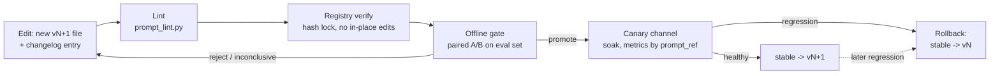

# 06: Prompts as versioned artifacts; prompt changes as deploys

## The idea

A prompt change changes production behaviour as much as a code change does, and often more, because one sentence touches every request. So it gets the same lifecycle as a deploy:



Four properties make this work. They are the same ones that make schema migrations safe:

1. **Versions are immutable and append-only.** You never edit `v2.md` after publishing it. You add `v3.md`.
2. **Every version has a content hash**, recorded in a lock file and stamped on every trace span as `prompt_ref = name@vN#sha12`.
3. **Every version has a changelog entry** saying what changed and which observed failure motivated it.
4. **Deployment is a pointer.** Channels (`stable`, `canary`) point at versions, so a rollback is a one-line change to a pointer, not a revert of prose.

## Why it matters

Anthropic's April 2026 postmortem on Claude Code quality describes three changes that combined into a diffuse regression. One of them was a system-prompt addition: "Length limits: keep text between tool calls to ≤25 words. Keep final responses to ≤100 words unless the task requires more detail." It shipped on April 16 with Opus 4.7 and was reverted on April 20, after a broader ablation eval "showed a 3% drop for both Opus 4.6 and 4.7" ([Anthropic, April 23 postmortem](https://www.anthropic.com/engineering/april-23-postmortem)).

The process they committed to afterwards is a deploy pipeline for prompts:

- "We will run a broad suite of per-model evals for every system prompt change to Claude Code"
- "continuing ablations to understand the impact of each line"
- guidance "to ensure model-specific changes are gated"
- "For any change that could trade off against intelligence, we'll add soak periods, a broader eval suite," and "gradual rollouts so we catch issues earlier."

That team had code review, tests and dogfooding. The prompt line still got through, because reading a prompt doesn't tell you what it does at scale. Only measuring it does.

## How it works

### The registry

`code/prompt_registry.py` is about 200 lines. The layout:

```text
prompts/
  prompts.lock.json       {"log_triage": {"1": "ba4733...", "2": "31ef56...", "3": "2c6132..."}, ...}
  channels.json           {"log_triage": {"stable": 2}, ...}
  log_triage/
    v1.md v2.md v3.md
    CHANGELOG.md
```

Each file starts with front matter:

```yaml
---
name: log_triage
version: 2
model: claude-sonnet-5-5
owner: platform-oncall
description: Spec rewrite. Output feeds the pager router directly.
variables: services
---
```

Design decisions, and the reason for each:

| Decision | Why |
|---|---|
| The hash covers the front matter, including `model`. | A model change is a behaviour change. The unit of versioning is the (prompt, model) pair. |
| The hash is computed after normalising line endings and trailing whitespace. | Editor noise shouldn't create a "new version". Meaning changes should. |
| `render()` fails on missing *and* unexpected variables, and on a mismatch between declared and used placeholders. | A silently empty `{{invariants}}` is the prompt equivalent of a null config value. Fail at render time, not in the model's interpretation. |
| `verify()` fails on in-place edits, missing lock entries, missing changelog entries, deleted versions, and channels that point at missing versions. | These are the five ways the history stops being trustworthy. CI runs `verify` on every PR. |
| A rollback is a `channels.json` edit. | The old version is byte-identical to what ran before, because it was never edited. |

Here is what `verify` says when someone changes "3am" to "4am" in a published version (a real run on a copy of the registry):

```text
FAIL log_triage@v2: content changed after publish (locked 31ef56a113a4, now 8906faaa77ca); create v4 instead
```

Stamp the reference on every span, so online metrics can be grouped by version:

```python
with tracer.span("triage", prompt_ref=pv.ref) as span:   # "log_triage@v2#31ef56a113a4"
    ...
```

### The offline gate

`code/ab_harness.py` runs two versions on the same JSONL rows and compares them **paired**, row by row. The only rows that carry information are the discordant ones: the candidate is right and the baseline wrong (a win), or the reverse (a loss). The test is an exact McNemar test, which is a two-sided binomial test on wins against losses.

The gate rules, in order:

1. **Reject** if any `must_pass` row that the baseline got right now fails. Must-pass rows are your invariants: the incident that must never be missed again, or the false page that woke the VP.
2. **Reject** if the schema-valid rate drops.
3. **Promote** if wins exceed losses and p < 0.05.
4. **Otherwise, inconclusive.** Add rows, or soak on canary with tighter alerting.

Know your gate's resolving power before you trust it. On a paired test with no losses, 5 wins gives p = 2/32 = 0.0625, and you need **6 wins and 0 losses** to get p = 0.031. On a 15-row set, a prompt change has to fix 6 rows without breaking any before the gate can promote it on statistics alone. That's deliberate. Smaller real effects need more rows, and [Module 12](../12-hill-climbing/README.md) covers how many (power, clustered standard errors, and repeated samples per row on nondeterministic models).

### Soak and rollback

An offline eval covers the inputs you thought of. Canary covers the ones you didn't. Route a slice of traffic to `canary`, and compare the two channels on metrics grouped by `prompt_ref`:

| Metric | Why it moves |
|---|---|
| Schema-valid rate, retry rate | Format regressions. These are the fastest signal. |
| Abstain rate (`unknown`, `needs_human`) | The prompt got more or less willing to commit. |
| Label distribution (share of `page`) | A broad rule capturing too much, like v3's `timeout`. |
| Downstream outcome (pages acked as real, tickets closed as not-a-bug) | Ground truth, on a delay. |
| Tokens and latency per call | Process bloat, or an effort change. |

Soak for at least one full traffic cycle: weekday and weekend, plus the nightly batch window if your inputs change shape then. Roll back by moving `stable` back. Then write the failure into the eval set as a new row, ideally a `must_pass` one, so the same regression can't pass the offline gate again ([Module 15](../15-observability-and-production/README.md) covers online evals and drift).

## Worked example: a reasonable-looking rule the gate rejects

**The trigger.** During INC-2291, a Kafka broker's ISR shrank, consumer lag on `invoices` reached 1.2M, and the triage step said `unknown`/`ticket`. Nobody was paged for 40 minutes. In the review, an engineer added a signature line to the prompt:

```diff
 These signatures were settled in past incident reviews. Apply them before your own judgment:
+- `consumer lag`, `timeout` → category `dependency`, severity `page`
 - `OOMKilled`, `No space left on device`, `NotReady` → category `infra`, severity `page`
```

**The process.** The engineer creates `v3.md` (a copy of v2 plus the diff), adds a `## v3` changelog entry, runs `prompt_registry.py lock` and `verify`, runs the linter (clean), then runs the gate. Here is the real output, using the simulated model:

```text
$ python ab_harness.py log_triage 2 3
version                                   valid  correct
log_triage@v2#31ef56a113a4                 100%      87%
log_triage@v3#2c6132ef8f8c                 100%      93%
wins (candidate right, baseline wrong): ['kafka-lag', 'upstream-timeout']
losses (baseline right, candidate wrong): ['idempotency']
exact McNemar p = 1.0000
decision: REJECT (must_pass regression on ['idempotency'])
```

**Reading it.** v3 has higher accuracy, 93% against 87%. A dashboard showing two accuracy numbers would ship it. The paired view shows why it shouldn't ship:

- It fixed the incident row (`kafka-lag`) and one more.
- It broke `idempotency`, a must-pass row: `IllegalStateException: idempotency key reused with a different payload (request timeout=30s, ...)`. That's an app bug that should open a ticket. v3 pages on it, because the log line happens to contain `timeout`. The simulated model applies rules literally, and so does a literal-minded real model: the GPT-4.1 guide described that model as following instructions "more literally than its predecessors", and Anthropic says the same of Opus 5's review prompts.
- Even without the must-pass rule, 2 wins against 1 loss gives p = 1.0. The data says nothing either way.

**The fix** (exercise 3): narrow the signature to the phenomenon, not the word. Use `consumer lag` and `upstream timeout` as separate, specific signatures, and add the broker case to the `dependency` definition. Then publish it as `v4`. On the simulated model, that v4 scores 100% on the 15 rows, and the gate *still* says `INCONCLUSIVE (2 wins vs 0 losses, p=0.5000)`. That is the honest answer: two rows of evidence can't distinguish a real improvement from luck. Your choices are more rows from the incident archive, or a canary soak. v3 stays in the registry as a record of what was tried and why it was rejected. That record is the changelog entry:

```markdown
## v3 (2026-10-14)
- Add rule: `consumer lag`, `timeout` map to `dependency`/`page` (from INC-2291 ...).
- Status: candidate. The A/B on triage_eval.jsonl rejected it: `timeout` is too broad and pages
  on an app_bug row marked must_pass.
```

**The online half.** Had v3 passed offline and gone to canary, the first metric to move would have been the `page` share for `prompt_ref = log_triage@v3#2c6132ef8f8c`. Every log line containing a client-side timeout would have paged. The rollback is `"stable": 2`, which is exact because v2's bytes never changed.

## Pitfalls

| Pitfall | How to detect it |
|---|---|
| **Editing a published version in place** ("it's just a typo"). | `prompt_registry.py verify` in CI. |
| **Comparing two accuracy numbers instead of paired outcomes.** | If your report has no wins/losses lists, it isn't paired. |
| **A gate that always promotes.** No must-pass rows, alpha set to 1, or "inconclusive" treated as a pass. | Count gate decisions over a quarter. If there are no rejects, the gate isn't doing anything. |
| **Overfitting the prompt to the eval set.** Adding signatures until every row passes. | Keep a held-out split that prompt authors never read. Anthropic's hill-climbing work reports reverting a change when train improved but test stayed flat ([Module 12](../12-hill-climbing/README.md)). |
| **Rolling back the prompt while the model alias moved underneath.** | Pin model snapshots in the front matter where your provider offers them, and log the response's `model` field next to `prompt_ref`. |
| **Injected context changing without a version.** `{{invariants}}` comes from a file someone edited. | Hash rendered inputs too, or log the injected file's git SHA on the span. |
| **No `prompt_ref` in traces.** | You can't group online metrics by version, so you can't soak. |

## In your day job

- Move your production prompts out of string literals and into versioned files with front matter. Add `verify` and the linter to CI the same day, because those are cheap.
- Build a 20 to 50 row eval set from real traffic for your highest-volume prompt, and mark the incidents you never want repeated as `must_pass`.
- Put `prompt_ref` on every LLM span. Then add one dashboard panel: schema-valid rate and label distribution, grouped by `prompt_ref`.
- Make "prompt change" a deploy type in your change-management tooling, with the same canary and rollback expectations as a config push.
