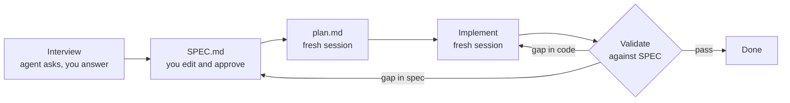

# 03: Spec-driven development: interview, SPEC.md, plan, implement, validate

## The idea

Spec-driven development (SDD) makes the **spec the source of truth** and the code a derived artifact. The loop is:



The new step compared with [02](02-research-plan-implement.md) is the **interview**. Instead of you writing a spec from a blank page, the agent asks you questions until the hard decisions are made explicit, and then writes the spec. Claude Code's docs give the prompt verbatim (read 2026-10-19):

```text
I want to build [brief description]. Interview me in detail using the AskUserQuestion tool.

Ask about technical implementation, UI/UX, edge cases, concerns, and tradeoffs. Don't ask obvious questions, dig into the hard parts I might not have considered.

Keep interviewing until we've covered everything, then write a complete spec to SPEC.md.
```

They follow it with: "Once the spec is complete, start a fresh session to execute it." And they describe what a good spec looks like: "The most useful specs are self-contained: they name the files and interfaces involved, state what is out of scope, and end with an end-to-end verification step that proves the feature works. Time spent making the spec precise pays off more than time spent watching the implementation." ([Claude Code docs, "Best practices"](https://code.claude.com/docs/en/best-practices))

DeepLearning.AI's spec-driven development course (Paul Everitt, JetBrains) adds two things worth keeping. The first is a project-level **constitution**: mission, tech stack and roadmap, which every feature spec inherits. The second is an explicit **replan** step when validation shows the spec was wrong ([DeepLearning.AI, "Spec-Driven Development with Coding Agents"](https://www.deeplearning.ai/short-courses/spec-driven-development-with-coding-agents/)). In a mature repo your constitution already exists. It's CLAUDE.md/AGENTS.md plus your architecture and invariants docs ([Module 08](../08-harness-engineering/README.md)).

## Why it matters

Agents are very good at filling gaps with plausible defaults, and plausible defaults are exactly where distributed-systems bugs hide. Karpathy's MenuGen write-up is the canonical case. The worst bug in his vibe-coded app was matching Stripe payments to users by email instead of by a persistent user ID ([Karpathy, "Vibe coding MenuGen"](https://karpathy.bearblog.dev/vibe-coding-menugen/)). The code worked, and the design was wrong. No test the agent wrote for itself would catch it, because the agent chose the design.

The interview attacks that class of error directly: it makes the agent surface the decisions it would otherwise make silently. The SPEC then does three jobs at once:

1. **Contract for the implementer.** A fresh session can build from it with no chat history.
2. **Oracle for validation.** Requirements with IDs (R1, R2...) map to tests, and a reviewer can check the diff against them ([07](07-reviewing-ai-code-and-when-not-to-delegate.md)).
3. **Review artifact for humans.** Two pages of decisions is something a senior engineer can review in ten minutes. A 1,500-line diff is not.

> **Synthesis:** a SPEC.md is an RFC whose primary reader is a machine. The sections that matter most for an agent are the ones humans skip in RFCs: **non-goals**, **invariants**, and **"done when"**. An agent will happily do adjacent work you didn't ask for, which is one of Kent Beck's three warning signs ([04](04-tdd-with-agents.md)), unless the spec says not to.

## How to do it

1. **Seed the interview with constraints you already know.** The docs prompt starts minimal. For a production system, add the non-negotiables up front, so the questions go to the real unknowns:

   ```text
   I want to add idempotency keys to POST /v1/charges in payments-api (Go, Postgres, calls
   the PSP over HTTP). Constraints I already know: multi-tenant, 6 replicas, p99 budget for
   the endpoint is 250ms, PSP supports its own idempotency key header.
   Interview me in detail using the AskUserQuestion tool. Dig into concurrency, failure
   mid-request, retention, and client contract. Don't ask obvious questions.
   Keep interviewing until we've covered everything, then write SPEC.md using
   templates/SPEC.md as the structure.
   ```

2. **Answer like you're in a design review.** When you don't know, say so. The answer becomes an Open Question, not a guess.
3. **Edit the SPEC by hand.** Check every requirement for testability ("returns 409 within 50 ms" rather than "handles concurrency"). Add non-goals you know the agent will be tempted by. Mark it approved.
4. **Plan in a fresh session** from SPEC.md (plus research.md if the area is unfamiliar). Check that the plan maps each requirement to a phase and a test.
5. **Implement in a fresh session** from plan.md.
6. **Validate against the SPEC, not against the plan.** Run the "done when" commands, then a clean-context review of the diff against SPEC.md (the docs' adversarial-review prompt, or [`code/diff_reviewer.py`](code/diff_reviewer.py)).
7. **Replan when validation shows the spec was wrong**: edit SPEC.md first, then regenerate the plan. Never let the code silently become the new spec.

For Codex, the same flow works with files. Codex reads AGENTS.md as its project instructions, and `codex exec` can enforce a structured final answer with `--output-schema`. That's handy for a validation run that must return `{requirement_id, pass, evidence}` rows ([Codex docs](https://developers.openai.com/codex/noninteractive)).

## Worked example: the interview surfaces the decision you'd have missed

**The bad version.** A one-line spec in the prompt:

```text
add idempotency keys to the charges endpoint so retries don't double charge
```

*(Illustrative output.)* The agent adds an `Idempotency-Key` header, a table `(key PRIMARY KEY, response JSONB)`, and logic of the form "if key exists, return stored response; else process and store". It passes a test that sends the same request twice. Here is what is still wrong, any of which double-charges or leaks data in production:

- The key is global, not per tenant. Tenant B reusing tenant A's key gets A's charge response back. That's a data leak.
- Same key, different body (amount changed) returns the old response with 200. The client thinks the new amount was charged.
- Two concurrent requests with the same key both miss the lookup and both call the PSP. The check-then-act race is the core of idempotency, and the code has it.
- The process crashes after the PSP call but before the response is stored. The retry calls the PSP again with no PSP-side idempotency key.

**The good version.** The interview, abridged *(illustrative transcript)*:

```text
Q1  Scope of a key: per tenant, per API credential, or global?
    > Per tenant. (tenant_id, key) is the identity.
Q2  Same key, different request body. Replay the stored response, or reject?
    > Reject. What does the IETF draft say?
    The httpapi WG draft "The Idempotency-Key HTTP Header Field" says the resource SHOULD reply
    422 for a reused key with a different payload, and 409 while the original request is still
    being processed. It is an expired draft (-07), so treat it as convention, not a standard.
    > Use 422 and 409.
Q3  What identifies "the same request"? Raw bytes differ with JSON key order.
    > SHA-256 of canonical JSON of the body plus method and path.
Q4  Crash after the PSP accepted the charge but before we stored the response. On retry?
    > ...what are the options?
    (a) re-call the PSP with the same PSP idempotency key derived from ours, so the PSP dedupes;
    (b) mark the key "unknown" and require manual reconciliation.
    > (a). Derive PSP key = HMAC(tenant_id || key). Add a reconciliation alert if PSP reports a mismatch.
Q5  Retention of keys?
    > 24h, documented. After that the same key is a new request.
Q6  Do failed requests (PSP 5xx) store a response?
    > No. Only terminal outcomes (2xx, 4xx from validation, PSP decline) are stored. 5xx = key released.
```

Look at Q4 and Q6. Those are the questions a reviewer asks after the incident. The interview asked them before any code existed. The resulting SPEC.md (the full file is in [examples.md](examples.md), scenario 1) has requirements like:

```markdown
- R2: A request whose (tenant_id, key) exists with a different fingerprint returns 422 and does not call the PSP.
- R3: A request whose (tenant_id, key) is in state `in_progress` returns 409 with Retry-After: 1.
- R5: The PSP call carries Idempotency-Key = HMAC-SHA256(server_secret, tenant_id || ":" || key).
## Non-goals
- Idempotency for endpoints other than POST /v1/charges.
- Changing the PSP client's retry policy.
## Done when
- [ ] go test ./... -race passes
- [ ] TestCharges_ConcurrentSameKey_OnePSPCall: 50 goroutines, same key -> exactly 1 PSP call (fake PSP counter)
- [ ] TestCharges_CrashAfterPSP_RetryDedupesAtPSP passes
- [ ] no files outside internal/charges, internal/idempotency, migrations/ changed
```

**Why the second version works.** Each production failure listed under the bad version maps to a requirement with an ID and a named test that would fail if it were violated. The non-goals stop the agent from "helpfully" adding idempotency to refunds. The "done when" block is directly usable as a `/goal` condition or a Stop-hook script.

## Pitfalls

| Pitfall | How to detect it |
|---|---|
| Interviewing on trivia | Questions about naming or log formats. Restate: "dig into concurrency, failure and contracts". |
| Approving the agent's defaults by fatigue | Count questions you answered "whatever you think". Each one is an unreviewed design decision. Mark them as Open Questions. |
| Untestable requirements | "Robust", "handles", "efficient". Rewrite each as an observable with a number or status code. |
| Spec drift | Code merged that contradicts SPEC.md. Validation must cite requirement IDs, and replan edits the spec first. |
| Spec too long to review | Over about 2 pages. Split the feature, or move background to a linked doc. |
| Implementing in the interview session | The context is full of debate and rejected options. Start fresh, as the docs say. |

## In your day job

- For any feature that touches money, ordering or auth, run the interview prompt before writing a line of code, and seed it with your known constraints.
- Keep `code/templates/SPEC.md` in your repo and require "Non-goals" and "Done when" to be non-empty.
- Make requirement IDs appear in test names or docstrings (`# covers R3`). The reviewer and the next engineer can then trace them.
- When the implementation surprises you, decide explicitly: is the code wrong (fix the code) or the spec (replan)?
