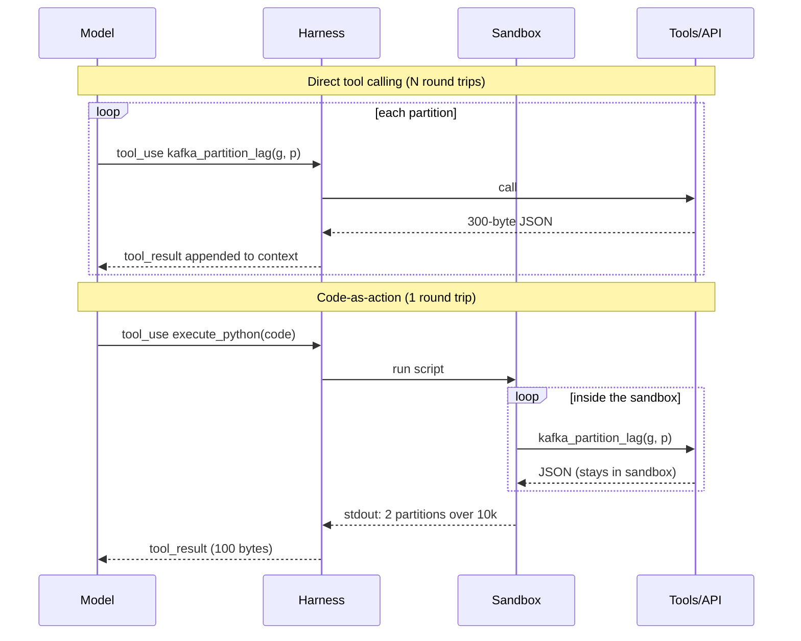

# 04: Code-as-action and programmatic tool calling

## The idea

In direct tool calling, every tool call is a round trip through the model: the model emits a call, your harness runs it, the result is appended to the context, and the model reads it before deciding the next call. That's the right shape when each result changes what to do next. It's the wrong shape for loops: "check lag on every partition of every group," "fetch 200 documents and keep the ones mentioning X," "poll until the rollout finishes."

**Code-as-action** changes the unit of action from "one tool call" to "one program." The model writes a short script that calls the tools as functions, loops and filters in code, and prints only what it needs. The tool results stay in the execution environment; only stdout comes back to the context.

Three names for closely related ideas:
- **CodeAct** (Wang et al., 2024): use executable Python as the agent's action space. The paper reports up to 20% higher success than JSON or text actions on its benchmarks ([arXiv 2402.01030](https://arxiv.org/abs/2402.01030)). Hugging Face's smolagents library is built around "code agents" in this style.
- **Code execution with MCP** (Anthropic): present MCP servers to the agent as a code API on a filesystem (`servers/google-drive/getDocument.ts`), let it read only the definitions it needs, and run its code in a sandbox ([Anthropic](https://www.anthropic.com/engineering/code-execution-with-mcp)).
- **Programmatic tool calling** (Anthropic API): tools marked `allowed_callers: ["code_execution_20250825"]` become Python functions inside the API's code-execution sandbox. Their results go to the script, not into Claude's context ([Anthropic, advanced tool use](https://www.anthropic.com/engineering/advanced-tool-use)).

## Why it matters

The numbers are large because the cost of direct calling is superlinear:
- Anthropic's code-execution-with-MCP example went from 150,000 tokens to 2,000, a 98.7% reduction. In their spreadsheet example the agent filters 10,000 rows in code: "The agent sees five rows instead of 10,000."
- Programmatic tool calling reduced average tokens on complex research tasks from 43,588 to 27,297 (37%), and in the budget-compliance example about 200KB of expense line items became about 1KB of results. Orchestrating 20+ calls in one code block removes 19+ inference passes.
- The cost is quadratic in the naive loop. The API is stateless, so every turn resends the whole history (prompt caching makes the resend cheaper, not free). N sequential tool calls means N inference passes over a context that grows each time.

Ronacher's version of the argument: models already know Python and your SDKs very well, so one code tool composes better than thirty narrow ones, and a successful session can be saved as a script that later runs in one call ([Ronacher](https://lucumr.pocoo.org/2025/8/18/code-mcps/)).

## How it works



### When to use which

| Signal | Direct calls | Code-as-action |
|---|---|---|
| Each result decides the next step | yes | |
| 3+ dependent calls, or a loop over items | | yes (Anthropic's rule of thumb) |
| Large intermediate data the model doesn't need to read | | yes |
| Data contains PII the model shouldn't see | | yes, with tokenization in the client |
| No sandbox available | yes | no: don't run model code unsandboxed |
| The action is a single write that needs approval | yes (one gated call) | |

### What you have to build
1. **An executor with the tools bound as functions.** On the API, programmatic tool calling gives you this. In your own harness it's an `execute_python` tool.
2. **A sandbox.** Anthropic's tradeoff paragraph says running agent-generated code needs a secure sandbox with resource limits and monitoring, which adds operational overhead that direct tool calls avoid. This module's `run_code_action` uses `exec` with trimmed builtins to show the data flow. That is **not** a sandbox. Use a container or microVM with no credentials and an egress allowlist ([07](07-execution-environments-and-agent-surfaces.md)).
3. **An output cap with guidance.** The script's stdout is still a tool result. Cap it, and say "print aggregates or top-N" when you truncate.
4. **Errors that help the script get fixed.** Return the exception, the stdout so far, and the list of available functions.

### The API version

```python
tools = [
    {"type": "code_execution_20250825", "name": "code_execution"},
    {"name": "kafka_partition_lag", "description": "Lag for one partition of one consumer group.",
     "input_schema": {"type": "object", "properties": {
         "group": {"type": "string"}, "partition": {"type": "integer"}}, "required": ["group", "partition"]},
     "allowed_callers": ["code_execution_20250825"]},
]
# client.beta.messages.create(..., tools=tools, betas=["advanced-tool-use-2025-11-20"])
```

When Claude calls `kafka_partition_lag` from its script, your harness receives a `tool_use` with a `caller` pointing at the code-execution block. You return the result as usual, and it goes to the script rather than the context. Only the script's final output comes back to Claude as a `code_execution_tool_result`. (Feature names and the beta header are as of the November 2025 post; check the current docs.)

## Worked example: a cluster-wide lag scan

Situation: "Which partitions across the cluster have lag over 10,000?" Your Kafka admin API is fine-grained: `kafka_list_groups()`, `kafka_partition_count(group)`, `kafka_partition_lag(group, partition)`. The fixture has 6 groups with 48 partitions each, and two hot partitions.

### Before: direct tool calling

The model must call `kafka_partition_lag` 288 times, plus 7 calls to list groups and count partitions. Each result is about 250 characters of JSON. `measure_direct()` in `code/code_as_action.py` computes the footprint (measured by the code; it counts characters, not a real model's tokens):

```text
direct tool calling: {'tool_calls': 295, 'model_turns': 296, 'context_tokens': 18233, 'cumulative_input_tokens': 2687112}
```

About 18k tokens of mostly-irrelevant JSON in the final context, and about 2.7M input tokens across all turns because each turn resends the history. In practice the model won't even do this. It will sample a few partitions and guess, or give up. Either way the answer is wrong.

### After: one script

The `execute_python` tool's description tells the model which functions exist and that only `print()` output returns. The model writes:

```python
hot = []
for g in kafka_list_groups():
    for p in range(kafka_partition_count(g)):
        r = kafka_partition_lag(g, p)
        if r["lag"] > 10_000:
            hot.append((g, p, r["lag"]))
hot.sort(key=lambda x: -x[2])
print(f"{len(hot)} partitions over 10k lag:", hot)
```

```text
code-as-action:      {'tool_calls': 1, 'model_turns': 2, 'context_tokens': 87}
```

The scripted run in `demo()` also shows self-correction at the script level. The first script uses a wrong key, and the executor returns:

```text
KeyError: 'consumer_lag'. stdout so far: ''. Available functions: ['kafka_list_groups', 'kafka_partition_count', 'kafka_partition_lag'].
```

The second script uses `r["lag"]` and prints `2 partitions over 10k lag: [('group-03', 17, 52000), ('group-05', 2, 14500)]`. (The fake model's fix is scripted; the point is the information the error gives it.)

The deeper move from Anthropic's post: once that script works, save it as `scripts/hot_partitions.py` inside a skill ([05](05-skills.md)). The next time, it's one call to a known-good script instead of a fresh generation.

## Pitfalls

| Pitfall | How to detect it |
|---|---|
| Running model code without isolation | Your executor shares a filesystem, network or credentials with anything you care about. If `exec`, `subprocess` or a shared container is the "sandbox", it isn't one. |
| Printing raw data anyway | Script stdout is as large as the direct-call results would have been. Cap stdout and say "print aggregates." |
| Using code for single judgment-heavy steps | Scripts that make one call and print everything. Direct calls are simpler there. |
| No timeout or resource limits | A `while True` poll pins a worker. Set wall-clock and CPU limits in the sandbox. |
| Writes inside scripts that bypass gates | Your `PreToolUse` hook checks `kubectl delete` in Bash, but the script calls the Kubernetes API directly. Gate writes at the credential level ([Module 16](../16-security-and-containment/README.md)). |
| Losing observability | One `execute_python` span hides 288 API calls. Instrument the functions bound into the sandbox so each call still emits a span ([Module 15](../15-observability-and-production/README.md)). |

## In your day job
- Look for traces with more than ten consecutive calls to the same tool. Each is a candidate for a script.
- For data-heavy investigations (log sweeps, partition scans, fan-out over services), give the agent a sandboxed `execute_python` with your read-only clients bound in, and nothing else.
- When a script works twice, commit it into a skill's `scripts/` directory and make the skill say "run this."
