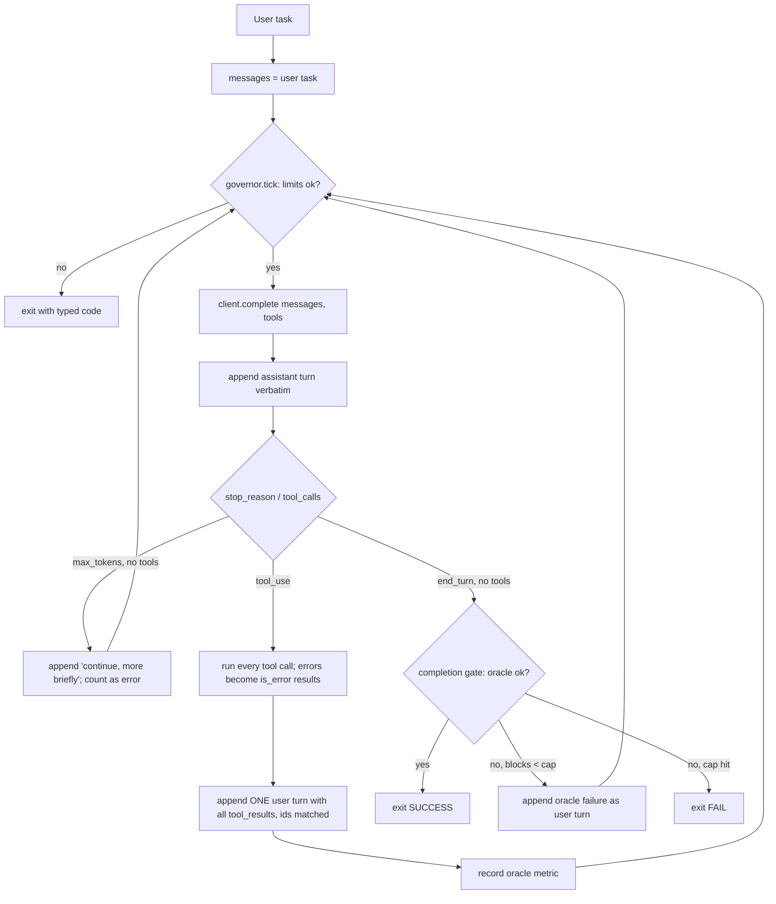

# 01: The agent loop from scratch

## The idea

An agent is a loop around a stateless function. Each turn you send the model the **entire** conversation so far plus the tool schemas. It replies with text, tool-use requests, or both, and a `stop_reason` saying why it stopped generating. If it asked for tools, your code runs them and appends the results as the next user message. Then you call it again. When it replies without asking for tools, it believes it is done, and control returns to whoever started the loop.

That's the whole mechanism. Thorsten Ball's walkthrough builds a working code-editing agent in under 400 lines of Go, most of it boilerplate, with three tools (`read_file`, `list_files`, `edit_file`) ([Ball, "How to Build an Agent"](https://ampcode.com/how-to-build-an-agent)). Geoffrey Huntley describes every coding agent as roughly "300 lines of code running in a loop with LLM tokens" ([Huntley, "how to build a coding agent"](https://ghuntley.com/agent/)). OpenAI's description of Codex is the same loop with more care around the prompt: user input goes in, the model either returns a final message or requests a tool, the tool output is appended, and the loop repeats until an assistant message ends the turn ([Bolin, "Unrolling the Codex agent loop"](https://openai.com/index/unrolling-the-codex-agent-loop/)).

The rest of this module is about what you wrap around this loop. You cannot reason about governors, oracles or Ralph until you can write this loop yourself, so that is where we start.

## Why it matters

Every framework (Claude Agent SDK, OpenAI Agents SDK, LangGraph) runs this loop for you and hides the details. When something goes wrong, the failure is almost always in one of four places:

1. **Message bookkeeping.** A tool_result without its matching tool_use, or results split across two user messages, gets a 400 from the API. A dropped assistant turn makes the model lose track of what it asked for.
2. **Termination.** A loop that ends only when the model stops calling tools has no upper bound. OpenAI's Agents SDK raises `MaxTurnsExceeded` for exactly this reason ([OpenAI Agents SDK, running agents](https://openai.github.io/openai-agents-python/running_agents/)).
3. **Truncation.** `stop_reason == "max_tokens"` is not "done". If you treat it as done, you ship half a sentence. If you treat it as a tool call, you crash.
4. **Cost growth.** The API is stateless, so the full history goes back on every call. Payload grows quadratically with the number of turns. OpenAI notes that prompt caching is what makes "sampling the model ... linear rather than quadratic", and that caching needs an exact prefix match ([Bolin](https://openai.com/index/unrolling-the-codex-agent-loop/)).

If you have written the loop yourself, these stop being mysterious framework behaviour. They become four lines you can read.

## How it works



### The message protocol

After three iterations of the toy task in [`code/agent_loop.py`](code/agent_loop.py), `messages` looks like this (abbreviated, from a real run with the scripted `FakeClient`):

```json
[
  {"role": "user", "content": "Make spec_tokenbucket.py pass."},
  {"role": "assistant", "content": [
     {"type": "text", "text": "Let me look at the workspace."},
     {"type": "tool_use", "id": "t1", "name": "list_files", "input": {"path": "."}}]},
  {"role": "user", "content": [
     {"type": "tool_result", "tool_use_id": "t1", "content": "PROMPT.md\nfix_plan.md\n...", "is_error": false}]},
  {"role": "assistant", "content": [
     {"type": "tool_use", "id": "t2", "name": "read_file", "input": {"path": "tokenbucket.py"}},
     {"type": "tool_use", "id": "t3", "name": "run_tests", "input": {}}]},
  {"role": "user", "content": [
     {"type": "tool_result", "tool_use_id": "t2", "content": "\"\"\"Token-bucket rate limiter...", "is_error": false},
     {"type": "tool_result", "tool_use_id": "t3", "content": "FAIL 3/5 failing\nFAILED spec_tokenbucket.py::test_starts_full...", "is_error": false}]}
]
```

Three rules:
- Append the assistant turn **exactly as returned**, including text alongside the tool_use blocks.
- When the model asks for several tools at once, return all of their results in **one** user message, each `tool_use_id` matching its request.
- A failing tool is still a result. Return `is_error: true` with a message the model can act on, rather than raising. This is 12-factor agents' factor 9, "compact errors into context" ([HumanLayer, 12-Factor Agents](https://github.com/humanlayer/12-factor-agents)).

### stop_reason

| `stop_reason` | Meaning | What the loop does |
|---|---|---|
| `tool_use` | Model wants tools run | Execute, append results, loop |
| `end_turn` | Model thinks it is finished | Run the completion gate if you have one; otherwise return (unverified) |
| `max_tokens` | Output was cut off at your `max_tokens` | Not done. Ask it to continue more briefly, count it toward the error breaker |

The Messages API defines a few more values (for example `stop_sequence` and `refusal`). The course kit's `Response` normalises to the three that matter for this loop. Check the current API reference when you handle the others.

### The loop, in the course code

This is the core of `run_agent` in [`code/agent_loop.py`](code/agent_loop.py) with tracing removed:

```python
while True:
    gov.tick()                                   # iteration cap + all budget checks
    resp = client.complete(messages, system=system, tools=schemas, max_tokens=max_tokens)
    gov.record_usage(resp.usage.input_tokens, resp.usage.output_tokens)
    messages.append(resp.to_assistant_message())

    if resp.stop_reason == "max_tokens" and not resp.tool_calls:
        gov.record_outcome(False)
        messages.append({"role": "user", "content": "Your reply hit max_tokens. Continue, more briefly."})
        continue

    if not resp.tool_calls:                      # model says done
        if completion_gate is None:
            return done(ExitCode.SUCCESS, "model ended turn (no gate: unverified)")
        ok, why = completion_gate()              # the harness, not the model, decides
        if ok:
            return done(ExitCode.SUCCESS, "completion gate passed")
        ...                                      # feed `why` back, up to max_gate_blocks
        continue

    results = []
    for call in resp.tool_calls:
        gov.record_tool_call(call.name, call.input)       # repetition detector
        out, is_err = _execute(by_name, call.name, call.input)
        gov.record_outcome(not is_err)                    # consecutive-error breaker
        results.append({"type": "tool_result", "tool_use_id": call.id, "content": out, "is_error": is_err})
    messages.append({"role": "user", "content": results})
    gov.record_metric(metric())                           # no-progress detector
    gov.check()
```

### What production loops add (Codex)

OpenAI's Codex write-up is the best public description of a production loop's internals ([Bolin](https://openai.com/index/unrolling-the-codex-agent-loop/)):
- **Turn vs thread.** A *turn* is one user request and every model/tool iteration it causes. A *thread* is the whole conversation.
- **Prompt order.** Sandbox and permissions instructions come first, then developer instructions, then the aggregated AGENTS.md files (capped at 32 KiB by default), then an environment message, then the user message. Static content goes first so it caches.
- **Append-only.** Changing tools, model, sandbox or working directory mid-thread breaks the cache, so Codex *appends* a change message instead of editing earlier ones. An early MCP bug that listed tools in an inconsistent order caused cache misses.
- **Compaction.** Past a threshold, history is replaced by a compacted item, so the thread can continue.

> **Synthesis:** Treat `messages` as an append-only event log. Never rewrite history in place, never reorder tool lists, and measure the cache hit rate as a cost SLO. Event sourcing is the right mental model, and [03-context-engineering](../03-context-engineering/README.md) goes deeper on compaction.

## Worked example: the naive loop vs the governed loop

**Bad version.** This is the loop most people write first:

```python
messages = [{"role": "user", "content": task}]
while True:
    resp = client.complete(messages, tools=schemas)
    if not resp.tool_calls:
        return resp.text                         # "done"
    for call in resp.tool_calls:
        out = TOOLS[call.name](**call.input)     # exceptions crash the loop
        messages.append(resp.to_assistant_message())   # appended once PER CALL
        messages.append({"role": "user", "content": [
            {"type": "tool_result", "tool_use_id": call.id, "content": out}]})
```

What goes wrong:
- With two parallel tool calls, the assistant turn is appended twice and the results are split across two user messages. The real API rejects this. A fake client won't notice, which is why you should assert on message shape in tests.
- A missing file raises `FileNotFoundError` and kills the run, instead of telling the model "no such file, use list_files".
- `max_tokens` truncation returns half an answer as success.
- A model that re-reads the same file forever never stops. Run the course's `runaway_responder` against this loop and it spins until your API quota runs out.
- "Done" means the model said so. Nobody ran the tests.

**Good version.** Run the governed loop against the same toy task:

```bash
PYTHONPATH=shared .venv/bin/python 07-loops/code/agent_loop.py
```

Real output (scripted `FakeClient`, real tools, real pytest oracle):

```text
exit=SUCCESS reason='completion gate passed' iterations=5
governor: {'iterations': 5, 'input_tokens': 11200, 'output_tokens': 790, 'cost_usd': 0.0454, ...,
           'best_metric': 1.0, 'since_improvement': 0}
final text: Fixed both bugs; spec_tokenbucket.py passes 5/5.
  span llm_call        {"iteration": 1, "n_messages": 1, "stop_reason": "tool_use", ...
  span tool_call       {"tool": "list_files", "args": "{\"path\": \".\"}", "is_error": false, ...
  span llm_call        {"iteration": 2, "n_messages": 3, "stop_reason": "tool_use", ...
  span tool_call       {"tool": "read_file", "args": "{\"path\": \"tokenbucket.py\"}", ...
  span tool_call       {"tool": "run_tests", "args": "{}", "is_error": false, "out_chars": 697}
  ...
  span completion_gate {"blocks_so_far": 0, "ok": true}
```

The `n_messages` column is 1, 3, 5, 7, 9: the history the stateless API receives grows on every call, and `test_messages_accumulate_and_the_full_history_is_resent` asserts it. The same loop against `runaway_responder` stops after three calls:

```text
exit=STALLED reason='repetition: read_file({"path": "tokenbucket.py"}) called 3x in last 3 calls'
```

## Pitfalls

| Pitfall | How to detect it |
|---|---|
| Results for parallel tool calls split across messages | Test: assert one user turn per assistant turn, with ids in order (`test_parallel_tool_calls_return_in_one_user_turn_with_matching_ids`) |
| Exceptions from tools escape the loop | Fuzz each tool with bad args; every failure should be an `is_error` result |
| `max_tokens` treated as success | Grep traces for `stop_reason=max_tokens` followed by run end |
| Unbounded tool output floods context | Track `out_chars` per tool span; truncate (the course code caps at 4,000 chars) and point to a log file |
| Path traversal through file tools | Resolve paths and refuse anything outside the workspace root (`safe()` in `workspace_tools`) |
| Agent edits the oracle | Make spec files read-only in the tool layer, not just in the prompt |
| Mutating the system prompt or tool list mid-run | Cache-hit rate drops; diff the request prefix between turns |

## In your day job
- Before adopting an SDK, write this loop once against your own tools. You'll read SDK traces much faster afterwards.
- In any agent you own, grep for the termination condition. If the only exit is "no tool calls", add a cap and a gate this week.
- Add `stop_reason`, token counts and tool names to every LLM span. You will need them for [15-observability-and-production](../15-observability-and-production/README.md).
- Treat the message list like a Kafka topic: append-only, ordered, replayable. Use `RecordingClient`/`ReplayClient` from the kit to replay a bad run offline.
