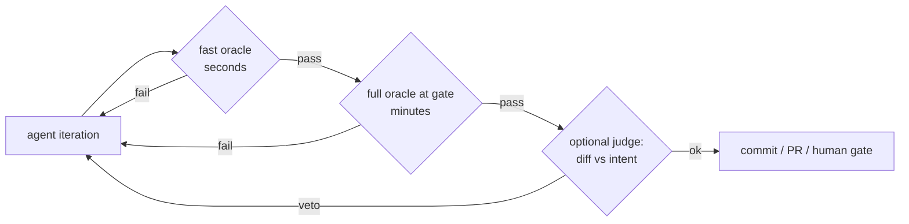

# 02: Oracles and backpressure

## The idea

An **oracle** is the check a loop uses to decide whether the work is right. It returns a fact that the agent cannot produce itself: an exit code, an error count, a parity diff, a benchmark number. **Backpressure** is what the oracle does inside the loop. It rejects bad work at the point where it is produced, so the bad work doesn't get committed, built on, or reported as done. Huntley's Ralph setup relies on tests, type checkers and static analysis to reject bad iterations, and asks the agent to document *why* each test exists ([Huntley, "Ralph Wiggum as a 'software engineer'"](https://ghuntley.com/ralph/)).

Two rules carry most of the weight:
1. **The oracle's quality caps the loop's quality.** Agents optimise toward whatever the verifier checks, and anything it doesn't check can drift. Carlini's lesson from the C compiler project was that the tests had to be near-perfect for exactly this reason ([Carlini](https://www.anthropic.com/engineering/building-c-compiler)).
2. **Write the oracle first, and prove it can fail.** Before any loop runs, apply known-bad changes and confirm the oracle rejects each one. Steve Kinney's build order puts this first, ahead of the queue, the spend limits, the logs and the loop itself ([Kinney, "The Ralph Loop"](https://stevekinney.com/courses/ai-development-setup/the-ralph-loop)).

## Why it matters

Spotify's background-agent series names three outcomes: no PR, a PR that fails CI, and a PR that passes CI but is wrong. The third is "the most serious error, as it erodes trust in our automation" ([Spotify, Honk part 3](https://engineering.atspotify.com/2025/12/feedback-loops-background-coding-agents-part-3)). An agent produces that third outcome when its oracle is weaker than the reviewer believes.

Anthropic's long-running harness work hit the same problem. Claude marked features done after unit tests or a `curl` check passed, even when the feature failed end to end. Adding browser automation, so the agent tested as a user would, fixed much of this ([Anthropic, "Effective harnesses for long-running agents"](https://www.anthropic.com/engineering/effective-harnesses-for-long-running-agents)). Carlini put it this way: "For autonomous systems, it is easy to see tests pass and assume the job is done, when this is rarely the case."

## How it works

### The oracle-quality ranking

From strongest to weakest, following Kinney:

| Rank | Oracle | Why it ranks here | Typical use |
|---|---|---|---|
| 1 | An exit code from a check *you* wrote, run outside the agent's process | Binary, unambiguous, agent cannot fake it | `make check`, a migration verifier, a repro script |
| 2 | An error count | Graded, so it gives a gradient to climb, and it's still mechanical | `tsc` errors, lint violations, failing-file count in a migration |
| 3 | A parity harness | Compares against a reference implementation | Ports: old vs new output on the same inputs (Carlini's GCC comparison, Bun's TypeScript suite) |
| 4 | A green test suite | Only as good as its coverage of the behaviour you care about | Most feature work |
| 5 | A coverage percentage | Measures execution, not correctness; easy to game | Coverage campaigns, with a mutation check |
| 6 | An LLM referee | Non-deterministic, biased toward approval, can be argued with | Taste, diff-vs-intent checks, where nothing else exists |

The exit code has to come from outside the agent's own process, because the agent's process can exit 0 after a failed run. For the same reason, an agent-writable marker (a `touch done` file, a promise string, a `"passes": true` field) is a claim and not evidence. Kinney's upgrade is a **dual condition**: the marker and a deterministic check must both agree. If the agent claims done and the check rejects it, log a premature claim and keep going. `ralph.py` does exactly this.

LLM judges have a place. Spotify runs one on the diff against the prompt to catch overreach, such as unrelated refactors or disabled flaky tests. It vetoes about 25% of sessions, and about half of those recover. Spotify also says it has no evals for that judge yet. [11-llm-as-judge](../11-llm-as-judge/README.md) covers how to calibrate one before you trust its veto.

### Properties of a loop-grade oracle

- **Fast enough to run every iteration.** Stripe runs a local lint subset on each push in under 5 seconds and allows at most two CI rounds after that ([Stripe](https://stripe.dev/blog/minions-stripes-one-shot-end-to-end-coding-agents)). Use tiers: a fast subset each iteration, the full suite at the completion gate.
- **Read-only to the agent.** Enforce this in the tool layer or with permissions, not only in the prompt. Karpathy's autoresearch freezes the evaluation code in a file the agent may not touch ([karpathy/autoresearch](https://github.com/karpathy/autoresearch)). Anthropic's harness prompt says "It is unacceptable to remove or edit tests because this could lead to missing or buggy functionality."
- **Fails closed.** If the oracle crashes, times out or collects zero tests, the verdict is *broken*, never *pass*. Pytest exits 5 when it collects no tests. A naive `returncode in (0, 5)` check, or a summary that only looks for the word "failed", turns a deleted test file into a green build.
- **Legible to the agent.** Carlini's harness printed only a few lines, sent the rest to log files, put `ERROR` on the same line as the cause so grep finds it, and offered a `--fast` mode that ran a deterministic 1% or 10% sample to cope with the agent's "time blindness" ([Carlini](https://www.anthropic.com/engineering/building-c-compiler)). Spotify's verifiers filter build noise so it doesn't flood the context.
- **Graded where possible.** A pass/fail bit tells the governor nothing about progress. A score (fraction passing, error count) lets it detect stalls. See [03-governors](03-governors.md).



### Prove it can fail

This is mutation testing, applied to the oracle rather than the code. The procedure in [`code/oracle.py`](code/oracle.py):

1. Confirm the oracle **passes** on a known-good version. Otherwise a permanently red oracle looks strict.
2. For each known-bad change (a **mutant**), copy the workspace, apply the change, and run the oracle.
3. Any mutant the oracle passes is a **survivor**: a bug class the loop is free to introduce.

Pick mutants from the failure modes you actually expect: off-by-one comparisons, missing caps, "always allow", double-spend, and the classic agent cheats (hard-coded return values, a swallowed exception, a deleted assertion).

## Worked example: two oracles for a token bucket

The toy task is a per-tenant token-bucket rate limiter with two seeded bugs. There are two candidate oracles. `spec_smoke.py` is the kind of test a hurried agent writes for itself:

```python
def test_constructs():
    assert TokenBucket(3, 1.0) is not None
```

`spec_tokenbucket.py` encodes the actual behaviour against a fake clock:

```python
def test_starts_full_and_allows_exactly_capacity():
    b, _ = make(capacity=3)
    assert [b.try_acquire() for _ in range(4)] == [True, True, True, False]

def test_refill_never_exceeds_capacity():
    b, clock = make(capacity=2, rate=1.0)
    clock.advance(100)
    assert [b.try_acquire() for _ in range(3)] == [True, True, False]
```

The mutants, defined in `examples/toy_task/__init__.py`:

```python
MUTANTS = {
    "off_by_one_acquire": _mut("if self._tokens >= n:", "if self._tokens > n:"),
    "uncapped_refill":    _mut("min(self.capacity, self._tokens + elapsed * self.refill_per_sec)",
                               "self._tokens + elapsed * self.refill_per_sec"),
    "always_allow":       _mut("if self._tokens >= n:", "if True:"),
    "no_refill":          _mut("elapsed = now - self._last", "elapsed = 0.0"),
    "double_spend":       _mut("self._tokens -= n", "self._tokens -= n - 1"),
}
```

Running `PYTHONPATH=shared .venv/bin/python 07-loops/code/oracle.py` gives (real output):

```text
spec_tokenbucket.py    caught 5/5 mutants; survivors: []
spec_smoke.py          caught 0/5 mutants; survivors: ['off_by_one_acquire', 'uncapped_refill', 'always_allow', 'no_refill', 'double_spend']
```

Both oracles are green on the fixed code, so both would let a loop report "done". Only one of them would catch a regression. In a loop, the smoke oracle is worse than having no oracle, because it produces false confidence that gets committed. Put this check in CI next to the oracle (`test_strong_oracle_kills_every_mutant`), so that a later edit that weakens the spec fails the build.

What the agent sees from the strong oracle on the buggy code (real `summary_for_agent()` output) is short and greppable:

```text
FAIL 3/5 failing
FAILED spec_tokenbucket.py::test_starts_full_and_allows_exactly_capacity - as...
FAILED spec_tokenbucket.py::test_refill_never_exceeds_capacity - assert [True...
FAILED spec_tokenbucket.py::test_refills_at_rate - assert False
E       assert [True, True, False, False] == [True, True, True, False]
...
```

The broken-oracle case is also tested. An empty spec file returns `ORACLE BROKEN (exit 5): fix the test setup, not the code`, with a score of 0.0, and `ralph.py` refuses to start a loop against it (exit code `BROKEN`).

## Choosing an oracle for real tasks

| Task | Strongest available oracle | Watch out for |
|---|---|---|
| Language or framework port | Parity: run old and new on the same inputs; reuse the old test suite if it's language-independent (Bun) | Behaviour the suite doesn't cover; performance |
| Dependency or API migration | Compiler or type-checker error count, then tests | Agent adds `# type: ignore` or `any`; count those too |
| Flaky-test fix | Run the test N times under load or with a seed sweep; pass means 0/N failures | A fix that only changes timing; check the root cause |
| Performance target | Benchmark with a fixed budget and noise bounds | Noise larger than the gain (see [12-hill-climbing](../12-hill-climbing/README.md)) |
| Kafka consumer idempotency | Property test: replay with duplicates and reorders, assert the effect happened once | Tests that use the same mock as the implementation |
| UI change | Browser automation that drives the real page | Screenshots judged only by a model |

## Pitfalls

| Pitfall | How to detect it |
|---|---|
| Agent edits or deletes tests | Diff guard: fail the gate if any `spec_*`/`test_*` file changed; make them read-only in tools |
| Zero tests collected reads as pass | Treat pytest exit codes other than 0 and 1 as broken; require `passed > 0` |
| Oracle passes on hard-coded outputs | Add a mutant that returns the expected constant; property tests with random inputs |
| Oracle too slow to run per iteration | Tier it: a fast deterministic sample per iteration, the full suite at the gate |
| Oracle output floods context | Cap lines; first line is the verdict; full log to a file the agent can grep |
| LLM judge as the only gate | Measure its TPR/TNR on labelled cases first ([11-llm-as-judge](../11-llm-as-judge/README.md)) |
| "Done" read from an agent-writable file | Require a dual condition: marker plus oracle |

## In your day job
- Before you loop on anything, write the oracle command down and run it against one deliberately broken change. If it passes, stop and fix the oracle.
- Add a `prove_it_can_fail` test next to every oracle you hand to an agent, so oracle regressions fail CI.
- For migrations, convert "it works" into a number (errors remaining, files migrated, parity diffs). Numbers give the governor something to track.
- Make your test runner's first line a verdict and keep the rest short. Agents read it the way you read a pager alert.
