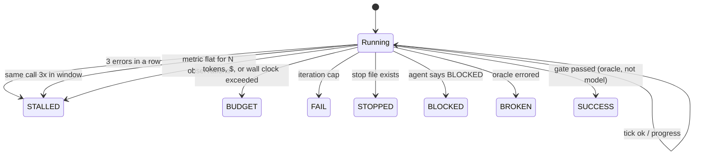

# 03: Governors

## The idea

A **governor** is the part of a loop that decides whether there will be a next iteration. It is deterministic code that the model cannot see or argue with. It's consulted at fixed points: before each model call and after each tool batch. When a limit is hit, it trips with a **typed exit code**. Kinney's five-part control loop (`measure → pick → run → accept → governor`) gives the governor four jobs: enforce caps on attempts, time, tokens and spend; detect stalls; stop after repeated identical failures; and honour a stop file ([Kinney, "The Ralph Loop"](https://stevekinney.com/courses/ai-development-setup/the-ralph-loop)).

The model decides *what* to do. The governor decides *whether to keep paying for it*. Keep these two concerns in separate code.

## Why it matters

Agents fail in ways that look like work. Kent Beck's three warning signs that the "genie" is going off track are: loops (repeating itself), functionality nobody requested, and cheating, such as disabling or deleting tests ([Beck, "Augmented Coding: Beyond the Vibes"](https://newsletter.kentbeck.com/p/augmented-coding-beyond-the-vibes)). In the repomirror overnight run, one agent used `pkill` to terminate itself after realising it was stuck in an infinite loop ([repomirror](https://github.com/repomirrorhq/repomirror/blob/main/repomirror.md)). That was the agent acting as its own governor, which you should not depend on. Anthropic's code-review bot ran one PR through more than 50 rounds overnight before round caps were added ([Anthropic, code review](https://claude.dev/blog/solving-code-review-at-anthropic/)).

The tools you use already ship governors. Each one marks a failure that somebody hit in production:

| Shipped guard | Where | Source |
|---|---|---|
| Stop hook overridden after **8 consecutive blocks** with no tool call between; tunable via `CLAUDE_CODE_STOP_HOOK_BLOCK_CAP`; scripts should exit 0 when `stop_hook_active` is true | Claude Code hooks | [hooks guide](https://code.claude.com/docs/en/hooks-guide) |
| `/goal` stops when Claude keeps answering the evaluator with no tool use for several turns; transient errors retry 3 times then pause; auth, credit, unrecoverable-overflow and unavailable-model errors clear the goal | Claude Code `/goal` | [goal docs](https://code.claude.com/docs/en/goal) |
| Recurring scheduled tasks expire after 7 days, "This bounds how long a forgotten loop can run." | Claude Code `/loop` | [scheduled tasks](https://code.claude.com/docs/en/scheduled-tasks) |
| `--max-turns` (exits with an error at the limit), `--max-budget-usd` (client-side estimate; "Spend can pass the cap, so leave headroom") | `claude -p` | [CLI reference](https://code.claude.com/docs/en/cli-reference) |
| `MaxTurnsExceeded`, or a registered fallback handler | OpenAI Agents SDK | [running agents](https://openai.github.io/openai-agents-python/running_agents/) |
| Auto-compaction gives up after a few attempts with a "thrashing" error | Claude Code | [how Claude Code works](https://code.claude.com/docs/en/how-claude-code-works) |
| Break after about 3 consecutive errors and escalate, with the counter reset on success | 12-factor agents, factor 9 | [12-factor-agents](https://github.com/humanlayer/12-factor-agents) |
| Count edits per file; after N, inject "reconsider your approach" | LangChain `LoopDetectionMiddleware` | [LangChain harness post](https://www.langchain.com/blog/improving-deep-agents-with-harness-engineering) |

All checked 2026-10-19 except the LangChain post, whose details come from the course research notes.

## How it works

### The distributed-systems mapping

| Governor | DS analogue | What it catches | Exit code |
|---|---|---|---|
| Iteration cap | Retry budget | Unbounded loops of any kind | `FAIL` |
| Token / $ budget | Rate limiter, quota | Expensive wandering with no repeats | `BUDGET` |
| Wall-clock limit | Request deadline | Slow tools, hung subprocesses, "time blindness" | `BUDGET` |
| Consecutive-error breaker | Circuit breaker (closed → open) | Repeating a failing approach: bad tool args, missing file, auth failure | `STALLED` |
| Repetition detector | Duplicate-request detection on an idempotency key | Same tool + same args, including A-B-A-B oscillation | `STALLED` |
| No-progress detector | Liveness vs progress (watchdog on a progress counter, not a heartbeat) | Busy but not converging; reverts; fake "done" claims | `STALLED` |
| Stop file | Drain / maintenance flag | Operator wants a clean stop without `kill -9` | `STOPPED` |
| Agent says it can't proceed | Explicit NACK | Contradictory spec, missing credential | `BLOCKED` |
| Oracle crashed / collected nothing | Health check failing | Fail closed rather than read silence as success | `BROKEN` |

**Kubernetes reconciler view.** A controller doesn't loop until it feels done. It reconciles, records conditions, and requeues with backoff. If reconcile keeps erroring, you see `CrashLoopBackOff`, not a controller burning CPU forever. A governed agent loop behaves the same way: every exit is a recorded condition with a reason, and the caller (a human, a scheduler, a parent loop) decides what to do with `STALLED` versus `BLOCKED`.

**Circuit-breaker view.** The consecutive-error counter is a breaker with a threshold of 3 and no half-open state inside a single run. The "half-open probe" is the next run, started fresh, perhaps with a better prompt. This matches the Claude Code best-practices advice: after two failed corrections, `/clear` and write a better prompt, because a clean session "almost always outperforms a long session with accumulated corrections" ([Anthropic, best practices](https://code.claude.com/docs/en/best-practices)).



### Design decisions in `governor.py`

- **Record, then check.** `record_tool_call`, `record_outcome` and `record_metric` only set a pending trip. `check()` raises it at a well-defined point, so a trip never happens halfway through writing a tool_result.
- **Check before spending.** `tick()` calls `check()` before incrementing, so a tripped governor never pays for another model call (`test_tripped_governor_never_ticks_again`).
- **Repetition uses a sliding window**, not "N identical in a row". A model alternating between two reads (A-B-A-B-A) defeats a consecutive check. With `max_repeats=3, repeat_window=6`, it trips on the fifth call. Signatures hash `json.dumps(args, sort_keys=True)`, so key order cannot hide a repeat.
- **Repeats are allowed if they're spread out.** Running `run_tests` every fourth call is a normal rhythm, and `test_spread_out_repeats_outside_window_are_allowed` checks that it doesn't trip. Tune the window to your tool mix.
- **Progress is a strict improvement over the best value seen so far.** Matching the best again, or oscillating between 0.4 and 0.6, is not progress. Kinney's definition is "the work was kept *and* the score improved". Metrics may be tuples, which compare lexically.
- **Every limit is a real number.** `None` disables a check, and you should only do that deliberately (for example, `ralph.py` disables token limits because the external agent process enforces its own `--max-budget-usd`).

## Worked example: four runaways, four different breakers

Each of these `FakeClient` responders is in `examples/toy_task/__init__.py`, and each has a test in `test_agent_loop.py`. All four run against the same `Limits(max_iterations=1000)`. If they only had an iteration cap, each would run 1,000 model calls.

```python
def runaway_responder(messages, kwargs):          # the same call forever
    return Response(tool_calls=[ToolCall(f"r{len(messages)}", "read_file", {"path": "tokenbucket.py"})],
                    stop_reason="tool_use", usage=Usage(1200, 150))
```

| Runaway behaviour | Breaker that trips | Model calls before the stop (measured) | Reason string |
|---|---|---|---|
| Re-reads `tokenbucket.py` forever | Repetition | 3 | `repetition: read_file({"path": "tokenbucket.py"}) called 3x in last 3 calls` |
| Alternates `tokenbucket.py` / `fix_plan.md` | Repetition (window) | 5 | `repetition: read_file({"path": "tokenbucket.py"}) called 3x in last 5 calls` |
| `list_files` with a new glob every call, 50k input tokens each | Dollar budget ($1, placeholder prices) | 6 | `cost $1.08 > $1.00` |
| Reads a different missing file every call | Consecutive errors | 3 | `3 consecutive errors; escalate instead of retrying` |
| Keeps replying "Done." while the oracle is red | Completion-gate cap (8) | 8 | `completion gate blocked 8x with no tool use between` |
| Every reply truncated at `max_tokens` | Consecutive errors | 3 | `3 consecutive errors; ...` |

The **bad version** of this table is a loop with `max_iterations=1000` and nothing else. The wandering agent alone would spend about $180 at the placeholder prices before stopping, and each of the others would keep going until it hit the cap. The governed loop stops each runaway within a handful of calls, and the exit reason tells the on-call human which failure it was.

The no-progress detector is easiest to see in `ralph.py`. A "lying" fake agent ticks every box in `fix_plan.md` without changing code (real output):

```text
{"iter": 1, "agent_rc": 0, "score": 0.4, "failed": 3, "open": 0, "premature_claim": true, "decision": "reverted"}
{"iter": 2, "agent_rc": 0, "score": 0.4, "failed": 3, "open": 0, "premature_claim": true, "decision": "reverted"}
{"iter": 3, "agent_rc": 0, "score": 0.4, "failed": 3, "open": 0, "premature_claim": true, "decision": "reverted"}
[ralph] exit=STALLED(5) after 3 iterations: no progress: metric stuck at best=0.4 for 3 observations
```

## Setting the numbers

*Course synthesis:* start from what one good run costs, then add headroom.
- **Iterations:** 2–3x the iteration count of a typical successful run in your traces. A coding task that normally finishes in 25 turns gets a cap of 60–75.
- **Dollars:** Anthropic's automation guidance is to "Start at three to five times the cost of a normal run, then tighten it as you see real numbers", and to have a capped run pause rather than fail ([Anthropic, agent automations](https://claude.dev/blog/building-effective-agent-automations/)).
- **Consecutive errors:** 3 is the 12-factor default. Raise it only for tools with known transient failures, and give those tools their own retry with backoff.
- **Repetition:** `max_repeats=3` within a window of about twice your tool count.
- **Stall patience:** on the order of iterations, not tool calls. 3 for Ralph-style loops where each iteration is a whole session, 5–10 observations for an inner loop.
- **Wall clock:** set it from the slowest acceptable run. autoresearch gives each experiment a fixed 5-minute budget so experiments are comparable ([karpathy/autoresearch](https://github.com/karpathy/autoresearch)).

## Pitfalls

| Pitfall | How to detect it |
|---|---|
| Only an iteration cap | Grep your loop for budget/stall code. Run `wandering_responder` against it. |
| Repetition check is consecutive-only | Run `oscillating_responder`. It should trip within one window. |
| "Progress" measured as activity (tokens, tool calls, commits) | Plot oracle score per iteration. Flat while commits rise means fake progress. |
| Budget checked after the call | Unit test: a tripped governor must not make another call |
| Exit code 0 for "hit the cap" | Callers treat the run as success. Use distinct codes and alert on `STALLED`/`BROKEN`. |
| Governor state in the context window | Model can talk its way around it. Keep counters in harness code only. |
| Stop hook without a `stop_hook_active` check | Runs into the 8-block cap every time. Test the hook with `stop_hook_active: true` input. |
| Same limits for every task class | Look at the distribution of costs per task class; set limits per class. |

## In your day job
- Add the four runaway responders to the test suite of any agent you own. Each should trip a distinct breaker in fewer than ten calls.
- Make your agent's exit status machine-readable (one of the seven codes) and route `BLOCKED` to a human queue and `BROKEN` to whoever owns the oracle.
- When you call `claude -p` from scripts, always pass `--max-turns` and `--max-budget-usd`, and enforce a wall clock (`timeout 30m claude -p ...`) outside it.
- Review governor trips weekly, the same way you review alert noise. A breaker that trips often points to a tool or prompt that needs fixing ([08-harness-engineering](../08-harness-engineering/README.md)).
