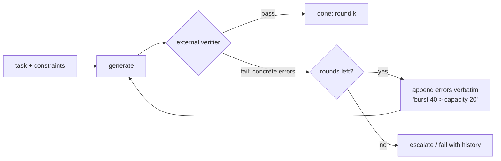

# 04: Self-correcting loops

## The idea

A self-correcting loop is **generate → verify → fix**, bounded. The model produces an artifact, a verifier checks it, and if the check fails, the *specific* failure goes back to the model for another attempt, up to a round cap. Anthropic calls this the **evaluator-optimizer** workflow and says to use it when "clear evaluation criteria" exist and iteration "measurably" improves the result ([Anthropic, "Building effective agents"](https://www.anthropic.com/engineering/building-effective-agents)). OpenAI's long-horizon Codex template writes the same loop as a rule: "Run validation after each milestone (fix failures immediately)" ([OpenAI, "Run long horizon tasks with Codex"](https://developers.openai.com/blog/run-long-horizon-tasks-with-codex)).

The key variable is **where the feedback comes from**:
- **External feedback**: a compiler, a test, a schema validator, a linter, a benchmark. The second attempt gets information the first attempt didn't have.
- **Intrinsic reflection**: the same model is asked to "review your work and improve it". The second attempt gets no new information, only a second sample, with extra pressure to change something.

Andrew Ng's Agentic AI course teaches reflection together with two lessons that are often skipped: "using external feedback" and "evaluating the impact of reflection", which means measuring whether the loop helps rather than assuming it does ([DeepLearning.AI, Agentic AI](https://www.deeplearning.ai/courses/agentic-ai/)).

## Why it matters

Self-assessment is weak where it matters most. Anthropic's harness-design work found that "agents reliably skew positive when grading their own work", and that "Out of the box, Claude is a poor QA agent", so they split the generator from a separate evaluator that clicked through the live app ([Anthropic, "Harness design for long-running application development"](https://www.anthropic.com/engineering/harness-design-long-running-apps)). LangChain notes that "Models are biased towards their first plausible solution" ([LangChain, harness engineering](https://www.langchain.com/blog/improving-deep-agents-with-harness-engineering)). A reflection prompt with no new information mostly samples that bias again.

Asking for more self-checking also has a cost. Anthropic's Opus 5 prompting guide says explicit instructions such as "include a final verification step" cause **over-verification**, and that removing them "reduces wasted tokens with no loss in quality" ([Anthropic, Prompting Claude Opus 5](https://platform.claude.com/docs/en/build-with-claude/prompt-engineering/prompting-claude-opus-5)). Anthropic's best-practices page, meanwhile, says to "give Claude a way to verify its work" ([best practices](https://code.claude.com/docs/en/best-practices)).

> **Course stance** (from [01-gap-analysis](../research/01-gap-analysis.md)): put the check in the **environment** (a test, a validator, a gate the model can run or that runs on it), not in the **prompt** ("double-check your work"). Then re-measure on each model upgrade, because how much the model checks itself changes between models.

## How it works



### Rules for the fix round

1. **Feed back the verifier's words, not a paraphrase.** `burst 40 > capacity 20` is actionable. "There seems to be a problem with the limits" is not.
2. **Keep the failed attempt in context.** The model needs to see what it produced in order to change it. That's why `generate_verify_fix` appends the assistant turn before the feedback.
3. **Cap rounds, small.** Stripe's minions get "often one, at most two, CI runs", and only after everything fixable locally has been fixed ([Stripe](https://stripe.dev/blog/minions-stripes-one-shot-end-to-end-coding-agents)). Anthropic's code-review reviewer asks the author to rethink after 3 rounds ([Anthropic, code review](https://claude.dev/blog/solving-code-review-at-anthropic/)).
4. **Separate generator and evaluator when the check is a judgment.** Use a different session or model, with its own rubric and few-shot calibration. Anthropic's frontend evaluator had to be tuned over several rounds of reading its logs, because it started "lenient and superficial".
5. **Report the history on failure.** A run that didn't converge should return each round's errors, so a human can tell "close, wrong field" from "oscillating between two wrong answers".

### Measure it: the pass-rate-by-round curve

For a fixed set of cases, record the round at which each case first passed. Plot cumulative pass rate against round, for each feedback mode, together with tokens per case. The questions are:
- What's the marginal pass rate of round *k* over round *k−1*?
- What does round *k* cost, in tokens and latency?
- Does intrinsic reflection do better than simply resampling round 0 (best-of-n)? If not, it's a slower and more expensive version of resampling.

*Course synthesis:* a fix round is worth running when `Δpass_rate(k) × value_per_success > cost(k) + latency_cost(k)`. Round costs grow because the history grows, and Δpass usually shrinks after round 1, so in practice the cap tends to be 1–3. Before acting on a 3-point gain, use paired comparisons and error bars ([12-hill-climbing](../12-hill-climbing/README.md)).

## Worked example: a JSON rate-limit policy

The task, from [`code/self_correct.py`](code/self_correct.py), is to emit a per-tenant rate-limit policy with hard rules (`burst <= capacity`, `refill_per_sec` equal to the requested rate, correct types). The verifier is deterministic:

```python
def verify_policy(raw, req):
    ...
    if p["burst"] > p["capacity"]:
        errs.append(f"burst {p['burst']} > capacity {p['capacity']}")
    if "rps" in req and abs(p["refill_per_sec"] - req["rps"]) > 1e-9:
        errs.append(f"refill_per_sec is {p['refill_per_sec']}, requirement says {req['rps']}")
    return errs
```

**Bad version: intrinsic reflection.**

```text
user:      Write the JSON rate-limit policy for tenant acme-3. Requirements: {"rps": 8}. ...
assistant: {"name": "tenant", "capacity": 20, "refill_per_sec": 8.0, "burst": 40}
user:      Review your answer carefully for mistakes and return an improved JSON object.
assistant: {"name": "tenant", "capacity": 20, "refill_per_sec": 8.0, "burst": 40}
```

**Good version: external feedback.**

```text
user:      Write the JSON rate-limit policy for tenant acme-3. ...
assistant: {"name": "tenant", "capacity": 20, "refill_per_sec": 8.0, "burst": 40}
user:      The policy failed validation:
           - burst 40 > capacity 20
           Return the corrected JSON only.
assistant: {"name": "tenant", "capacity": 20, "refill_per_sec": 8.0, "burst": 20}
```

Running `measure()` over 10 cases gives:

```text
external  pass rate by round: 0% -> 100% -> 100%   mean tokens/case: 820
intrinsic pass rate by round: 0% -> 0% -> 0%   mean tokens/case: 1410
```

**Read this honestly.** These numbers come from `scripted_model`, a `FakeClient` responder that was *written* to fix the error only when the feedback names it. They show the measurement harness working. They are not a measurement of any real model. A real model will often fix some errors on a bare "review it" prompt, especially strong reasoning models. That's exactly why you run `measure()` against the real API (set `ANTHROPIC_API_KEY`) on your own cases before you decide how many rounds to pay for. The shape to look for is the same either way: does each round's Δpass justify its token bill? Here the intrinsic loop spent 72% more tokens for nothing.

### The same pattern inside an agent loop

In [`code/agent_loop.py`](code/agent_loop.py), the completion gate is generate → verify → fix at the scale of a whole turn. The `premature_script` fixture fixes one bug and claims "Done, the limiter is fixed." The gate runs the oracle and sends back this (real output, abbreviated):

```text
Not done. The oracle says:
FAIL 1/5 failing
FAILED spec_tokenbucket.py::test_refill_never_exceeds_capacity - assert [True...
E       assert [True, True, True] == [True, True, False]
Keep working.
```

The scripted agent fixes the refill cap on the next turn, and the gate passes. This is the Stop-hook pattern from [07-scheduled-ambient-event-loops](07-scheduled-ambient-event-loops.md), and Spotify's rule, where no PR is opened if any verifier fails ([Spotify](https://engineering.atspotify.com/2025/12/feedback-loops-background-coding-agents-part-3)), is the same idea.

## Variants worth knowing

| Variant | When it fits | Watch for |
|---|---|---|
| Compiler/test feedback (the default) | Code, configs, queries, anything executable | Agent "fixes" the test instead of the code: make tests read-only |
| Schema/structured-output validation and retry | Extraction, tool arguments | Retrying the same prompt with no error text attached |
| Separate evaluator model with rubric | Taste, UX, writing, where no deterministic check exists | Evaluator leniency; calibrate on labelled examples ([11-llm-as-judge](../11-llm-as-judge/README.md)) |
| Adversarial reviewer subagent | Diffs against a plan | "Reviewers asked to find gaps will always find some", which leads to over-engineering ([best practices](https://code.claude.com/docs/en/best-practices)) |
| Reasoning sandwich (high effort to plan, lower to implement, high to verify) | Long agent tasks under a time limit | LangChain found xhigh effort throughout scored worse (53.9% vs 63.6%) because of timeouts ([LangChain](https://www.langchain.com/blog/improving-deep-agents-with-harness-engineering)) |

## Pitfalls

| Pitfall | How to detect it |
|---|---|
| "Review your work" with no new information | In the curve, intrinsic ≈ round 0; compare against plain resampling |
| Feedback paraphrased by a model before it reaches the generator | Diff the feedback against the raw verifier output; pass it through verbatim |
| Unbounded fix rounds | Round histogram with a long tail; add a cap and escalate with history |
| Self-grading as the gate | Agreement between self-grade and external check below about 90%: replace the gate |
| Over-verification on new models | Token spend rises with no change in pass rate after a model upgrade; strip "verify" instructions and re-measure |
| Oscillation between two wrong fixes | History shows A, B, A errors; record decisions ("tried X, rejected because Y") like OpenAI's Plans.md decision notes |

## In your day job
- For every LLM step that produces something executable, wire the executor's error output back verbatim, with a round cap of 1–2.
- Delete "please double-check your answer" from your prompts and replace it with a check that runs. Measure the token savings.
- Before adding a reflection round to a production pipeline, run `measure()` on 50 real cases with and without it. Keep the round only if the paired gain clears the noise.
- When the check is a judgment call, run the judge in a separate session with its own rubric, and never let the generator see the rubric's scoring code.
