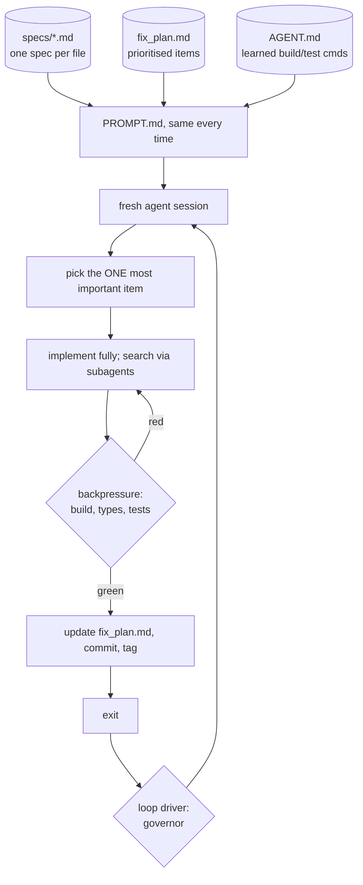

# 05: Ralph loops

## The idea

A Ralph loop runs **the same prompt, in a fresh agent session, over and over**, with all state kept on disk. Geoffrey Huntley named it and gives the purest form as one line of bash ([Huntley, "Ralph Wiggum as a 'software engineer'"](https://ghuntley.com/ralph/)):

```bash
while :; do cat PROMPT.md | claude-code ; done
```

The agent has no memory between iterations. Each run re-reads the same specs, the same prioritised plan and the repo, does **one** thing, records what it did, and exits. The next iteration starts clean. In reconciler terms, every iteration is a level-triggered reconcile: it ignores what happened last time and acts on the observed state on disk.

The technique works because it uses context windows the way you'd want them used. Huntley's warning is that "The more you allocate to a context window, the worse the performance of the context window will be" ([Huntley, agent workshop](https://ghuntley.com/agent/)). Ralph gives each unit of work a nearly empty window. Dex Horthy's summary of the idea is to "carve off small bits of work into independent context windows" ([Horthy, "A Brief History of Ralph"](https://humanlayer.dev/blog/brief-history-of-ralph)).

## Why it matters

Ralph is the cheapest way to run an agent unattended for hours, and it has public results:
- **Huntley** built the CURSED programming language with it. He also published a client's message reporting a "$50k USD contract, delivered, MVP, tested + reviewed" for "$297 USD" in cost. That's the client's claim, not an audited number.
- **repomirror** (YC Agents hackathon) ran headless Claude Code in a while loop overnight and ported six codebases: about 1,100 commits for under $800 in inference, roughly $10.50 per hour per Sonnet agent ([repomirror](https://github.com/repomirrorhq/repomirror/blob/main/repomirror.md)).
- **Carlini's C compiler** used a Ralph-style loop per agent, with 16 agents, about 2,000 sessions over two weeks, and just under $20k, producing a 100k-line Rust compiler that builds Linux 6.9 ([Carlini](https://www.anthropic.com/engineering/building-c-compiler)).

It also fails in predictable ways. Huntley lists them: ripgrep misses that lead to "it's not implemented" conclusions and duplicate implementations, placeholder code, dynamic languages without a type checker, broken trees that need a reset, and context degrading as it fills. His summary is that the technique is "deterministically bad in an undeterministic world". You tune it, in his words, "like a guitar".

## How it works

### Huntley's original design



- **Deterministic context each iteration.** Load the same `specs/*` (one spec per file) and a prioritised `fix_plan.md`. Regenerate the plan when it goes stale.
- **One item per loop.** "To get good outcomes with Ralph, you need to ask Ralph to do one thing per loop."
- **State lives outside the context.** The plan, specs and `AGENT.md` persist between iterations. Commit and tag after every green build.
- **Backpressure.** Tests, type checkers and static analysis reject bad work.
- **Subagents as a context firewall.** The main context acts as a scheduler. It fans out search to many subagents but allows only one subagent for build and test, to avoid what Huntley calls backpressure chaos.
- **Anti-placeholder instruction**, from his prompt: "DO NOT IMPLEMENT PLACEHOLDER OR SIMPLE IMPLEMENTATIONS. WE WANT FULL IMPLEMENTATIONS."

### Three ways to run it

**1. The bash loop (fresh context).** Carlini's script, as shown in the article:

```bash
#!/bin/bash
while true; do
    COMMIT=$(git rev-parse --short=6 HEAD)
    LOGFILE="agent_logs/agent_${COMMIT}.log"
    claude --dangerously-skip-permissions \
           -p "$(cat AGENT_PROMPT.md)" \
           --model claude-opus-X-Y &> "$LOGFILE"
done
```

He ran it in a container. Parallel agents coordinated through git: each cloned a bare upstream repo and claimed tasks with **lock files** in `current_tasks/`, so a git conflict made a second claimant pick something else. That's optimistic concurrency control on a shared task queue.

**2. The official plugin (same session).** Anthropic's `ralph-wiggum` plugin for Claude Code moves the loop into one session. A **Stop hook** intercepts exit and feeds back the same prompt, so each pass sees the previous pass's files and git history ([plugin README](https://github.com/anthropics/claude-code/tree/main/plugins/ralph-wiggum)):

```text
/ralph-loop "Make all tests in tests/billing pass. Output DONE when they do." --max-iterations 20 --completion-promise "DONE"
/cancel-ralph
```

The README's own guidance: always set `--max-iterations`, give concrete completion criteria, and tell the agent what to output when it's stuck. It also notes that the completion promise is an exact string match, so it can't distinguish success from "blocked". It recommends the plugin for work with automatic checks and for greenfield work and refinement, and not for judgment-heavy work, unclear criteria or production debugging.

**3. The course drivers.** [`code/ralph.py`](code/ralph.py) and [`code/ralph.sh`](code/ralph.sh) are the bash loop with the governors from [03-governors](03-governors.md) added: an iteration cap, wall clock, a stop file, a stall breaker, an agent-crash breaker, commit on progress, revert on regression, and a done condition that requires the oracle to agree with the plan.

### The fresh-context vs Stop-hook debate

Dex Horthy argues the plugin "misses the point". It focuses on running forever by re-feeding the prompt *inside the same session*, while Ralph's value is a fresh context per unit of work. He also reports practical problems: it failed without `--dangerously-skip-permissions`, it installs a Stop hook that applies to every session in the directory, and its state file can break Claude in the repo if deleted ([Horthy](https://humanlayer.dev/blog/brief-history-of-ralph)). Kinney's rule of thumb is "fresh context for long runs, accumulating context for short debugging" ([Kinney](https://stevekinney.com/courses/ai-development-setup/the-ralph-loop)).

| | Fresh-context loop (bash, `ralph.py`) | Same-session Stop-hook loop (plugin, `/goal`) |
|---|---|---|
| Context per iteration | Empty; re-reads disk | Accumulates; compaction kicks in |
| Good for | 10+ iterations, overnight, one item per run | A handful of fix-until-green turns |
| Crash recovery | Next iteration just starts | Session state can be lost or polluted |
| Cost per iteration | Re-reading specs each time (cacheable prefix) | Growing history, cheaper early, costlier late |
| Failure mode | Re-discovers context every time; needs good specs and notes | Context rot; anchoring on early mistakes |

> **Course stance:** fresh context plus durable state files is the default for anything long. Same-session Stop hooks are for short gates.

## Worked example: Ralph on the token bucket

The workspace has `specs/tokenbucket.md`, `fix_plan.md` with two items, and `PROMPT.md`:

```markdown
Study specs/*. Study fix_plan.md.

Pick the single most important unchecked item in fix_plan.md and implement it fully.
No placeholder implementations. Do not edit spec_*.py: they are the oracle.

Run `python -m pytest -q spec_tokenbucket.py`. When the item's behaviour passes, tick
the item in fix_plan.md, add one line under "## Notes" if you learned something about
the build, and exit. Do exactly one item, then stop.

If you cannot make progress, write the reason to .ralph/BLOCKED and exit.
```

```markdown
- [ ] FP-1 try_acquire must allow spending the last token (specs/tokenbucket.md#acquire)
- [ ] FP-2 refill must never exceed capacity (specs/tokenbucket.md#refill)
```

Run the driver with the offline stand-in agent (`fake_ralph_agent.py`, which does one item per invocation). Real output:

```text
$ FAKE_AGENT_MODE=fix python ralph.py --workspace . --agent-cmd "python fake_ralph_agent.py" \
      --oracle-cmd "python -m pytest -q spec_tokenbucket.py"
{"iter": 1, "agent_rc": 0, "score": 0.8, "failed": 1, "open": 1, "secs": 0.42, "decision": "kept"}
{"iter": 2, "agent_rc": 0, "score": 1.0, "failed": 0, "open": 0, "secs": 0.4, "decision": "kept"}
[ralph] exit=SUCCESS(0) after 2 iterations: plan empty and oracle green

$ git log --oneline
3980d18 ralph: iter 2 score=1.000
28a4752 ralph: iter 1 score=0.800
ee8789f ralph: baseline
```

**Bad version: trusting the agent's ticks.** A naive driver stops when `fix_plan.md` has no unchecked boxes. The `lie` mode ticks both boxes without changing any code, and that driver reports success on iteration 1 while the limiter still lets every tenant burst without limit. `ralph.py` requires the oracle to agree with the plan, reverts the false claim (so the boxes reopen), and stalls out:

```text
{"iter": 1, "agent_rc": 0, "score": 0.4, "failed": 3, "open": 0, "premature_claim": true, "decision": "reverted"}
{"iter": 2, ... "premature_claim": true, "decision": "reverted"}
{"iter": 3, ... "premature_claim": true, "decision": "reverted"}
[ralph] exit=STALLED(5) after 3 iterations: no progress: metric stuck at best=0.4 for 3 observations
```

Swap the stand-in for a real agent (in a container): `--agent-cmd "claude -p --dangerously-skip-permissions --max-turns 40 --max-budget-usd 3"`. Nothing else in the driver changes. That's the point of keeping the agent behind a command.

## Case studies

**repomirror: six repos overnight.** The loop was `cat prompt.md | claude -p --dangerously-skip-permissions`. The prompt asked for a commit and push after every file edit ("Make a commit and push your changes after every single file edit."), kept plans and TODOs in a scratch directory, and split effort about 80% porting and 20% tests. Lessons from the write-up:
- **Short prompts beat long ones.** A 1,500-word "improved" prompt made the agent slower and worse. They cut it back to 103 words.
- One agent `pkill`ed itself after realising it was stuck in an infinite loop. Treat that as a missing governor, not a feature.
- Agents over-reached, for example adding Flask/FastAPI integrations that had no counterpart in the JS original.
- Output reached about 90% complete and needed manual work for the last 10%.
- Cost: under $800 for about 1,100 commits, roughly $0.70 per commit.

**Bun: Zig to Rust in about 11 days.** Jarred Sumner's port used coordinated agent loops over a PR that added more than a million lines. Bun's test suite is written in TypeScript, so it served as a language-independent conformance suite, "A language-independent test suite with a million assertions". The cost before merge was 5.9 billion uncached input tokens, 690 million output tokens and 72 billion cached input reads, "around $165,000 at API pricing". The process rule was "fixing the process that generates the code instead of hand-fixing the code" ([Sumner, quoted by Willison](https://simonwillison.net/2026/Jul/8/rewriting-bun-in-rust/); original at [bun.com/blog/bun-in-rust](https://bun.com/blog/bun-in-rust)). The number of agents isn't stated. Note the ratio: cached reads were about 12x uncached input. Without prompt caching, the same run would have cost far more ([08-loop-economics](08-loop-economics.md)).

**Carlini: the oracle was the project.** Most of the effort went into tests, oracles and the harness. To let parallel agents work on different kernel bugs at the same time, he used GCC as an oracle: compile most files with GCC and a random subset with Claude's compiler, so each failure points at specific files, then add delta debugging for pairs of files that fail only together.

## When not to Ralph

Armin Ronacher's 2026 view is that loops have worked poorly for code he cares about: they amplify defensive, over-complex code and erode understanding. They work well for **ports, performance experiments, security scanning and research**, where the harness has a clear signal. "The harness just needs some signal that lets it continue" ([Ronacher, "The Coming Loop"](https://lucumr.pocoo.org/2026/6/23/the-coming-loop/)).

Horthy adds that you need to know the end state and how you'll test it *before* you loop, so Ralph is bad for exploratory work. On existing codebases, prefer one small change per night. A 6-hour React refactor run hit merge conflicts and was never merged. Code is cheap, so rerun the loop on fresh code rather than rebasing a stale PR. Huntley himself says Ralph works best for greenfield bootstrapping, not legacy code.

| Ralph it | Don't Ralph it |
|---|---|
| Port with a conformance suite | Architecture or API design |
| Dependency or framework migration with an error count | A bug you can't reproduce yet |
| Coverage or lint campaign, file by file | Production debugging under time pressure |
| Performance target with a stable benchmark | Code a small team must deeply understand and own |
| Greenfield app from a detailed spec | Anything whose oracle is "looks right to me" |

> **Course stance:** choose by **oracle quality**. Loop hard where a strong oracle exists, and stay interactive where it doesn't.

## Pitfalls

| Pitfall | How to detect it |
|---|---|
| Multiple items per iteration | Diffs touch several plan items; context overruns mid-item. Tighten "exactly one item". |
| Duplicate implementations after a search miss | Grep for near-identical function names across iterations; ask for code search via subagents |
| Placeholder code passes weak tests | Mutation-test the oracle ([02](02-oracles-and-backpressure.md)); grep for `TODO`, `pass`, `NotImplemented` |
| Plan file grows stale or bloated | Plan length rising while the oracle is flat; regenerate it |
| Long prompt drift | Prompt size creeping up over a week; repomirror's fix was cutting to 103 words |
| Stop-hook loop installed globally | Other sessions in the repo won't stop; scope hooks to the session or use `/goal` |
| Parallel Ralphs writing the same files | Merge conflicts, reverted work; use lock files or one writer per area ([06-agent-architectures](../06-agent-architectures/README.md)) |
| `--dangerously-skip-permissions` on your laptop | Never. Container or VM with scoped credentials ([16-security-and-containment](../16-security-and-containment/README.md)) |

## In your day job
- Pick one mechanical backlog (lint warnings, a deprecated API, `any` types) with an error-count oracle and run `ralph.py` on it overnight in a container, with a `--max-iterations` and a `--max-hours`.
- Write `specs/` as one file per concern and keep `PROMPT.md` under about 150 words. Put build and test commands in `AGENT.md` (or CLAUDE.md), not in the prompt.
- Make "done" two signals: the plan is empty *and* the oracle passes. Treat everything else as a claim.
- When a Ralph output is wrong, fix the prompt, specs or oracle and rerun. Don't hand-patch the output, or the loop never learns.
