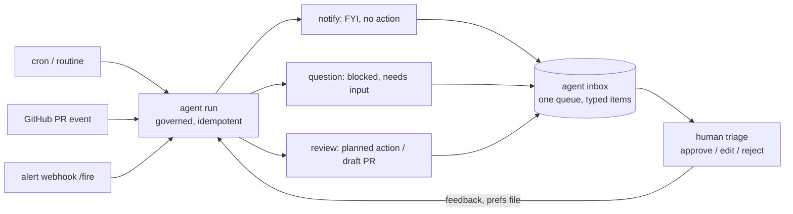

# 07: Scheduled, ambient and event-driven loops

## The idea

The loops so far start when you run them. This file covers loops whose **next turn is started by something other than you**: the previous turn ending (`/goal`, Stop hooks), a clock (`/loop`, routines, cron), or an event (a webhook, a PR, an alert). Once the trigger is outside you, two things become the engineering problem:
1. **Correctness across runs.** A run can fire late, fire twice, or fail to read a source, and nobody is watching.
2. **Supervision.** Ten agents running in the background is an inbox to manage, not ten chats to watch.

All Claude Code details below were checked against the docs on 2026-10-19. These features change often, so re-check the pages linked before relying on a specific number.

## Why it matters

Anthropic's guide to scheduled agents opens with the failure mode: they fail quietly. They lose access to a source or drift from your preferences, and nobody notices ([Anthropic, "Building effective agent automations"](https://claude.dev/blog/building-effective-agent-automations/)). The specific trap: "If an MCP server is down or its token has expired, the run still starts, just without that server's tools. The session logs an error, but the agent sees nothing from that source and reports 'nothing new.'" A broken integration looks exactly like a quiet day. The routines docs make the same point about the run list: "A green status in the run list means the session started and exited without an infrastructure error. It does not mean the task in your prompt succeeded." ([routines](https://code.claude.com/docs/en/routines)).

You already know this failure from monitoring. A dashboard with no data isn't a healthy service. **Unreadable is not quiet.**

## How it works

### What starts the next turn

| Mechanism | Next turn starts when | Stops when | Scope |
|---|---|---|---|
| [`/goal <condition>`](https://code.claude.com/docs/en/goal) | Previous turn finishes | A separate small fast model judges the condition met or impossible; an error you must fix; `/goal clear` | One session |
| [Stop hook](https://code.claude.com/docs/en/hooks-guide) | Previous turn finishes and the hook blocks the stop | Your script or prompt allows it; the 8-block cap | Every session in the settings scope |
| [`/loop`](https://code.claude.com/docs/en/scheduled-tasks) | An interval elapses (fixed, or self-paced 1 min to 1 h) | You cancel it; 7-day expiry; self-paced loop calls `ScheduleWakeup` with `stop: true` | Open session on your machine |
| Desktop scheduled task | Cron schedule, min 1 minute | You disable it | Your machine, no open session needed |
| [Routine](https://code.claude.com/docs/en/routines) (research preview) | Schedule (min 1 hour), API POST to `/fire`, or GitHub PR/release event | Run ends; routine disabled | Anthropic cloud, fresh clone each run |
| Monitor tool / Channels | A pushed event or a streamed output line | Stream ends | Session |

Pick by asking what should cause the next turn. If it's "the work isn't done yet", use `/goal` or a Stop hook. If it's "time passed", use `/loop` or a routine. If it's "something happened", use an event trigger, and don't poll if the event can be pushed: the scheduled-tasks page recommends Channels or the Monitor tool for that reason.

### `/goal`: a fresh-model completion gate

`/goal` wraps a session-scoped prompt-based Stop hook. After each turn, the condition and the conversation go to the small fast model, which returns *not yet met* (with a reason that guides the next turn), *met*, or *impossible*. Things you need to know:
- **The evaluator doesn't run tools.** It "judges your condition against what Claude has surfaced in the conversation". Write conditions that Claude's own output can demonstrate, such as "`npm test` exits 0", and expect Claude to show the evidence.
- **Good conditions** have one measurable end state, a stated check, and constraints that must not change ("no other test file is modified"). They can be up to 4,000 characters. Bound the run with "or stop after 20 turns".
- **Guards:** if Claude goes several turns without using tools, the loop stops and returns control. Authentication, credit, unrecoverable context-overflow and unavailable-model errors clear the goal. Transient errors retry, and after three automatic retries the goal pauses.
- **Headless:** `claude -p "/goal CHANGELOG.md has an entry for every PR merged this week"`. Add `--output-format stream-json --verbose` so a long goal doesn't look hung.

### Stop hooks: deterministic gates

A Stop hook runs when Claude tries to end its turn. Three types:
- **command:** your script. Exit 2 (stderr goes back to Claude), or JSON `{"decision": "block", "reason": "..."}`, keeps Claude working.
- **prompt:** one LLM call returning `{"ok": false, "reason": "..."}`. Adding `"impossible": true` lets the stop through for a condition that can never be met.
- **agent:** an experimental subagent with tools, a 60-second default timeout and up to 50 tool-use turns, returning the same `ok`/`reason` shape.

The loop guard: "Claude Code overrides a Stop hook after it blocks eight times in a row with no tool call from Claude in between." Check `stop_hook_active` in the hook input and exit 0 when it's set, or raise the cap with `CLAUDE_CODE_STOP_HOOK_BLOCK_CAP` if your gate legitimately needs more rounds ([hooks guide](https://code.claude.com/docs/en/hooks-guide)).

> **Course stance:** blocking verification gates work, and hooks that try to steer behaviour mostly don't. Spotify's Stop hook runs every verifier and opens no PR if any fails ([Spotify](https://engineering.atspotify.com/2025/12/feedback-loops-background-coding-agents-part-3)). That's the canonical use. More in [14-steering-and-guardrails](../14-steering-and-guardrails/README.md).

### `/loop`: session-scoped schedules

- `/loop 5m check the deploy` runs at a fixed interval. `/loop check the deploy` (no interval) lets Claude choose 1 minute to 1 hour after each iteration. A bare `/loop` runs the built-in maintenance prompt: continue unfinished work, tend the branch's PR (review comments, failed CI, conflicts), then cleanup passes. It takes irreversible actions only when they continue something the transcript already authorised.
- `.claude/loop.md` (or `~/.claude/loop.md`) replaces that default prompt. Edits take effect on the next iteration, and content beyond 25,000 bytes is truncated.
- **Bounds:** 1-minute minimum; at most 50 scheduled tasks per session; no catch-up for missed fires (a task that comes due while Claude is busy fires once when idle); recurring tasks "automatically expire 7 days after creation ... This bounds how long a forgotten loop can run."
- **Jitter:** recurring tasks run late by up to half the interval, capped at 30 minutes. The exception is `*/5 * * * *` (what `/loop 5m` creates), which runs at 4 minutes 45 seconds so the next run lands inside the five-minute prompt-cache TTL.

### Routines: cloud, unattended, triggered

A routine is a saved prompt, repos, environment and connectors that runs in Anthropic's cloud on a **schedule** (hourly or less often), an **API** `/fire` call, or a **GitHub** event (pull request or release, with filters). Each run clones the repos fresh and pushes to `claude/`-prefixed branches. Create one with `/schedule` from the CLI. Two design details are worth copying into your own systems:
- Text sent to `/fire` arrives "wrapped in a `<routine-fire-payload>` block that labels it as untrusted data", and the routine acts on it only if the saved prompt says to. An alert body is data, not instructions ([16-security-and-containment](../16-security-and-containment/README.md)).
- Runs execute without permission prompts, using your identity on connectors. Scope repos, network and connectors to what the routine needs.

### Design rules for anything that runs on its own

From Anthropic's automation guide (six components: Sources, Destination, Agent, Schedule, Memory, Guardrails), restated as distributed-systems rules:

| Rule | Source wording | DS equivalent |
|---|---|---|
| **Bookmarks, not windows** | "A late run leaves a gap and an early run repeats items. Instead, give the agent a bookmark per source." | Consumer offsets, not wall-clock ranges |
| **Ledger with stable IDs** | Each line records when, where from, "an ID that doesn't change", and last status | Dedupe table keyed by idempotency key |
| **Idempotent side effects** | Check today's post isn't already there; count it as sent only on `"ok": true` plus a ts; update ledger and bookmarks only after that; otherwise mark "maybe posted" and change nothing else | Exactly-once effect via check-then-act plus an outbox state machine |
| **Unreadable is not quiet** | On a failed source: keep its bookmark, write from the other sources, end with one line naming what it couldn't read | Distinguish "no data" from "zero" in metrics |
| **Re-verify before acting** | "re-check its live source just before posting" | Read-your-writes check before an external side effect |
| **Budget as pause** | "Start at three to five times the cost of a normal run"; a capped run pauses with `budget_reached` | Quota with a visible throttled state |

### Supervising many loops: the agent inbox

LangChain's ambient-agents post argues that background agents still need humans in the loop, through three patterns: **notify** (flag without acting), **question** (ask instead of guessing) and **review** (approve, edit or give feedback on a planned action). They built an "Agent Inbox" on a ticket-queue model because Slack notifications got lost ([LangChain, "Introducing ambient agents"](https://www.langchain.com/blog/introducing-ambient-agents)). Mitchell Hashimoto's version is human-scale: in the last 30 minutes of the day, launch research, exploration and triage agents that *only write reports*, and read them in the morning ([Hashimoto, "My AI Adoption Journey"](https://mitchellh.com/writing/my-ai-adoption-journey)).



*Course synthesis:* map exit codes to inbox item types. `SUCCESS` with a diff becomes **review**, `BLOCKED` becomes **question**, and `STALLED`/`BROKEN`/`BUDGET` become **notify** for whoever owns the harness. If the inbox has no item for a run, the run didn't report, and that is itself an alert.

## Worked example: nightly flaky-test triage

Situation: CI has about 30 flaky tests. You want an agent that runs every weeknight, picks up new flake reports, tries a fix for one, and leaves a reviewable PR or a clear note.

**Bad version.**

```text
/schedule weekdays at 2am: look at CI failures from the last 24 hours, fix the flaky tests, and post a summary to #ci
```

What happens: Monday's run is 40 minutes late, so it misses failures from 01:20 to 02:00. Tuesday's CI-logs connector token has expired, so the agent sees no failures and posts "No new flakes", which is the unreadable-is-quiet failure. Wednesday the Slack post times out, the agent retries and the channel gets two summaries. Thursday it "fixes" a flake by adding `@retry(3)`, and the test goes green in the PR.

**Good version.** The routine prompt (saved in the repo as `automations/flake-triage.md`):

```markdown
State lives in automations/state/flake-triage.json: {"bookmark": {"ci_runs": "<last run id>"}, "ledger": [...]}.

1. Read CI runs with id > bookmark.ci_runs. If the CI source cannot be read, do NOT advance the bookmark;
   finish the report with "CI runs unavailable this run" and stop.
2. For each failing test, add or update a ledger row keyed by test node id: first_seen, last_seen, count, status.
3. Pick ONE ledger row with status "new" and count >= 3. Reproduce it: run it 50 times with `pytest -p randomly -x --count 50`.
   - If it does not fail in 50 runs, set status "cannot-reproduce" and stop.
   - Fix the root cause. Retries, sleeps, and skip markers are not fixes.
4. Your fix is done only when the 50-run loop passes AND `make test` passes. Open a draft PR on a claude/ branch.
5. Post to #ci only if today's "Flake triage YYYY-MM-DD" message is not already there. Count it as posted only when Slack
   returns ok:true and a ts. Then advance bookmark and ledger. If unsure, record "maybe posted" and change nothing else.
```

A Stop hook enforces step 4 deterministically instead of trusting the prompt (`.claude/settings.json` plus a script):

```json
{"hooks": {"Stop": [{"hooks": [{"type": "command", "command": "${CLAUDE_PROJECT_DIR}/.claude/hooks/flake-gate.sh"}]}]}}
```

```bash
#!/bin/bash
# flake-gate.sh: block the stop while a claimed flake fix is not proven.
INPUT=$(cat)
[ "$(echo "$INPUT" | jq -r '.stop_hook_active')" = "true" ] && exit 0   # respect the loop guard
TEST=$(jq -r '.ledger[] | select(.status=="fixing") | .test' automations/state/flake-triage.json | head -1)
[ -z "$TEST" ] && exit 0                                                  # nothing claimed: allow stop
if git diff --name-only origin/main | grep -Eq '(^|/)conftest\.py$' || git diff origin/main | grep -Eq '@retry|time\.sleep|pytest\.mark\.skip'; then
  echo "Fix adds retries/sleeps/skips or edits conftest.py. Fix the root cause in the code under test." >&2; exit 2
fi
if ! pytest -q "$TEST" -p randomly --count 50 -x >/tmp/flake.out 2>&1; then
  echo "Still flaky: $(grep -m1 -E 'FAILED|Error' /tmp/flake.out)" >&2; exit 2
fi
exit 0
```

(`--count` comes from the `pytest-repeat` plugin and `-p randomly` from `pytest-randomly`. Substitute whatever your repo uses to rerun and reorder tests.)

What to check after the first week:
- Every run produced an inbox item: draft PR (review), "cannot reproduce" (notify), or "CI unavailable" (notify). Zero silent runs.
- Bookmarks advanced only on runs where the source was read. Ledger IDs are unique.
- No PR diff contains `@retry`, `sleep` or `skip`. The hook blocked at least once, which proves the gate can fail.
- Cost per run is within the budget you set at 3–5x a normal run.

## Pitfalls

| Pitfall | How to detect it |
|---|---|
| Time-window reads ("last 24h") | Items missing or duplicated around late or early runs; switch to bookmarks |
| Failed read reported as "nothing new" | Inject a bad token in staging; the report must say "unavailable" |
| Duplicate side effects on retry | Count posts or PRs per run id; require check-then-act plus a "maybe" state |
| Stop hook without the `stop_hook_active` check | Turns end with the block-cap warning; test the hook with that field set |
| Global Stop hook surprises other sessions | Put hooks in the narrowest settings scope; prefer `/goal` for one-off conditions |
| `/goal` condition the evaluator can't see | Goal never resolves; make Claude print the check's output |
| Forgotten loops | Inventory scheduled tasks weekly; `/loop` tasks expire at 7 days, but routines don't |
| Untrusted event payload treated as instructions | Payload in a delimited block; the prompt says what to do with it |
| Inbox overload | Track items per day and time-to-triage; merge low-value automations or move them to "notify only" |

## In your day job
- Convert one recurring human chore (dependency bump triage, flake triage, stale-PR nudges) into a routine with bookmarks, a ledger and an idempotent post. Run it in "notify only" mode for a week before allowing PRs.
- Replace "keep going until tests pass" prompts with `/goal` conditions that name the command and an invariant, plus a turn bound.
- Write every Stop hook to respect `stop_hook_active`, and test it against a run where the check fails.
- Give background agents a single inbox with typed items, and treat a run with no item as an incident.
