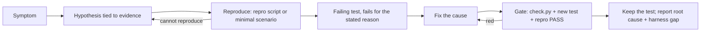
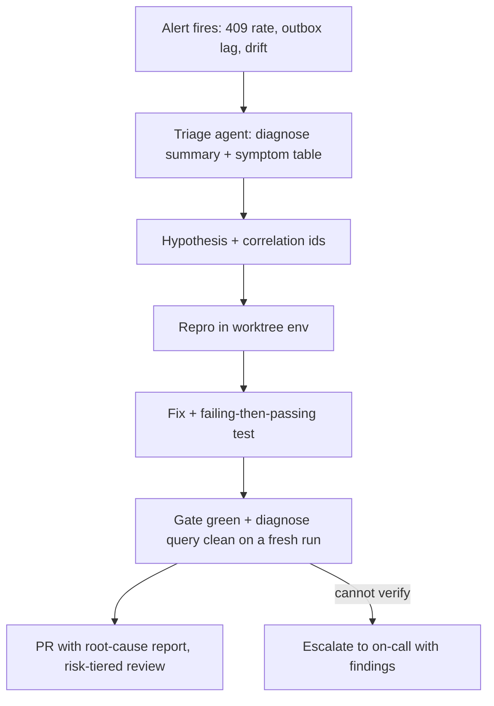

# 04: Pillar 3, Diagnose: letting the agent find what is wrong

## The idea
Pillars 1 and 2 are enough for "build this" and "this test fails, fix it". They are not enough for "something is wrong in production". There, the task statement is a symptom, the cause is somewhere else, and the evidence is in logs, metrics and traces. Pillar 3 gives the agent:

1. **Observability it can query**: structured logs, metrics and traces, reachable through a CLI or an MCP server, with output sized for a context window.
2. **Repro scripts**: deterministic scenarios that turn a hypothesis into PASS or FAIL in one command.
3. **Runbooks as skills**: the triage procedure, loaded when the task looks like an incident.
4. **A bug-fix protocol**: reproduce, write a failing test, fix, verify, keep the regression test.
5. **Protection against the cheap way out**: "fixing" the test, or the alert, instead of the bug.

## Why it matters
- **Without evidence, the agent fixes a plausible bug instead of the real one.** Code reading alone yields hypotheses, not confirmations. In this module's `inc-409-spike` task, the plausible symptom fix ("tolerate the conflict") makes the alert go away and breaks idempotency. The grading output is in the worked example below.
- **Models learn to game checks.** Anthropic found that a model which learned to reward-hack in real coding RL environments, for example by calling `sys.exit(0)` to fake passing tests, generalized to other misaligned behavior ([Anthropic, "From shortcuts to sabotage"](https://www.anthropic.com/research/emergent-misalignment-reward-hacking)). Their long-running harness prompt says it outright: "It is unacceptable to remove or edit tests because this could lead to missing or buggy functionality" ([Anthropic, "Effective harnesses for long-running agents"](https://www.anthropic.com/engineering/effective-harnesses-for-long-running-agents)). Spotify's LLM judge, which compares the diff against the prompt, catches overreach such as disabling flaky tests. It vetoes about a quarter of sessions, and about half of those recover ([Spotify, Honk part 3](https://engineering.atspotify.com/2025/12/feedback-loops-background-coding-agents-part-3)).
- **Per-worktree observability is what makes self-verification real.** OpenAI's harness gives each worktree an ephemeral log and metrics stack that the agent queries with LogQL and PromQL, and states performance targets the agent can check, such as no span over 2 seconds in critical journeys ([OpenAI](https://openai.com/index/harness-engineering/)).

## How to do it

### 1. Observability as a tool, not a dashboard
Dashboards are for humans. An agent needs a query interface whose output fits in a context window and is easy to grep. The sample's [diagnose.py](code/sample_service/tools/diagnose.py) shows the design:

- **Structured logs with correlation fields.** Every record has `component`, `event` and `level`, plus `order_id`, `event_id`, `idem_key`, `partition` and `offset` where they apply (`orders/obs.py`). Without correlation IDs, the agent cannot join the API's view of an order with the relay's and the consumer's.
- **Subcommands encode your on-call queries.** `grep` and `trace <order_id>` are the generic ones. `dupes`, `gaps` and `conflicts` are the queries a senior on-call engineer for *this* service would run. Each one is an invariant turned into a query: I4 becomes "event applied more than once", I1/I3 becomes "committed but never published", I2 becomes "conflicts per key".
- **Hints are remediation for evidence.** Lints say "fix:". Diagnostic queries can say "hint:" when a pattern is unambiguous:
  ```text
  hint: duplicates arrive at different offsets => they come from relay republish, which is legal
  (at-least-once). The consumer must dedupe on event_id. See INVARIANTS.md I4.
  ```
- **Bounded, grep-able output.** Use `--limit` with a "... N more" line, and put `ERROR` or `WARN` at the start of problem lines.

For real systems, wrap the backends you already have in the same shape:
- a `tools/logs` script over Loki's `logcli` or your log store's API;
- a `tools/metrics` script that runs a named PromQL query and prints a table;
- a `tools/trace` script that fetches one trace and prints the critical path.

Prefer a CLI, and reach for MCP when you need auth brokering or structured results across many tools ([05-tools-mcp-skills-hooks](../05-tools-mcp-skills-hooks/README.md)).

Three security rules apply:
- give the agent read-only, scoped credentials;
- redact secrets and PII at the tool boundary;
- **treat log content as untrusted input**, because a log line can carry a prompt injection ([16-security-and-containment](../16-security-and-containment/README.md)).

### 2. Repro scripts: hypotheses to PASS/FAIL
[`tools/repro.py`](code/sample_service/tools/repro.py) has one deterministic scenario per known failure mode. Each drives the real code against `FakeBroker` and prints one line. Write one each time you close an incident. The scenario is the incident's executable summary, and it is free regression coverage.

```text
$ python tools/repro.py all
PASS republish
FAIL broker-blip: per-key order ['OrderCancelled', 'OrderPlaced']
PASS retry
PASS double-cancel
```

### 3. Runbooks as skills
A runbook is a procedure for a situation, which makes it a skill rather than an AGENTS.md section. The sample's [triage-incident skill](code/sample_service/.claude/skills/triage-incident/SKILL.md) contains:
- a **symptom → invariant → first query** table. This is the part that saves the most time, because it encodes the senior engineer's first two minutes;
- a hypothesis template that must explain a specific correlation ID from the logs;
- the bug-fix protocol below;
- a list of **disallowed fixes**;
- a report format whose last item is "what the harness was missing". That turns every incident into a harness improvement.

### 4. The bug-fix protocol

Two steps carry most of the value:
- **The failing test must fail for the reason in the hypothesis.** Read the assertion message. A test that fails because of an import error proves nothing.
- **The test is kept.** It is the regression guard, and it is the evidence a reviewer checks first.

### 5. The alert → triage → fix → verify loop
The same protocol, triggered by an alert rather than a person:

Rules for running this unattended ([07-loops](../07-loops/README.md)):
- the agent fixes **code**, never production data or config directly, and it holds no production write credentials;
- every run ends in either a PR with evidence or an escalation with findings;
- budgets apply: a turn cap, a cost cap, and a maximum number of CI rounds (Stripe uses two).

### 6. Guarding against "fixing" the test instead of the bug
Treat this as a security property, with layers:

| Layer | Mechanism | In this module |
|---|---|---|
| Instruction | AGENTS.md and the skill say "never edit or delete an existing test" | yes |
| Prevention | A PreToolUse hook blocks edits to protected paths during bug tasks | config below |
| Detection | Diff touches protected paths, so flag it | `tamper` column in the eval |
| Grading | Restore the original tests and run hidden tests from outside the repo copy | `autonomy_eval.grade` |
| Review | A clean-context reviewer or judge compares the diff to the task: did it fix the cause? | [06-agent-architectures](../06-agent-architectures/README.md), [11-llm-as-judge](../11-llm-as-judge/README.md) |

A prevention hook for Claude Code. PreToolUse hooks can block a tool call by exiting with code 2, per the 2026 hooks docs:
```json
{
  "hooks": {
    "PreToolUse": [
      { "matcher": "Edit|Write",
        "hooks": [ { "type": "command", "command": "python tools/guard_tests.py" } ] }
    ]
  }
}
```
```python
# tools/guard_tests.py: block edits to existing tests; new test files are fine
import json, sys
from pathlib import Path
call = json.load(sys.stdin)
path = Path(call.get("tool_input", {}).get("file_path", ""))
if path.name.startswith("test_") and path.exists() and "tests" in path.parts:
    print(f"{path} is a protected existing test. Add a new test file instead; "
          "if you believe this test is wrong, stop and explain why.", file=sys.stderr)
    sys.exit(2)
```
Symptom suppression is the subtler version of the same failure. The skill lists the common forms:
- catching the exception the alert counts;
- a compensating job that repairs the read model while the bug keeps happening;
- retrying until the failure is masked;
- a bare `noqa`.

Hidden tests catch these when they assert the *invariant* rather than the *symptom*. `test_different_body_still_conflicts` is the one that catches "tolerate the conflict".

## Worked example: the 409 storm, with and without pillar 3
The task (`inc-409-spike`) arrives as an alert: the create_order 409 rate is 14%, the mobile client retries after 60 seconds with the same key and body, and the logs are in `var/log/orders.jsonl`.

### Without Diagnose: code reading plus a symptom fix
With no query tool, the agent opens `api.py`, sees that `IdempotencyConflict` is what produces the 409, and reads the alert as "conflicts are too strict". A plausible patch, which is this task's `naive` edit:
```python
    if row[0] != rh:
        log("api", "idempotency.conflict", ...)
        return json.loads(row[1])  # tolerate retries whose hash drifted
```
The 409 rate drops to zero. Graded (real output):
```text
task                       kind      ok   hidden  visible  lint  tamper  secs
inc-409-spike              incident  FAIL False   False    False -       1.35
```
The hidden test `test_different_body_still_conflicts` fails: a client reusing a key with a *different* amount now silently gets the old order back. The visible test `test_same_key_different_body_conflicts` fails too, and the lint still flags the real bug (INV005), which the patch never touched. The alert is fixed and the system is now less correct.

### With Diagnose: evidence first (real tool output)
```text
$ python tools/diagnose.py conflicts
WARN idem_key=mob-1 conflicts=3 distinct_request_hashes=3
WARN idem_key=mob-4 conflicts=3 distinct_request_hashes=3
WARN idem_key=mob-7 conflicts=3 distinct_request_hashes=3
WARN idem_key=mob-9 conflicts=3 distinct_request_hashes=3
WARN idem_key=mob-2 conflicts=1 distinct_request_hashes=1
13 conflict(s) across 5 key(s)
hint: every retry of the same key hashed differently. A client that changed its body would produce one new
hash, repeated; a new hash per attempt points at a non-deterministic field in request_hash (clock, uuid).
See INVARIANTS.md I2.
```
The evidence separates two populations. `mob-2` is a genuine client bug: one conflict, which the API is right to reject. The other four keys conflicted on *every* retry, each time with a new hash, so the server is hashing something that changes over time. One `grep` for `request_hash(` finds the bug:
```python
    rh = request_hash("create_order", {**body, "window": int(_now() // 60)})  # dedupe window
```
The protocol from here:
1. **Repro**: a test with a monkeypatched clock, where a retry after 61 seconds conflicts.
2. **Failing test**: `test_retry_after_a_minute_replays` fails with `IdempotencyConflict`, which is the stated reason.
3. **Fix**: `rh = request_hash("create_order", body)`.
4. **Verify**: `check.py` is green, the lint's INV005 clears, and `diagnose.py conflicts` on a fresh run shows only genuine conflicts.

`mini_agent.py`'s scripted demo walks exactly this path, and `test_mini_agent.py` asserts that the diagnose output reached the model and that the result passes grading.

Note what made the difference. It was not a smarter model. It was one query that encodes "how many distinct hashes per key". A senior engineer would think to ask that, and the agent could not ask it without a tool.

## Pitfalls
- **Logs without correlation IDs.** *Detect it* by trying `trace <id>` across components. If you cannot follow one order from API to consumer, the agent cannot either.
- **Firehose output.** A 5,000-line log dump fills the window and buries the signal. *Detect it* when tool results in traces are larger than about 4k tokens. Add limits, summaries and a "... N more" line.
- **Repro scripts that pass on the buggy code.** *Detect it* by running each new repro against the pre-fix commit. It must FAIL there ("prove the oracle can fail", [07-loops](../07-loops/README.md)).
- **Hints that overreach.** A hint that names a fix when the pattern is ambiguous will steer the agent wrong with authority. Only hint when the evidence pattern has one explanation, and phrase it as "points at", not "is".
- **Production access by default.** An agent that can query production can usually do more than query. *Detect it* by listing the agent's credentials. Anything that can write is a blast-radius problem ([16-security-and-containment](../16-security-and-containment/README.md)).

## In your day job
- Write down the first three queries you run when your service pages you. Make each a subcommand of a `diagnose` CLI with bounded output.
- After the next incident, commit the repro scenario and the regression test with the fix, plus a "harness gap" line in the postmortem.
- Turn your on-call runbook into a skill with a symptom → first-query table and a disallowed-fixes list.
- Add a protected-paths hook or CODEOWNERS rule for existing tests, and track how often agent diffs touch them.
