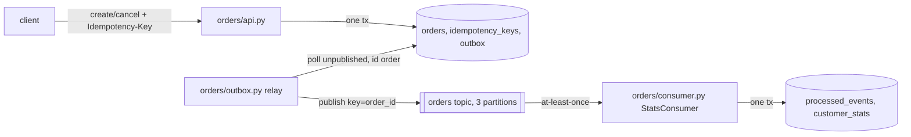

# ARCHITECTURE.md

## Modules and ownership
| Module | Owns tables | Responsibility |
|---|---|---|
| `orders/db.py` | schema | `connect()`, and `tx()`, the only transaction primitive |
| `orders/api.py` | `orders`, `idempotency_keys`, writes `outbox` | idempotent commands: `create_order`, `cancel_order`, `get_order` |
| `orders/outbox.py` | reads/marks `outbox` | `relay_once()`: the only publisher; `lag()` SLI |
| `orders/consumer.py` | `processed_events`, `customer_stats` | `StatsConsumer.handle()`, `drain()` helper |
| `orders/broker.py` | none | hermetic fake broker with fault injection |
| `orders/obs.py` | none | structured JSON logs (`ORDERS_LOG_PATH`) |

## Events (topic `orders`, key = `order_id`)
| Type | Payload | Emitted by |
|---|---|---|
| `OrderPlaced` | `event_id, order_id, customer_id, amount_cents` | `create_order` |
| `OrderCancelled` | `event_id, order_id, customer_id, amount_cents` | `cancel_order` |

`event_id` is the outbox row id as a string. It is the dedupe key (INVARIANTS.md I4).

## Delivery semantics
Exactly-once *effect*, built from at-least-once delivery plus idempotent
consumers. There is no exactly-once delivery anywhere in this system, and no
code should assume it.

## Tooling
- `tools/check.py`: the gate (lint + tests).
- `tools/lint_invariants.py`: AST lint for I1 to I4, with remediation text.
- `tools/check_docs.py`: fails if docs reference files, anchors or modules that do not exist.
- `tools/repro.py`: deterministic scenarios for each invariant.
- `tools/diagnose.py`: queries over structured logs.
