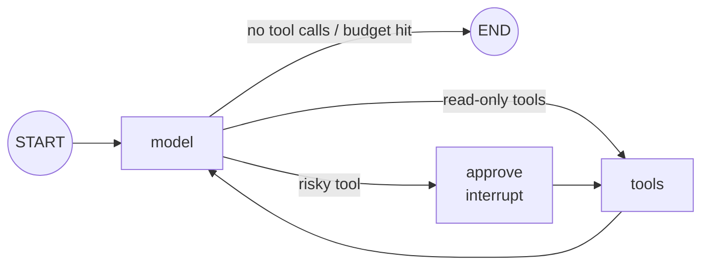

# 03: LangGraph core: state, nodes, edges, reducers, subgraphs, streaming

## The idea

LangGraph is a runtime for **stateful graphs of steps**. You declare:

- a **state schema** (a `TypedDict`, dataclass or Pydantic model), which is the only thing that flows between steps;
- **nodes**, which are functions `state -> partial update`;
- **edges**, either fixed (`add_edge("tools", "model")`) or **conditional** (`add_conditional_edges("model", route, [...])`), where a router function reads state and names the next node;
- **reducers** per state key, which say how a node's update is merged into the current value.

Execution runs in **super-steps**, after the Pregel / bulk-synchronous-parallel model: every node scheduled for this step runs (concurrently if there are several), all their updates are merged through the reducers, a checkpoint is written, and the next set of nodes is computed from the edges. That is the whole engine. Checkpoints, interrupts and time travel ([04](04-langgraph-durability-hitl.md)) are all consequences of "state is merged and persisted at step boundaries".

The LangChain Academy courses that teach this are "Introduction to LangGraph" (M1 Simple Graph, Router, Agent; M2 State Schema, State Reducers, Multiple Schemas; M4 Parallelization, Sub-graphs, Map-reduce) and "Quickstart: LangGraph Essentials" (Nodes, Edges, Conditional Edges).

## Why it matters

The reducer is the part distributed-systems engineers recognise immediately, and the part most tutorials gloss over. Without a reducer, a key is **last-writer-wins**, and LangGraph refuses concurrent writes to it. Here is real output from the course venv, with two parallel nodes (`logs` and `metrics`) both writing `findings`:

```text
InvalidUpdateError : At key 'findings': Can receive only one value per step. Use an Annotated key to handle multiple values.
```

That is a good failure: loud, at the step boundary, and with the fix in the message. The silent failures come from reducers that *do* merge, but merge wrongly (see the subgraph example below).

## How it works

### State and reducers

```python
import operator
from typing import Annotated, Any, TypedDict

def merge_dicts(left: dict, right: dict) -> dict:
    return {**left, **right}

class TriageState(TypedDict, total=False):
    alert_id: str                                                   # no reducer: overwrite
    messages: Annotated[list[dict[str, Any]], operator.add]         # append-only event log
    tool_sequence: Annotated[list[str], operator.add]
    approvals: Annotated[dict[str, dict[str, Any]], merge_dicts]    # keyed merge
    turns: int
    final_text: str
```

This is the schema in [`code/langgraph_agent.py`](code/langgraph_agent.py). The choice per key:

| Reducer | Semantics | Use for |
|---|---|---|
| none | last writer wins; concurrent writes error | scalars set by one node (`turns`, `final_text`) |
| `operator.add` | append (list concat) | event logs, findings from parallel branches |
| `langgraph.graph.message.add_messages` | append, but **upsert by message id**; also accepts `RemoveMessage` | LangChain message lists; edit or delete history |
| custom `(left, right) -> merged` | whatever you define (keyed merge, max, set union) | approvals by `tool_use_id`, counters, CRDT-like merges |

This module's state uses plain Anthropic-format dicts with `operator.add`, because the nodes call `ainative_kit` rather than LangChain chat models. `add_messages` would also work, but it converts dicts to LangChain message objects, and then the request you send is no longer byte-identical to the raw loop's.

### Nodes, edges, routers

```python
g = StateGraph(TriageState)
g.add_node("model", model)
g.add_node("approve", approve)
g.add_node("tools", tools)
g.add_edge(START, "model")
g.add_conditional_edges("model", route_after_model, ["approve", "tools", END])
g.add_edge("approve", "tools")
g.add_edge("tools", "model")
graph = g.compile(checkpointer=saver, store=store)
```



The router is a pure function of state:

```python
def route_after_model(state) -> Literal["approve", "tools", "__end__"]:
    calls = _pending_calls(state)
    if not calls or state.get("turns", 0) >= max_turns:
        return END
    return "approve" if any(c["name"] in RISKY_TOOLS for c in calls) else "tools"
```

Two design rules follow from super-step semantics:

1. **Routers and gates must be pure.** They may run again on resume or replay.
2. **Put side effects in exactly one node** (here, `tools`), so "did this side effect happen?" maps to "did this node's step get checkpointed?".

Nodes that need runtime services take a second parameter. `model(state, runtime: Runtime)` gets `runtime.store` (long-term memory), `runtime.context` (per-run context) and `runtime.stream_writer` (custom stream events).

### Parallel branches and map-reduce with `Send`

Fan-out over a list known only at runtime (for example "check every service in the blast radius") uses `Send`:

```python
from langgraph.types import Send

def fan(state):  # conditional edge returning a list of Sends
    return [Send("check", {"service": s}) for s in state["services"]]

g.add_conditional_edges(START, fan, ["check"])
```

Real output, three `check` nodes in one super-step, merged by `operator.add`:

```text
{'services': ['checkout-api', 'payments-router', 'ledger'],
 'findings': ['checkout-api: ok', 'payments-router: ok', 'ledger: ok']}
```

This is the parallelization and orchestrator-workers pattern from [Module 06](../06-agent-architectures/README.md), with the single-writer rule enforced by the reducer: each worker appends, and nobody overwrites.

### Subgraphs

A compiled graph can be a node in another graph. With **shared keys**, the subgraph reads and writes the parent's channels directly. With **different schemas**, you call the subgraph inside a wrapper node and translate input and output. Subgraphs get their own checkpoint namespace, so `get_state(config, subgraphs=True)` shows their state when they are interrupted.

### Streaming

`graph.stream(input, config, stream_mode=...)` yields as the run progresses:

| `stream_mode` | Yields |
|---|---|
| `"values"` | full state after each step |
| `"updates"` | `{node_name: update}` per node |
| `"messages"` | LLM tokens as `(chunk, metadata)` (LangChain chat models only) |
| `"custom"` | whatever nodes emit through the stream writer |
| `"checkpoints"`, `"tasks"`, `"debug"` | checkpoint and task lifecycle events (need a checkpointer) |

Real output from `langgraph_agent.py` for the read-only alert `ALERT-4213`:

```text
== 4. stream a read-only alert, node by node (stream_mode='updates') ==
  model  -> ['messages', 'turns']
  tools  -> ['messages', 'tool_sequence']
  model  -> ['messages', 'turns']
  tools  -> ['messages', 'tool_sequence']
  model  -> ['final_text', 'messages', 'turns']
```

The current docs recommend a newer event-streaming API (`graph.stream_events(..., version="v3")`) for new applications. In langgraph 1.2.16 both APIs exist, and `stream(..., stream_mode="updates")` keeps working.

## Worked example: the subgraph double-count

You extract "diagnose" into a reusable subgraph that shares the `findings` key with the parent. Both declare `findings: Annotated[list[str], operator.add]`.

```python
class Sub(TypedDict):
    findings: Annotated[list[str], operator.add]

sg = StateGraph(Sub)
sg.add_node("inner", lambda s: {"findings": ["from subgraph"]})
sg.add_edge(START, "inner"); sg.add_edge("inner", END)

parent = StateGraph(Good)          # Good.findings also uses operator.add
parent.add_node("diagnose", sg.compile())
parent.add_edge(START, "diagnose"); parent.add_edge("diagnose", END)
parent.compile().invoke({"findings": ["parent"]})
```

Real output:

```text
{'findings': ['parent', 'parent', 'from subgraph']}
```

**Why it fails.** The subgraph starts with the parent's `findings` (`['parent']`), appends to it, and returns its **whole** final value (`['parent', 'from subgraph']`) as the node's update. The parent's reducer then appends that to its own `['parent']`. An append-only reducer is not idempotent under "return full state". It is the same bug as a consumer that re-publishes its entire offset range instead of the delta.

**Fixes, in order of preference:**

1. Give the subgraph its own schema (for example `sub_findings`) and call it from a wrapper node that returns only the delta: `return {"findings": result["sub_findings"]}`.
2. Use a reducer that is idempotent for this pattern: `add_messages` (upsert by id), or a set or keyed merge.
3. Test it. One assertion, `len(out["findings"]) == len(set(out["findings"]))`, catches it.

## Pitfalls

- **No reducer on a key written by parallel branches.** You get `InvalidUpdateError`. This is the good outcome. Add the reducer you mean.
- **Append reducers with full-state returns** (subgraphs, nodes that return `state["messages"] + [new]`). This is the silent double-count above. Detection: the history length grows faster than the turn count.
- **Side effects in routers or gate nodes.** They re-run on resume. Detection: a replay test that counts side effects ([04](04-langgraph-durability-hitl.md)).
- **Putting non-serialisable objects in state** (clients, DB handles). The checkpointer must serialise state. Close over them in a graph factory, as `build_graph(client, world)` does, or pass them in `context`.
- **Unbounded loops.** A model-tools cycle with no budget is an infinite loop with a bill attached. LangGraph has a `recursion_limit` (super-steps per run). Also keep your own turn budget in state, so the stop is a domain decision rather than an exception.

## In your day job

- Draw the graph before you code it. If you cannot name the one node that has side effects, the design is not done.
- Choose a reducer per key deliberately and write it in the schema. Code review should ask "what happens if two branches write this?"
- Use `Send` for blast-radius fan-out (check N services, or N shards) with an append reducer, and cap N.
- Use `stream_mode="updates"` as the progress feed for an on-call UI or Slack thread. It is the cheapest useful observability you can get.
