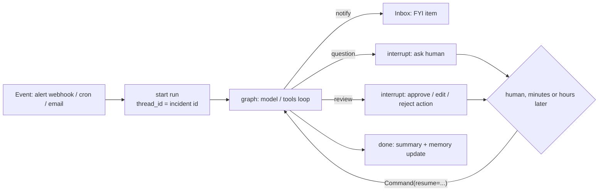

# 06: Deep Agents and ambient agents

## The idea

**Deep Agents** is LangChain's open-source agent *harness*: a `create_agent` loop pre-wired with the components that make Claude Code-style agents work on long tasks. Harrison Chase's original post ([LangChain, "Deep Agents"](https://www.langchain.com/blog/deep-agents), 2025-07-30) names four:

1. a **detailed system prompt**;
2. a **planning tool** (a to-do list, `write_todos`);
3. **subagents** for context isolation (the `task` tool);
4. a **filesystem**, so the agent can offload context to files instead of holding it in the window.

The current package adds pluggable filesystem **backends** (in-state, local disk, LangGraph Store, composite routing, and sandboxes that unlock an `execute` tool), **summarization and offload** middleware, **skills**, **memory**, async subagents, and human approval through `interrupt_on`. LangChain Academy's "Introduction to Deep Agents" walks these in order: M1 Building, M2 Execution Environment (backends, sandboxes, interpreter), M3 Context Management (summarization and offload, skills, memory), M4 Delegation (subagent teams, dynamic subagents), M5 Async Subagents, M6 Managed Deep Agents.

**Ambient agents** are agents triggered by **events** (an alert, an email, a cron tick) rather than by a chat message, running in the background, often many at once. Chase's framing ([LangChain, "Introducing ambient agents"](https://www.langchain.com/blog/introducing-ambient-agents), 2025-01-14) is that they "listen to an event stream and act on it accordingly, potentially acting on multiple events at a time", and that human-in-the-loop is central to them, not an afterthought. The on-call triage agent in this module *is* an ambient agent: PagerDuty fires, the agent runs, and a human sees an approval request.

## Why it matters

The four Deep Agents components are context strategies, and that is why they help. Chase's observation about Claude Code's to-do tool: "Funnily enough - this doesn't do anything! It's basically a no-op." The tool performs no action. It works because writing and re-reading the plan keeps it in recent context ([Module 03](../03-context-engineering/README.md)). Subagents work because the parent only sees the subagent's final report, not its 40 tool calls. The filesystem works because a 200 KB log dump in a file costs nothing until it is grepped.

The harness matters more than intuition suggests. LangChain reports moving the deepagents CLI from 52.8% to 66.5% on Terminal Bench 2.0 with the model fixed, through harness changes: a pre-completion verification checklist, loop detection, trace-driven fixes, and a "reasoning sandwich" (high reasoning effort to plan and verify, lower to implement). Using the highest effort everywhere scored *worse* (53.9% vs 63.6%) because of timeouts ([LangChain, "Improving Deep Agents with harness engineering"](https://www.langchain.com/blog/improving-deep-agents-with-harness-engineering)). [Module 08](../08-harness-engineering/README.md) is about that discipline.

For ambient agents, the supervision UX decides whether the system is used. LangChain built **Agent Inbox** because chat and Slack notifications got lost. It presents interrupts as a ticket queue. The interrupt payload in [`code/langgraph_agent.py`](code/langgraph_agent.py) follows its `HumanInterrupt` schema. Note: the `langchain-ai/agent-inbox` GitHub repository was **archived on 2026-09-20** and is read-only. The schema is still a good contract for interrupts, but do not adopt that repo as a dependency. The current LangChain path for approvals is `HumanInTheLoopMiddleware` with approve, edit, reject and respond decisions.

## How it works

### A deep agent

```python
from deepagents import create_deep_agent
from langchain.agents.middleware import TodoListMiddleware

log_digger = {
    "name": "log-digger",
    "description": "Reads large log windows for ONE service and returns a 5-line summary with timestamps.",
    "system_prompt": "You read logs. Return at most 5 lines: timestamp, level, message, count.",
    "tools": [query_logs],                 # least privilege: no restart for the subagent
}

agent = create_deep_agent(
    model="anthropic:claude-sonnet-5-5",
    tools=[get_alert, query_logs, restart_service],
    system_prompt=SYSTEM_PROMPT,
    subagents=[log_digger],
    middleware=[TodoListMiddleware()],     # planning is opt-in in recent versions (v0.7+, per docs)
    interrupt_on={"restart_service": True},
)
```

Snippets were checked against docs.langchain.com on 2026-10-19. `deepagents` is not installed in the course venv.

| Component | Mechanism | Context strategy (LangChain's write / select / compress / isolate) |
|---|---|---|
| `write_todos` | a tool whose "effect" is the plan in state | write |
| Filesystem (`ls`, `read_file`, `write_file`, `edit_file`, `glob`, `grep`) | backend: `StateBackend`, `FilesystemBackend`, `StoreBackend`, composite, sandbox | write, select |
| Summarization and offload middleware | compress old turns, offload big tool results to files | compress |
| `task` (subagents) | isolated by default (sees only the task), `mode: "fork"` (beta) inherits history | isolate |
| Sandbox backend | adds `execute` | isolate (and the security boundary, [Module 16](../16-security-and-containment/README.md)) |

### Ambient agent shape



Chase's three human-in-the-loop patterns:

- **Notify**: flag something without acting ("disk on broker-3 at 97%, owner paged").
- **Question**: ask instead of guessing ("which runbook applies to this alert?").
- **Review**: approve, edit or reject a planned action (the `restart_service` gate).

What makes this work is durable interrupts ([04](04-langgraph-durability-hitl.md)): an ambient agent's human is never synchronously present. The Academy's "Project: Ambient Agents with LangGraph" builds an email assistant with exactly this structure, plus **agent evaluations** (M3) and **memory** that learns from the human's edits (M5).

## Worked example: adding Deep Agents components to the triage agent, one at a time

The research note on Deep Agents (`research/practitioners.md` #34) suggests building the raw agent first, then adding the four components one at a time and measuring each against an eval. Here is that ablation plan for the triage agent. Outputs are not shown because they depend on a real model. Run it in [exercise 6](exercises.md).

**Bad version: add everything at once.**

```python
agent = create_deep_agent(model=..., tools=[...], subagents=[log_digger, metrics_digger, deploy_differ],
                          middleware=[TodoListMiddleware()], interrupt_on={"restart_service": True})
```

Suppose the pass rate on the 3-case dataset drops from 3/3 to 2/3 (an illustrative scenario, not a measured result). You cannot tell why. The candidates: the todo list added a planning turn that blew the turn budget; the subagent summarised away the `HikariPool` line the diagnosis needs; or the default system prompt, prepended to yours, contradicted "never restart for capacity problems".

**Good version: ablate.**

| Step | Change | Eval to watch | Expected risk |
|---|---|---|---|
| 0 | raw agent (`raw_agent.py`) | all three evaluators | baseline |
| 1 | + `write_todos` | `within_turn_budget` | an extra turn per run; raise the budget deliberately, or don't |
| 2 | + filesystem offload of `query_logs` output > 4 KB | `correct_action` | the agent forgets to read the file back |
| 3 | + `log-digger` subagent | `correct_action`, cost per run | the summary drops the decisive line; fix the subagent's prompt to keep ERROR lines verbatim |
| 4 | + `interrupt_on={"restart_service": True}` | `no_forbidden_tools`, plus a replay test | none if the gate is the only path to the tool |

Keep a component only if its eval delta is positive across repeated trials (run each configuration several times; [Module 12](../12-hill-climbing/README.md) covers noise and error bars). For a three-tool triage agent, expect steps 1 to 3 to be **neutral or negative**. Deep Agents components pay off on long, open-ended tasks (research, coding, multi-hour work), not on a four-turn decision. That is a real finding about when the harness earns its keep, not a failure of the experiment.

## Pitfalls

- **Adopting the harness for a short task.** Planning and subagents add turns, tokens and latency. Detection: compare cost per run and turns against the raw baseline.
- **Subagents that summarise away evidence.** Detection: a judge or code check that the parent's final answer cites a line that actually appears in the tool output.
- **Subagents with the parent's full tool set.** If you omit `tools`, a subagent inherits the main agent's tools, so `restart_service` would be reachable from a context the gate may not cover. Give subagents least privilege.
- **Local filesystem backend in production.** The agent can read whatever the process can. Use a state, store or sandbox backend ([Module 16](../16-security-and-containment/README.md)).
- **Ambient agents without an inbox.** Approval requests posted to a busy Slack channel get lost. That is why Agent Inbox exists. Detection: the p50 time from interrupt to decision, and the count of interrupts older than your SLA.
- **No concurrency control on events.** The same alert fires three times and you get three runs. Key the `thread_id` on the incident id and dedupe at the trigger.

## In your day job

- Treat Deep Agents as a reference harness. Read its middleware list and steal the governors (loop detection, a pre-completion checklist) for your own agent even if you never import it.
- For event-driven agents, write the three HITL patterns into the design doc: what does this agent notify about, what does it ask, and what does it need reviewed?
- Measure "time to human decision" as an SLO for ambient agents. If it exceeds your durability window, the agent is not safe to run unattended.
- Run every new harness component as an ablation against the baseline eval before you keep it.
