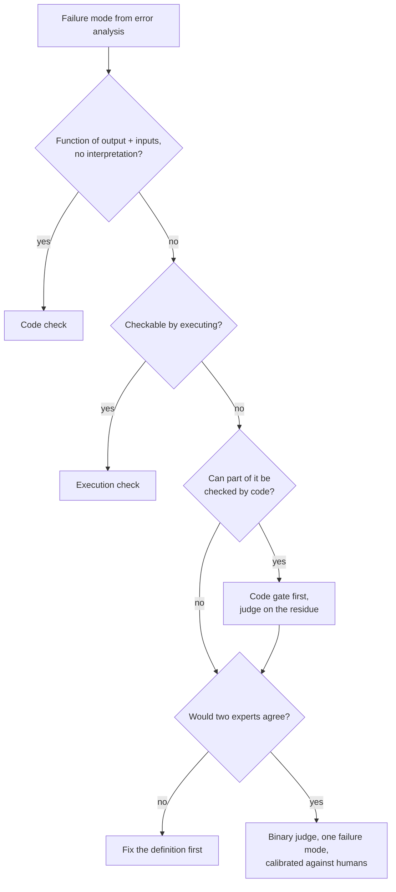

# 01: When you need a judge, and when a code check is enough

## The idea

A judge is an LLM call whose output is a grade for another model's output. It is the most flexible grader you have, and also the slowest, most expensive, and least trustworthy one. So you choose graders the way you choose consistency levels: start with the cheapest one that gives you the guarantee you need, and only go up a level when the property can't be checked any lower.

The ladder, from cheapest to most expensive:

| Rung | Grader | Typical checks | Cost per check | Trust |
|---|---|---|---|---|
| 1 | Schema / parse | valid JSON, required fields, enum values | microseconds | exact |
| 2 | Deterministic code | regex, set membership, numeric tolerance, "the count in the summary equals the count in the facts" | microseconds | exact for what it checks |
| 3 | Execution | run the tests, apply the migration to a scratch DB, `go vet` | seconds | exact for what the tests cover |
| 4 | LLM judge, binary, one failure mode | "every impact claim is supported by the facts" | 1 model call, about 1-5 s and fractions of a cent | measured TPR/TNR, see [03](03-calibration.md) |
| 5 | Human | a domain expert's verdict and critique | minutes | the reference you calibrate against |

OpenAI's graders guide describes the same ladder: string check, then Python, then score model, then human spot-check ([OpenAI, Graders](https://developers.openai.com/api/docs/guides/graders)). Anthropic's eval-building workflow defaults to programmatic checks and falls back to a judge only when "the output space is open-ended, with many valid answers but clear quality criteria" ([Anthropic, "Automating eval design and hillclimbing"](https://claude.dev/blog/automating-eval-design-and-hillclimbing/)).

The second rule is **one failure mode per judge**. A judge answers one yes/no question that came out of your error analysis in [Module 10](../10-evals-fundamentals/README.md). "Is this summary good?" is not a question a judge can answer reliably, and nor can a human. "Does the summary state the customer impact correctly?" is.

## Why it matters

Every rung you climb costs you something you care about as a systems engineer:

- **Determinism.** A code check returns the same answer every time. A judge can flip on identical input; Anthropic's eval tooling runs the grader twice on the same output to catch exactly that ([Anthropic](https://claude.dev/blog/automating-eval-design-and-hillclimbing/)).
- **Latency and cost.** A 500-item eval with one judge call per item is 500 model calls on every run. Three judges per item is 1,500.
- **A second thing to validate.** A code check is validated by reading it. A judge has to be measured against human labels ([03](03-calibration.md)) and re-measured whenever it changes ([06](06-who-validates-the-validators.md)).

Anthropic's own guidance on agent verification puts it bluntly: use an LLM as judge only when the gain is worth it, because it is "not very robust" and adds latency ([Anthropic, "Building agents with the Claude Agent SDK"](https://claude.com/blog/building-agents-with-the-claude-agent-sdk)).

The opposite mistake is just as common. Teams write a regex for something that needs judgement, then wonder why the metric is flat while users complain. ROUGE and cosine similarity on outputs are the classic version: they are cheap and deterministic, and they measure the wrong thing ([Hamel Husain and Shreya Shankar, Evals FAQ](https://hamel.dev/blog/posts/evals-faq/)).

## How to decide

Go through these questions for each failure mode in your taxonomy:

1. **Can the property be stated as a function of the output and the inputs, with no interpretation?** Then write code. Examples: the JSON parses; the PR touches no file outside `services/billing/`; the summary mentions an incident ID matching `INC-\d+`.
2. **Can it be checked by running something?** Then run it. Examples: tests pass, the SQL executes, `go vet` is clean. Of the 20 code-review comments in `code/data/code_review_comments.jsonl`, CR-018 (discarding a `context.WithTimeout` cancel func) is caught by `go vet`'s `lostcancel` check. You don't need a judge to grade a comment that a linter would have made for you.
3. **Can part of it be checked by code?** Split it. Put the code part in front as a cheap gate, and give the judge only what is left. This is the most useful question on the list.
4. **Does it need reading comprehension, paraphrase tolerance, or tracing semantics?** Now a judge is justified, scoped to that one property.
5. **Would two domain experts agree on the verdict?** If not, stop. Neither a judge nor a code check will save you; fix the definition first. Anthropic's test for a good task: "two domain experts would reach the same verdict and everything the grader checks is stated in the task" ([Anthropic](https://claude.dev/blog/automating-eval-design-and-hillclimbing/)).



## Worked example: customer impact in incident summaries

Your on-call tooling drafts the customer-facing part of an incident summary from the incident facts. Error analysis on 100 drafts found five failure modes: wrong timeline, missing customer impact, wrong customer impact, leaked internal hostnames, and tone that is too casual for the status page. Here is the grader decision for each:

| Failure mode | Grader | Why |
|---|---|---|
| Leaked internal hostnames | Code: regex over `*.internal`, `10.\d+`, pod-name patterns | Exact, cheap, no judgement involved |
| Wrong timeline | Code: extract `HH:MM UTC` and compare with the facts' window | Timestamps are structured |
| Missing customer impact | Code (partial): does the summary contain a count, a percentage, or "no customer impact"? | Catches root-cause-only drafts cheaply |
| **Wrong customer impact** | **Judge** | "Delayed" vs "lost", "us-east-1" vs "all regions", "about 3,400" vs "3,412" need reading comprehension |
| Tone | Judge (pairwise against the current template, see [04](04-pairwise-reference-and-summary-evaluators.md)) | Subjective; pairwise agrees better with humans for this kind of criterion ([Eugene Yan](https://eugeneyan.com/writing/llm-evaluators/)) |

**The bad version** is one judge for everything:

```text
Evaluate this incident summary for accuracy, completeness, tone and safety.
Give a score from 1 to 10 and explain.
```

It mixes five failure modes, two of which a regex does better. When the score drops from 7.2 to 6.8, you can't tell which mode got worse. It also wastes judge capacity on hostnames, which a regex catches every time.

**The good version** is the table above: three code checks that run in microseconds, plus one judge that answers a single question. The code checks also make the judge's job easier. Because root-cause-only drafts are already rejected, the judge sees fewer of the easy failures and its measured TNR describes the hard ones.

You can see what goes wrong when the judge relies on a "code-like" shortcut in `code/judge_fakes.py`. The `incident_keyword_judge` fake passes a summary when it contains the exact affected-customer count. That is a reasonable code check for *missing* impact. Used as the judge for *wrong* impact, it misses faithful paraphrases and waves through confident errors:

```text
INC-2291-s5  human=fail  judge(v1)=pass
"From 09:12 to 10:05 UTC, webhook deliveries were delayed by 14-41 minutes for 3,412
 merchants across all regions after a rebalance storm; ..."
facts: "... delayed ... 3,412 merchants in us-east-1 ..."
```

The count is right and the scope is wrong. Only something that reads both documents catches it. On the dev split, this count-only grader has a TNR of 0.38: it lets through 8 of the 13 wrong summaries (`python code/compare_judges.py`).

The lesson is not that the code check is bad. It is the right check for "missing impact". It is the wrong grader for "wrong impact", and splitting the two lets each grader do one job well.

## Pitfalls

- **Judge-for-everything.** Detect it by counting: if more than half your judges could be replaced by a regex or a test, you are paying for model calls to do string matching. Audit each judge with the question, "What would a code check for this miss?"
- **Multi-criteria judges.** Detect it by reading the rubric: more than one question, or the word "and" joining two properties. Split it into one judge per property. Anthropic's agent-evals guidance says the same: one judge per dimension ([Anthropic, "Demystifying evals"](https://www.anthropic.com/engineering/demystifying-evals-for-ai-agents)).
- **Code checks that pretend to be semantic.** Detect it by looking for ROUGE, BLEU or embedding similarity used as a pass/fail gate. Treat those as exploration signals at most ([Evals FAQ](https://hamel.dev/blog/posts/evals-faq/)).
- **A judge whose verdict the generator can read.** If the agent can see the judge's rubric and output in its loop, it will optimise toward the judge, not toward the property. Karpathy has made the point that LLM judges used as rewards get gamed through adversarial examples ([Dwarkesh Podcast, Oct 2025](https://www.dwarkesh.com/p/andrej-karpathy)). Keep the rubric out of the generator's context, and check periodically for "high judge score, low human score" divergence ([OpenAI, Graders](https://developers.openai.com/api/docs/guides/graders)).
- **Skipping the expert-agreement check.** If two of your senior engineers disagree about whether a review comment "found a real bug", your judge's TPR/TNR will be noise. Have two people label the same 30 items and compute kappa before you build anything. Eugene Yan reports that human annotators often reach only 0.2-0.3 kappa on hard criteria ([Eugene Yan, "Product Evals in Three Simple Steps"](https://eugeneyan.com/writing/product-evals/)).

## In your day job

- Take your team's current LLM grader list. For each grader, write one line saying which failure mode it covers and why code can't cover it. Delete or split the graders where you can't write that line.
- Put the code checks in front of the judge as a gate, the same way you'd run cheap health checks before an expensive canary analysis.
- When someone proposes "an LLM judge for quality", ask which failure mode from error analysis it targets. If the answer is "all of them", send them back to [Module 10](../10-evals-fundamentals/README.md).
