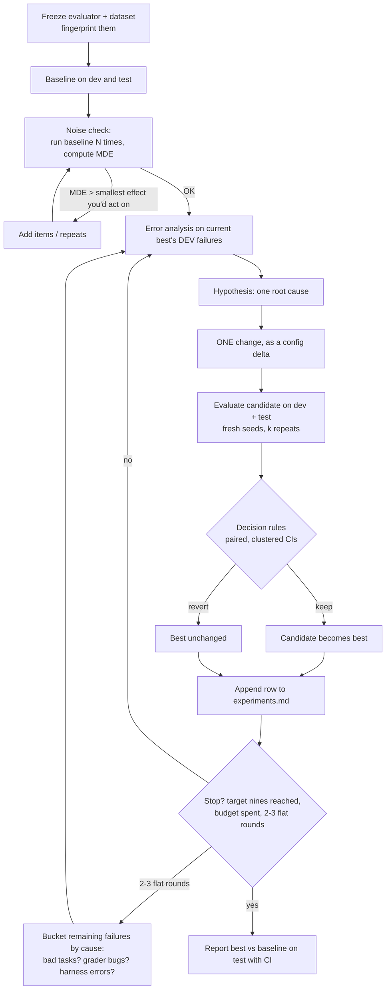

# 01: The hill-climbing loop

## The idea

Hill-climbing is greedy local search over the configuration of an LLM system, with an eval as the objective. You hold a **current best** config. Each round you propose **one** change to it, motivated by error analysis of the current best's failures. You evaluate the candidate on the same items and decide **keep** (it becomes the new best) or **revert** (the best stays). Every round, kept or not, goes into an **experiment log**.

The search space is anything you can change without retraining a model: system prompt sections, tool definitions and descriptions, the harness (retries, verification passes, context assembly), the model, and the reasoning effort. A config file captures all of it, so a variant is data, not a hand-edited branch.

This is coordinate ascent with a noisy objective, and three things make it work. First, **one change per round**, so every delta in the log is attributable. Second, **a decision rule fixed in advance**, so you can't talk yourself into a 1-point win. Third, **a durable log**, so the climb survives context resets, handoffs, and your own memory.

## Why it matters

Without the loop you get what OpenAI's receipt-inspection cookbook calls "poke-and-hope guesswork" ([OpenAI cookbook, "Eval Driven System Design"](https://developers.openai.com/cookbook/examples/partners/eval_driven_system_design/receipt_inspection)). Anthropic's published hill-climbs show what the disciplined version buys:

- **A support bot.** Held-out accuracy went from 78.6% to 90.5% at about one fifth of the cost. The climb moved from Opus 4.8 at high effort to a smaller model at low effort with an improved prompt ([Lance Martin, "Automating eval design and hillclimbing with Claude"](https://claude.dev/blog/automating-eval-design-and-hillclimbing/)).
- **An inbox router.** It went from 0.681 to 0.875. The variant that added worked examples was reverted "because train went up while test stayed flat" (same post).
- **A skill eval.** It went from 66.1% to about 88% over 24 rounds, and the last phase of gains came from fixing *broken graders* (same post).

That last point is a gift. An honest loop surfaces eval bugs, because a fix that should work and doesn't makes you go and read the transcripts.

## How it works



The steps, as decision rules:

1. **Freeze the evaluator.** Hash the grader code and the dataset, and check the hash every round. If either changes, the climb is void and you restart from a new baseline. Karpathy's autoresearch states the same rule as "`prepare.py`... Not modified" ([karpathy/autoresearch](https://github.com/karpathy/autoresearch)). In `hillclimb.py` it is enforced, not requested.
2. **Baseline and noise check** (concept 02). Do not run round 1 until you know the smallest effect the eval can see.
3. **Hypothesis from error analysis, not from vibes.** Read the current best's dev failures, group them by cause (open and axial coding from [Module 10](../10-evals-fundamentals/README.md)), and attack the largest bucket that a single change could fix.
4. **One change.** One prompt section, one tool, or one parameter. If the fix needs two coordinated edits, it is one *conceptual* change: write it as one delta and say so.
5. **Evaluate on dev and test with fresh seeds.** Fresh seeds mean you are not using common random numbers. You cannot fix the API's sampling seed, so do not get used to the clean deltas that fixed seeds give.
6. **Decide by rule** (concept 03): dev significantly up, test not down and carrying a meaningful share of the dev gain, cost within budget. Otherwise revert. Ties go to the simpler config.
7. **Log it.** Record the hypothesis, the change, the deltas with CIs, the cost, the decision, and the reason. Reverted rows tell the next person what not to retry.
8. **Stall handling.** After two or three flat rounds, stop proposing fixes and read every remaining failure. Anthropic's hillclimb workflow does exactly this, and it is where grader bugs and ambiguous tasks surface (Lance Martin, above).
9. **Finish at the best test version, and report the test CI against the baseline.** If the gain is within noise, do not merge.

### Karpathy's autoresearch: the minimal form

autoresearch is the purest version of the loop ([karpathy/autoresearch](https://github.com/karpathy/autoresearch), March 2026). It has three files and a handful of rules:

| Element | autoresearch | Why it matters |
|---|---|---|
| Frozen evaluator | `prepare.py` holds data and `evaluate_bpb`, and the agent may not modify it | The optimizer cannot redefine success |
| One editable surface | `train.py` only | Changes are attributable |
| Fixed budget | 5 minutes of wall-clock training per experiment, about 12 per hour | Trials are comparable, and compute is bounded |
| One scalar metric | `val_bpb`, lower is better, vocabulary-size-independent | No multi-objective hand-waving |
| Keep or discard | A lower `val_bpb` advances the branch; equal or worse is a `git reset` | Greedy search with version control as the state store |
| Durable log | `results.tsv`: commit, val_bpb, memory_gb, status, description | The state survives context resets |
| Human lever | `program.md`, which the human edits and the agent reads | Steering happens in Markdown, not in code |
| Simplicity criterion | "All else equal, simpler wins"; removing code at equal results is a win | The code stays small as the climb accumulates |

(Contents of `program.md` as read from the repo on 2026-10-19.)

Notice two things autoresearch does *not* need, because its domain is unusually clean. First, there is no train/test split beyond the fixed validation set: `val_bpb` on held-out data is hard to overfit with a handful of architecture edits. Second, there are no error bars: the metric is smooth and the deltas it acts on are, for its use, above noise. Your incident router has neither property. Its metric is a proportion over a few hundred correlated items, and its levers (prompt text) can memorize the eval. So you keep autoresearch's skeleton and add statistics and splits.

## Worked example

### The bad version: poke and hope

Here is a real-looking Slack thread. Every number in it is a single run.

```text
mon  ran router eval: 71.2%
mon  added "think step by step", 73.9% -- nice, merged
tue  pasted the 20 alerts it got wrong as examples: 82.0% !!
wed  someone says prod misroutes are up; eval says 81.6%, must be traffic mix
thu  bumped effort to max: 79.4%?? reverted, flaky API probably
```

What went wrong, round by round:
- **"Think step by step" +2.7.** The dev SE of one run is about 2 points, and paired noise between two runs is about the same. This is noise. In our simulation the change is a true no-op that costs 57% more per alert (see the log below).
- **Pasted failures +8.** These are the eval's own items, memorized. On held-out alerts, the change *lowered* accuracy.
- **"Eval says 81.6%."** The eval is no longer an independent measurement, because it now contains its own answer key.
- **max effort −2.6, "flaky API."** It was not flaky. Max effort exhausted `max_tokens` on a slice of alerts, a real and reproducible regression.

### The good version: the same week, as a logged climb

The variants file (`code/data/variants.json`) holds the baseline and an ordered list of single changes, each with its hypothesis:

```json
{
  "repeats": 4, "seed": 1, "min_effect": 0.05,
  "rules": {"test_ratio": 0.5, "block_leaks": false},
  "baseline": {"name": "v0-baseline", "model": "claude-sonnet-5-5", "effort": "medium",
               "sections": ["base"], "tools": [], "extra_prompt": "", "max_tokens": 1024},
  "rounds": [
    {"name": "v1-step-by-step", "hypothesis": "Generic reasoning boilerplate helps everywhere.",
     "change": {"add_section": "step_by_step"}},
    {"name": "v2-queue-defs",
     "hypothesis": "Error analysis: ambiguous-owner alerts go to the team whose service shows the symptom.",
     "change": {"add_section": "queue_definitions"}},
    {"name": "v3-fewshot-failures", "hypothesis": "Paste 60 current dev failures as few-shot examples.",
     "change": {"paste_dev_failures": 60}}
  ]
}
```

(Abridged. `block_leaks` is off only so you can watch v3 fail. Its default is on.)

Before round 2, the error analysis on the baseline's dev failures looks like this. These are simulated outputs from `router_eval.py`, majority-failed items, with the four repeated predictions shown:

```text
136 dev failures: ambiguous 46, lookup 31, reasoning 25, tiebreak 17, easy 17

ambiguous | payments-api pods OOMKilled on node pool gp-b; node memory pressure
          | label platform  | preds payments, payments, payments, database
tiebreak  | Alert chain: 14:55 CDN origin timeouts; 14:50 lb lb-api-2 unhealthy targets;
          |   14:13 k8s node mem-c-8 NotReady
          | label platform  | preds edge, edge, data-pipeline, edge
lookup    | svc-vega crash loop after deploy af285b4
          | label data-pipeline | preds platform, platform, platform, platform
```

The largest bucket has a clear shape: the model routes to the team whose *service shows the symptom*, not the team that owns the *broken resource*. That points at one change, a queue-definitions section that says "route to the owner of the saturated or broken resource." The lookup bucket has a different shape: no prompt can fix missing knowledge (what is `svc-vega`?), so that fix belongs at the tool layer (concept 04).

Run it:

```bash
cd 12-hill-climbing/code
python hillclimb.py data/variants.json --out runs/demo
```

This is the resulting log, abridged from [code/runs/demo/experiments.md](code/runs/demo/experiments.md). It is simulated, but the decisions and numbers are exactly what the runner wrote:

| # | variant | dev % | Δdev [95% CI] | test % | Δtest [95% CI] | $/1k | decision | reason |
|---|---|---|---|---|---|---|---|---|
| 0 | v0-baseline | 69.6 | - | 67.9 | - | 2.66 | baseline | |
| 1 | v1-step-by-step | 69.9 | 0.3 [-1.3, 1.8] | 67.4 | -0.5 [-2.0, 0.9] | 4.18 | **revert** | dev change within noise |
| 2 | v2-queue-defs | 77.5 | 7.9 [4.5, 11.4] | 74.6 | 6.7 [3.9, 9.5] | 3.03 | **keep** | both up, significant |
| 3 | v3-fewshot-failures | 86.4 | 8.8 [4.5, 13.1] | 72.5 | -2.0 [-3.4, -0.6] | 6.25 | **revert** | dev up, test significantly down: overfit; 60 eval items pasted |
| 4 | v4-tiebreak | 79.8 | 2.2 [0.3, 4.2] | 78.8 | 4.2 [1.4, 7.0] | 3.16 | **keep** | both up |
| 5 | v5-owner-tool | 85.2 | 5.4 [2.1, 8.7] | 85.1 | 6.3 [2.8, 9.7] | 3.55 | **keep** | both up |
| 6 | v6a-effort-low | 82.9 | -2.2 [-4.0, -0.5] | 82.2 | -2.9 [-4.5, -1.4] | 1.43 | **revert** | dev regression |
| 6 | v6b-effort-high | 89.1 | 3.9 [1.3, 6.5] | 89.1 | 4.0 [1.2, 6.7] | 8.58 | **keep** | both up |
| 6 | v6c-effort-xhigh | 88.6 | 3.4 [0.9, 5.9] | 90.0 | 4.9 [2.0, 7.8] | 14.17 | **revert** | passed rules, lost the sweep to v6b |
| 6 | v6d-effort-max | 81.1 | -4.1 [-7.1, -1.0] | 79.3 | -5.8 [-9.2, -2.5] | 22.90 | **revert** | dev regression (truncations) |

Result: test went from 67.9 [62.7, 73.1] to 89.1 [86.6, 91.6]. The paired, incident-clustered gain is 21.2 [16.5, 25.8] points.

Read the log the way a reviewer would:
- **The deltas are against the current best, not the baseline.** Round 4's +2.2 is on top of round 2. A wrong comparison base makes every number misleading.
- **v3 is the most instructive row.** It has the largest dev gain of the whole climb and it *lost* on test. Its reason column also carries the leak warning. Concept 03 covers why.
- **The effort sweep is one round with four candidates.** Only the winner is kept. `xhigh` passed the rules but did not beat `high`, at 1.65x the cost. In a cost-aware climb, "passed but lost" is the expected fate of the top effort levels on a classification task.
- **Cost is a column, not an afterthought.** v6b raised cost per alert 2.4x. Whether 4 points is worth $5 per thousand alerts is a business call, and concept 04 shows how to make it one.

## Pitfalls

| Pitfall | How to detect it |
|---|---|
| Changing two things at once ("new prompt + Opus") | The log row's `change` field has more than one key; reviewers should reject it |
| Comparing against the original baseline rather than the current best | Deltas that grow monotonically, and kept rows whose Δ vs best is ~0 |
| Re-running a candidate until it wins | More than one row with the same variant name; seeds chosen after the fact |
| Hypotheses with no error analysis behind them | The hypothesis column says "might help" and cites no failure bucket |
| Editing the grader mid-climb to "fix" it | The fingerprint changes. If the grader really was wrong, fix it, re-baseline, and start a new log |
| Keeping the log in your head or a chat thread | No `experiments.md` / `results.tsv` in the repo; the next agent session retries reverted ideas |
| Never stopping | No stopping criterion written before round 1 (see concept 07) |

## In your day job
- Put a `variants.json` (or YAML) and an `experiments.md` next to every LLM feature you own. Treat them like a benchmark suite and its results history.
- Before you review a prompt PR, ask for the log row: hypothesis, change, Δ with CI on both splits, cost, decision. A PR that says "improves accuracy" with no row is a draft.
- When an agent does the climbing (concept 05), give it this loop as its `program.md`, and give it `hillclimb.py`-style guards it cannot edit.
- After two flat rounds, stop changing the system and spend an hour reading failures. That hour usually finds an eval bug.
