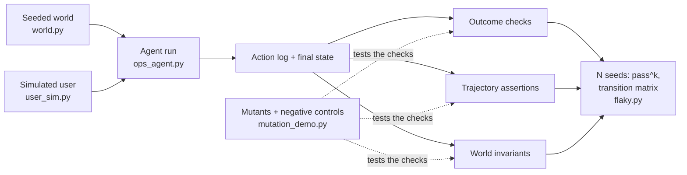

# 01: The race conditions of agents

## The idea
A race condition is a bug whose appearance depends on the order and timing of events you do not control. It hides from example-based tests because the bad interleaving is rare, and when it does show up you often can't reproduce it. You don't find races by writing more examples. You find them by controlling the scheduler and the network (deterministic simulation), by injecting faults on purpose (Jepsen, chaos), by running many seeded schedules, and by checking each resulting history against an invariant rather than an expected output.

Agents have the same class of bug. *Course synthesis:* the "race conditions" of an agentic system are failures that depend on the **path**: which tool results came back in which order, which retry hit a lost ack, which sample the model drew at step 4. They have the same three properties as races:

1. **Rare per run.** The agent is right most of the time, so a handful of example runs passes.
2. **Path-dependent.** The final answer can look correct while the path violated a rule, such as promoting without verification or deleting and recreating a deployment.
3. **Hard to reproduce.** Rerun it and the model samples differently, the sandbox has different load, and the bug is gone.

So you test agents the way you test concurrent systems. Control everything you can (the world, the faults, the user). Measure what you can't control (the model) statistically. Check observable histories (action logs and final state) against invariants.

## Why it matters
Here is a bug that `code/` reproduces. A deploy agent's retry logic generates a new `request_id` on each attempt. With no faults, every test passes. With a 20% ack-loss rate, Hypothesis finds a failing seed and shrinks it to `1`:

```text
deploy  staging  rid=staging-v2.4.0-1  error=timeout waiting for response (outcome unknown)
deploy  staging  rid=staging-v2.4.0-2  ok
get_status staging ...
deploy  prod     rid=prod-v2.4.0-1     ok
violations: duplicate rollout of payments/staging@v2.4.0
            (request ids 'staging-v2.4.0-1' and 'staging-v2.4.0-2')
```

The first deploy was applied, but its response was lost. The agent "retried" under a new idempotency key, so the server treated it as a new intent. You have seen this as a double charge, a duplicate Kafka produce, or a migration that ran twice. The agent's version is identical, except that the code doing the retry is a sampled policy rather than code you wrote.

The research numbers point the same way. τ-bench found that state-of-the-art function-calling agents (GPT-4o) succeeded on fewer than 50% of tasks, and that pass^8 fell below 25% in retail. Most of the gap between "it can" and "it reliably does" is consistency ([Yao et al.](https://arxiv.org/abs/2406.12045)). Anthropic reported a 6-point swing on Terminal-Bench 2.0 from infrastructure configuration alone, which is larger than many leaderboard gaps ([Anthropic, infra noise](https://www.anthropic.com/engineering/infrastructure-noise)). If you don't separate environment noise from agent behavior, you will tune prompts to fix your sandbox.

## How it works: the failure surface
Each failure mode below has a detector. The rest of the module builds them.

| Failure | What it looks like | Distributed-systems cousin | Detector (file) |
|---|---|---|---|
| **Wrong tool** | Calls `delete_deployment` to "unstick" pods; reads logs when it should roll back | Calling the wrong RPC | Forbidden-call assertion; trajectory policy (`check_forbidden`) |
| **Wrong arguments** | Right tool, `env="prod"` instead of `staging`; hallucinated service name | Bad request payload | World-side validation that returns an error the agent can read, plus assertions on args |
| **Loops** | `get_status` x12, never acts; edit-revert-edit on the same file | Livelock | Step budget; repeat detector (`check_step_budget`, the loop rule in `first_failure`) |
| **Premature stop** | "Deployed to prod." after deploying only to staging | Acking before commit | Claim-vs-state check (`check_claim_matches_state`) |
| **State corruption** | Duplicate rollout, replicas left at 0, half-applied migration | Lost update, double apply | World invariants over the action log (`world.violations()`) |
| **Side effects** | Pages someone, deletes and recreates, mutates during a read-only request | Non-idempotent side effect | Negative controls: read-only tasks must produce zero mutations (`codex_trace.py`) |
| **Nondeterminism** | Passes 35 of 40 runs | Flaky test | N runs, pass^k, flakiness verdict (`flaky.py`) |

Two of these rows need extra care.

**Premature stop is the agent version of acking before commit.** The model's final message is a claim, not evidence. Anthropic's evals guide defines the outcome as the environment's final state ("is there a reservation in the DB"), not what the agent said it did ([Anthropic, "Demystifying evals"](https://www.anthropic.com/engineering/demystifying-evals-for-ai-agents)). Every test in this module checks the claim against the world.

**Nondeterminism has two sources, and you must keep them apart.** One is the agent: sampling, plus sensitivity to small context differences. The other is the environment: resource limits, timeouts, flaky dependencies, time of day. The first is a product bug. The second is a harness bug. `flaky.py` makes each trial return one of three statuses (`pass`, `fail`, `infra_error`) for exactly this reason.

### The testing stack


## Worked example: one task, three test designs
The task is "Deploy payments v2.4.0 to prod." The agent has `get_status`, `get_logs`, `deploy`, `rollback`, `scale`, and `delete_deployment`.

**Bad: an example test against the transcript.**
```python
def test_deploy_agent():
    out = agent.run("Deploy payments v2.4.0 to prod.")
    assert "deployed" in out.lower()
```
This fails for the reasons a race-condition test fails. It runs once, in a fault-free world, and it checks the claim instead of the state. The premature-stop bug passes it, because the agent says "Deployed payments v2.4.0 to prod." while prod is still on v2.3.0. So does delete-and-recreate.

**Better: an outcome check against world state.**
```python
def test_deploy_agent():
    world = OpsWorld(seed=0)
    run = run_agent(client, world)
    assert world.snapshot()["payments/prod"] == {"version": "v2.4.0", "healthy": True, "replicas": 3}
```
This catches premature stop. It still misses two bugs that end in the right state: `skip_verify`, which promotes without checking staging, and `delete_prod_first`, which caused an outage in the middle of the run. The repo's `test_outcome_only_grading_misses_trajectory_bugs` asserts exactly this blind spot.

**Good: outcome + trajectory + invariants, across seeds and faults.**
```python
@pytest.mark.parametrize("bug, faults, must_fail", [
    ({"skip_verify": True},       None,                        {"staging_verified_before_prod"}),
    ({"premature_stop": True},    None,                        {"claim_matches_state", "outcome:prod_at_version"}),
    ({"delete_prod_first": True}, None,                        {"no_forbidden_calls", "world_invariants"}),
    ({"new_id_on_retry": True},   FaultPlan(ack_loss_rate=0.5), {"retry_reuses_request_id", "world_invariants"}),
])
def test_negative_controls_each_bug_is_caught_by_its_check(bug, faults, must_fail):
    r, w = run(bug, seed=3, faults=faults)
    assert set(failed(evaluate(r, w, "payments", "v2.4.0"))) == must_fail
```
Each injected bug must trip exactly the checks written for it. Then `test_properties.py` runs the correct agent across 150 seeds and fault plans and asserts that `world.violations()` stays empty. `flaky.py` runs a noisy agent 40 times and reports pass^k. Run them:

```text
$ .venv/bin/python -m pytest -q 13-testing-agentic-systems/code
48 passed
```

## Pitfalls
- **Testing the happy path only.** If your world never injects a fault, the retry and idempotency code paths in the agent's behavior never execute. *Detect:* grep your action logs for any `error` result. If none appear across the suite, your world is too kind.
- **Grading the transcript.** "Done!" is not evidence. *Detect:* for each eval, ask whether it would pass if the agent did nothing and just lied. If so, add a state check.
- **Treating one green run as a pass.** *Detect:* run the same task with 10 seeds before trusting it. If any seed fails, the test is flaky, and flaky means "rare bug", not "noise to ignore".
- **Blaming the model for the sandbox.** *Detect:* tag every failure as `fail` or `infra_error` at the source (timeouts, OOMs, container crashes). If more than a few percent are infra, fix the harness first ([05](05-statistical-testing-under-nondeterminism.md)).

## In your day job
- For each agent you own, write one line per row of the failure-surface table naming the check that catches it. Empty rows are your test backlog.
- Add a claim-vs-state check to every agent eval that ends in a natural-language report.
- Put a fault plan (transient errors plus lost acks) into whatever fake or staging environment your agent tests use, and make it seedable.
- When an agent incident happens, reproduce it as a seed in a simulated world before you touch the prompt, the same way you'd write a failing Jepsen history before fixing a consistency bug.
