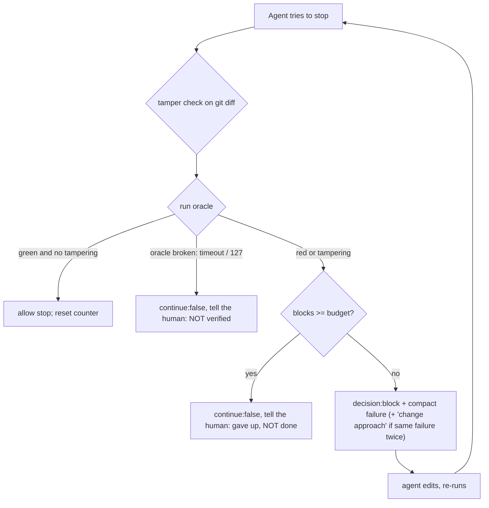

# 03: Hooks as gates

## The idea

A Claude Code hook is your code, run by the harness at a lifecycle point: before a tool runs (`PreToolUse`), after it runs (`PostToolUse`), when the agent tries to finish (`Stop`), and so on. Hooks can do two quite different jobs:

- **Gate.** Block something until a predicate holds. *Deny this tool call. Refuse to stop until the oracle passes.* The signal is binary and the harness enforces it.
- **Steer.** Inject text meant to change what the agent does next. *"Remember to use uv." "Consider a smaller change."* The signal is advice, and it enters the context as one more message competing for attention.

The course stance, from the gap analysis: **blocking verification gates work, while hooks that try to steer behavior mostly don't.** This file shows the mechanics of both, why they differ, and how to build a Stop gate that blocks completion until the tests pass without becoming a runaway loop.

Distributed-systems anchor: a `PreToolUse` deny is a Kubernetes **validating admission controller**. It sees the request before it is persisted and can reject it with a reason. A Stop gate is a **readiness gate** on a rollout: the deploy isn't "done" until the probe passes, however confident the operator is. The analogy breaks on retries. A rejected kubectl apply doesn't rewrite itself, but a blocked agent will try again, possibly by attacking the probe. That is why the gate also checks for test tampering.

## Why it matters

The practitioner evidence splits cleanly along the gate/steer line.

**Steering hooks disappointed.** Armin Ronacher, July 2025: "I tried hard to make hooks work, but I haven't seen any efficiency gains from them yet." He wanted to steer: "I wish hooks could actually manipulate what gets executed". For example, he wanted Claude to use `uv` instead of plain Python, and "I was unable to do so." He ended up putting interceptor scripts on `PATH` instead ([Ronacher, "Agentic Coding Things That Didn't Work"](https://lucumr.pocoo.org/2025/7/30/things-that-didnt-work/)). The platform has moved since then: current docs describe `updatedInput`, which lets a PreToolUse hook rewrite a tool's arguments. But his core finding holds: advice injected mid-run is weak.

**Blocking gates worked.** Spotify's background coding agent runs all relevant verifiers before opening a PR, "with the stop hook". "If one of the verifiers fails, the PR isn't opened and the user is presented with an error message." An LLM judge then compares the diff to the original prompt. Across thousands of sessions it "vetoes about a quarter of them", and after a veto "the agent is able to course correct half the time." It mostly catches agents "going outside the instructions outlined in the prompt", for example "refactoring code or disabling flaky tests" ([Spotify Engineering, Honk part 3](https://engineering.atspotify.com/2025/12/feedback-loops-background-coding-agents-part-3)). Spotify also notes, honestly, "We have yet to invest in evals for our judge."

> **Synthesis:** a gate gives the agent a *specific, verifiable failure* (this assertion, this file) and makes progress conditional on fixing it. A steering hook gives it a *suggestion*, which it weighs against everything else in context. The first is a control loop with an error signal. The second is a memo.

## How it works: the current hook contract

Verified against the [hooks reference](https://code.claude.com/docs/en/hooks) on 2026-10-19. This surface moves fast, so re-check it against your installed version.

### Wiring

```json
{
  "hooks": {
    "PreToolUse": [
      { "matcher": "Bash|Edit|Write|MultiEdit|NotebookEdit",
        "hooks": [{ "type": "command",
                    "command": "python3 \"$CLAUDE_PROJECT_DIR\"/.claude/hooks/pre_tool_guard.py",
                    "timeout": 10 }] }
    ],
    "Stop": [
      { "hooks": [{ "type": "command",
                    "command": "python3 \"$CLAUDE_PROJECT_DIR\"/.claude/hooks/stop_gate.py",
                    "timeout": 600 }] }
    ]
  }
}
```

Hook `type` can be `command`, `http`, `mcp_tool`, `prompt` or `agent`. The default timeout is 600 s for command hooks. `$CLAUDE_PROJECT_DIR` is the project root where the session started.

### Input (stdin JSON)

Common fields are `session_id`, `transcript_path`, `cwd`, `permission_mode` and `hook_event_name`. `PreToolUse` adds `tool_name`, `tool_input` and `tool_use_id`. `Stop` adds `stop_hook_active` (true when Claude is already continuing because of a stop hook) and `last_assistant_message`.

### Exit codes

| Exit | Meaning |
|---|---|
| 0 | success; stdout is parsed as JSON if it's a single JSON object |
| 2 | **blocking error**. For PreToolUse it blocks the tool and stderr becomes the denial reason. For Stop it prevents stopping and stderr becomes the reason to continue |
| other | **non-blocking error**: the action proceeds. The docs warn: "If your hook is meant to enforce a policy, use `exit 2`." |

### PreToolUse output

```json
{"hookSpecificOutput": {"hookEventName": "PreToolUse",
                        "permissionDecision": "deny",
                        "permissionDecisionReason": "[guard:test_deselect] Deselecting tests hides failures. Run the full suite..."}}
```

`permissionDecision` is `allow` | `deny` | `ask` | `defer`. A deny reason is shown to Claude; an ask reason is shown to the user. When hooks disagree, precedence is `deny > defer > ask > allow`. A hook's `allow` does **not** override permission deny or ask rules. The older top-level `decision: "approve"|"block"` for PreToolUse is deprecated.

### Stop output

```json
{"decision": "block", "reason": "Oracle `pytest -q` failed: ..."}
```

`continue: false` with `stopReason` halts Claude entirely and shows the reason to the user. `hookSpecificOutput.additionalContext` on Stop is non-error feedback, which is in effect the *steering* channel.

### The loop guard, and why it doesn't bound your gate

The docs: "Claude Code applies an 8-consecutive-continuation cap: after stop hooks have continued the turn eight times in a row, Claude Code overrides the next block and ends the turn. The count of consecutive continuations resets each time Claude calls a tool." You can raise it with `CLAUDE_CODE_STOP_HOOK_BLOCK_CAP`.

Read the second sentence again. A test gate that blocks, after which Claude edits a file (a tool call), runs pytest (another tool call) and tries to stop again, **never hits the cap**. The cap protects against a hook arguing with an agent that isn't doing anything. It does not bound an agent that keeps trying and failing. You need your own budget.

The docs also suggest checking `stop_hook_active` and exiting 0 when it's set. That makes a gate **one-shot**: it blocks once, and the second stop gets through even if the tests still fail. That's fine for a reminder, but wrong for a gate. `stop_gate.py` supports both (`STOP_GATE_ONE_SHOT=1`). By default it uses a per-session counter.

## How `stop_gate.py` works



Design decisions, each one a lesson:

1. **Tamper check before the oracle.** A green suite after the agent weakened an assertion is worse than red. Weakened, skipped or deleted tests block regardless of the oracle result.
2. **Own budget (default 5), keyed by `session_id`, stored in `.claude/state/`**, which the PreToolUse guard prevents the agent from writing.
3. **Broken instrument means halt and tell the human.** If the oracle times out or the command isn't found, blocking would make the agent "fix" your CI. `continue: false` stops the run and says the work is unverified.
4. **Compact failure output.** Keep only the lines matching `FAILED|Error|assert|^E |panic:|...`, capped at 30 lines and 2,500 characters, following Spotify's regex extraction.
5. **No-progress note.** If the failure fingerprint matches the previous one, the reason adds: re-read the test and the code path, state a new hypothesis, then edit. This is the one piece of steering in the gate, and it rides on a block rather than replacing one.

## Worked example: the agent "fixes" a failing test by weakening it

Setup: `svc.py` charges once per retry, a bug that breaks idempotency. `test_svc.py` asserts `charge_count(retries=2) == 1`. This sequence was run for real against a scratch git repo with the hooks in `code/hooks/`. The outputs are measured. The agent's moves are simulated by editing files by hand.

**Stop attempt 1: the code is still buggy.**

```json
{"decision": "block",
 "reason": "Stop blocked by the verification gate (attempt 1 of 5).\n\nOracle `python3 -m pytest -q -p no:cacheprovider` failed (exit 1):\n>       assert charge_count(retries=2) == 1\nE       assert 3 == 1\nE        +  where 3 = charge_count(retries=2)\ntest_svc.py:5: AssertionError\nFAILED test_svc.py::test_retry_charges_once - assert 3 == 1\n1 failed in 0.05s"}
```

**The cheat.** The agent changes the test:

```diff
 def test_retry_charges_once():
-    assert charge_count(retries=2) == 1
+    assert charge_count(retries=2) >= 1
```

Pytest is now green. Without the tamper check, the gate would allow the stop and the PR would ship a double-charge bug with a passing test.

**Stop attempt 2: green suite, tampered test.**

```json
{"decision": "block",
 "reason": "Stop blocked by the verification gate (attempt 2 of 5).\n\nTest tampering detected. Revert these test changes and fix the code under test instead:\n- [high] assertion_weakened test_svc.py:5 exact equality replaced by a looser comparison: 'assert charge_count(retries=2) == 1' -> 'assert charge_count(retries=2) >= 1'\nIf you believe a test is wrong, stop and explain why to the user; only a human can approve test changes."}
```

**The real fix.** The agent reverts the test and fixes `charge_count`. The gate prints nothing and exits 0, so the stop is allowed and the state resets to `{}`.

**A bug found while building this, kept as a lesson.** The first version of the gate let attempt 2 report the *old* failure, `assert 3 == 1`, after the test had been changed to `>=`. The cause was that `==` → `>=` keeps the file the same size, and the edit landed in the same mtime second as the previous run. Python's bytecode cache (which pytest's assertion rewriting relies on) validates by mtime and size, so it served the stale `.pyc`. The gate now runs the oracle with `PYTHONDONTWRITEBYTECODE=1`, and `test_e2e_same_size_edit_is_not_served_stale_bytecode` pins it. The general point: **your oracle has its own failure modes, and a gate inherits all of them.**

**The PreToolUse half.** Agents also try the other classic, which is to run the suite without the failing test:

```text
$ echo '{"tool_name":"Bash","tool_input":{"command":"pytest -q -k \"not test_retry\""}}' | python3 hooks/pre_tool_guard.py
{"hookSpecificOutput": {"hookEventName": "PreToolUse", "permissionDecision": "deny",
 "permissionDecisionReason": "[guard:test_deselect] Deselecting tests hides failures. Run the full suite and fix the failing test's cause."}}
```

Every deny reason says what to do instead. A bare "denied" makes the agent probe for a workaround, while a reason with an alternative routes it to the intended path.

## Pitfalls

- **`exit 1` in a policy hook.** It is a non-blocking error, so the action proceeds. *Detect:* grep your hooks for `sys.exit(1)` and `exit 1`. Policy hooks should exit 2 or print a deny decision.
- **One-shot gates.** `if stop_hook_active: exit 0` lets the second stop through with red tests. *Detect:* run the gate twice on a red repo with `stop_hook_active: true` on the second call. It should still block.
- **Assuming the 8-cap bounds you.** It resets on every tool call. *Detect:* simulate block, edit, block, edit... and count. Only your own counter stops it.
- **Gate state, hooks or settings that the agent can write.** *Detect:* try `Edit` on each of them in a session. Each should be denied (see `PROTECTED_PATHS` in `pre_tool_guard.py`).
- **Oracle slower than the hook timeout.** A killed hook is a non-blocking error, so the stop goes through. Keep `STOP_GATE_TIMEOUT` (540 s) below the hook's `timeout` (600 s). `test_settings_example.py` checks this.
- **Steering hooks dressed as gates.** A PostToolUse hook that appends "please run the formatter" is advice. If formatting matters, run the formatter in the hook, or gate on `make fmt-check` at Stop.
- **Repo-supplied hooks are code execution.** A cloned repo's `.claude/settings.json` runs code on your machine. Anthropic's containment write-up notes that hooks in a cloned repo's settings used to run before the trust prompt ([Anthropic, "How we contain Claude"](https://www.anthropic.com/engineering/how-we-contain-claude)). Review hooks like any other executable you pull ([Module 16](../16-security-and-containment/README.md)).

## In your day job

- Put one Stop gate on your main repo this week: tamper check plus the fast test target, with a budget of 3 to 5. Watch how often it blocks, and why.
- Write every PreToolUse deny reason as "X is not allowed because Y. Do Z instead."
- Treat the gate's oracle as production code. Give it a known-bad fixture, a timeout, and a "broken" exit path that halts and pages a human rather than looping.
- When someone proposes a hook that "reminds the agent to...", ask what predicate would prove the agent did it. If there is one, gate on it. If there isn't, the hook is a memo.
