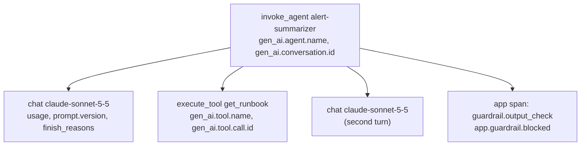

# 01: Tracing for LLM systems

## The idea
A trace of an LLM feature is the usual tree of spans with one addition: the spans carry the **inputs that decided the output**. For an ordinary RPC you log the route, the status and the latency. For a model call you also need the model ID, the prompt version, the sampling parameters, the token usage split by cache status, the stop reason and, when policy allows, the messages themselves. Without them you cannot answer the first question in any LLM incident: *what exactly did the model see, and what did it say?*

The industry has converged on one schema for this: the **OpenTelemetry GenAI semantic conventions**. Spans are named `{operation} {target}` (`chat claude-sonnet-5-5`, `execute_tool get_runbook`, `invoke_agent triage`) and carry `gen_ai.*` attributes. Anthropic's platform now emits these conventions natively for Managed Agents, the Messages API and the SDKs, and exports over any OTLP endpoint ([Anthropic, "Agent observability on the Claude Platform", 2026-10-14](https://claude.com/resources/articles/agent-observability-on-the-claude-platform)). The OpenAI Agents SDK traces agent, generation, function, guardrail and handoff spans by default ([OpenAI Agents SDK tracing docs](https://openai.github.io/openai-agents-python/tracing/)).

The conventions are still at **Development** stability. Attribute names have changed before and will change again. Pin the version you emit and re-check it when you upgrade. Everything below was checked against [github.com/open-telemetry/semantic-conventions-genai](https://github.com/open-telemetry/semantic-conventions-genai) on 2026-10-19. The docs moved there from the main semconv repo, and the old opentelemetry.io page now says it is no longer maintained.

## Why it matters
Anthropic's 2025 postmortem lists, among the reasons debugging took weeks, that "internal privacy and security controls limit how and when engineers can access user interactions" and that each bug "produced different symptoms on different platforms at different rates" ([Anthropic postmortem, 2025-09-17](https://www.anthropic.com/engineering/a-postmortem-of-three-recent-issues)). Both are tracing problems. You need structured, queryable metadata (which model, which server pool, which prompt version) precisely *because* you often cannot read the content. In its research system, Anthropic describes monitoring "agent decision patterns and interaction structures" without reviewing individual conversation contents ([Anthropic, "How we built our multi-agent research system"](https://www.anthropic.com/engineering/multi-agent-research-system)).

The course stance, from [Module 10](../10-evals-fundamentals/README.md), is that you instrument before users arrive. This file covers the production shape of that instrumentation.

## How it works

### The span tree for an agent


### The attributes that matter (verified names)

| Purpose | Attribute | Requirement level | Notes |
|---|---|---|---|
| What operation | `gen_ai.operation.name` | Required | `chat`, `execute_tool`, `invoke_agent`, `invoke_workflow`, `embeddings`, `retrieval`, ... |
| Who served it | `gen_ai.provider.name` | Required | `"anthropic"` for Claude |
| Model asked vs model answered | `gen_ai.request.model`, `gen_ai.response.model` | Cond. required / Recommended | These differ when an alias resolves. Alert when that happens unexpectedly |
| Prompt version | `gen_ai.prompt.name`, `gen_ai.prompt.version` | Cond. required when a named template is used | **Your rollback key.** Without it you cannot slice quality by deploy |
| Session | `gen_ai.conversation.id` | Cond. required | Do *not* invent one from a trace ID or a hash. The spec says so explicitly |
| Usage | `gen_ai.usage.input_tokens`, `gen_ai.usage.output_tokens`, `gen_ai.usage.cache_read.input_tokens`, `gen_ai.usage.cache_write.input_tokens`, `gen_ai.usage.reasoning.output_tokens` | Recommended | See the Anthropic arithmetic below |
| Why it stopped | `gen_ai.response.finish_reasons` | Recommended | A spike in `max_tokens` stops is a truncation incident |
| Effort | `gen_ai.request.reasoning.level` | Recommended | `low` / `medium` / `high`. A silent default change here is a quality incident (see [03-drift](03-drift.md)) |
| Errors | `error.type` | Cond. required on error | Low cardinality: `TimeoutError` or `529`, never the message |
| Content | `gen_ai.input.messages`, `gen_ai.output.messages`, `gen_ai.system_instructions`, `gen_ai.tool.definitions`, `gen_ai.tool.call.arguments`, `gen_ai.tool.call.result` | **Opt-In** | The spec warns these are "likely to contain sensitive information including user/PII data" |

**The Anthropic token arithmetic is a trap.** Anthropic's `input_tokens` field *excludes* cached tokens. The Anthropic-specific convention says `gen_ai.usage.input_tokens = input_tokens + cache_read_input_tokens + cache_write_input_tokens` ([semconv anthropic.md](https://github.com/open-telemetry/semantic-conventions-genai/blob/main/docs/gen-ai/anthropic.md)). If you forward the raw field, a perfectly cached request looks like a 1,500-token prompt when it was really 7,500 tokens. Your cost dashboards will undercount, and so will any "prompt size" drift detector.

### What to capture, hash or drop
Treat this as a data-classification decision, made once per feature and written down.

| Field | Default | Why |
|---|---|---|
| Model, prompt version, params, usage, latency, stop reason, tool names | **Always** | No PII. Needed for every slice |
| Tool call IDs, conversation ID | **Always** | Joins spans to the session log |
| Content hash of system prompt / tool schemas | **Always** | Detects prefix changes (cache incidents) without storing text |
| User messages, model output, tool arguments and results | **Opt-in, redacted, short retention, access-logged** | Needed for error analysis and judges. Also the main PII and secret carrier |
| Secrets, raw auth headers, emails, card numbers | **Never** | Scrub before export. Don't rely on the backend to do it |

Two practical rules:
1. **Redact in your exporter, not in the backend.** Once content leaves the process it is in someone else's retention policy. The OpenAI Agents SDK captures sensitive data by default (`trace_include_sensitive_data`), so redaction has to be a deliberate step in a custom processor.
2. **Separate the content store from the trace store.** Put a content hash and a pointer on the span. Keep the content in a store with tighter access and a shorter TTL. Online evals read from that store; dashboards never need it.

## Worked example
`code/otel_like.py` maps the course `Tracer` spans onto OTel names. Here is the bad version first, which is what most teams ship on day one:

```python
# BAD: free-form attrs, raw provider token count, full content inline, secrets included
with tracer.span("llm", model="sonnet", tokens=resp.usage.input_tokens,
                 prompt=messages, answer=resp.text, user=user_email):
    ...
```

This fails in four ways, each of which you will hit in an incident:
- `model="sonnet"` cannot tell you which snapshot served the request.
- `tokens` excludes cache reads and writes, so cost per request is wrong by a large factor on a well-cached feature.
- There is no prompt version, so you cannot answer "did quality drop after Tuesday's prompt change?".
- `prompt`, `answer` and `user` put PII into a trace store with 30-day retention that the whole org can read.

The good version records the course attributes and exports them through `to_otel`:

```python
from otel_like import TracedClient, to_otel
client = TracedClient(get_client(fake=fake), tracer, prompt_name="kafka-triage", prompt_version="v7")
with tracer.span("agent_run", agent_name="oncall-triage", conversation_id="inc-4821"):
    client.complete([{"role": "user", "content": "Consumer lag on orders-v2 (owner: dana@example.com)?"}],
                    system="You triage Kafka incidents.", max_tokens=300)
```

`python otel_like.py` prints this for the model call. This is real output from the fake client, and the IDs and timestamps change on every run:

```json
{
  "name": "chat claude-sonnet-5-5",
  "kind": "CLIENT",
  "status": {"code": "UNSET"},
  "attributes": {
    "gen_ai.operation.name": "chat",
    "gen_ai.provider.name": "anthropic",
    "gen_ai.usage.input_tokens": 1240,
    "gen_ai.response.finish_reasons": ["end_turn"],
    "gen_ai.request.model": "claude-sonnet-5-5",
    "gen_ai.response.model": "claude-sonnet-5-5",
    "gen_ai.request.max_tokens": 300,
    "gen_ai.prompt.name": "kafka-triage",
    "gen_ai.prompt.version": "v7",
    "gen_ai.usage.output_tokens": 86,
    "gen_ai.usage.cache_read.input_tokens": 0,
    "gen_ai.usage.cache_write.input_tokens": 0,
    "app.system.sha256": "82e35312ff570367",
    "app.messages.sha256": "17b08efad00a2269",
    "app.output.sha256": "336f7b798fb24444"
  }
}
```

The content became hashes because `capture_content=False` is the default, which matches the spec's Opt-In level. With `to_otel(span, capture_content=True)`, the bodies are included after `redact()`, so `dana@example.com` becomes `[REDACTED_EMAIL]` and `sk-ant-...` becomes `[REDACTED_API_KEY]`. The tests in `test_otel_like.py` pin down each of these behaviours, including the `7500 = 1500 + 6000 + 0` token arithmetic.

The `app.system.sha256` hash looks trivial, but it is the attribute that would have caught the incident in [examples.md](examples.md#3-incident-prompt-cache-misses-blew-the-budget). When the number of distinct system-prompt hashes per hour jumps from 1 to 3,600, something is writing a timestamp into your prefix.

## Pitfalls
- **Inventing a conversation ID.** Generating a UUID per request and calling it `gen_ai.conversation.id` breaks every session-level query. *Detect:* the count of distinct conversation IDs equals the request count.
- **High-cardinality `error.type`.** Putting the exception message in it (`"timeout after 30.02s on req_018E..."`) blows up your metrics backend. *Detect:* cardinality of `error.type` above roughly 50.
- **Content in span names.** `chat: summarize alert for dana@...` leaks into every index. Span names should be `{operation} {model}` only.
- **No prompt version on the span.** This is the most common gap and the most expensive one. *Detect:* run `count(distinct gen_ai.prompt.version)` over a week in which you know the prompt changed. If it returns 1, the attribute isn't being set.
- **Sampling traces at the head before evals run.** If the trace pipeline drops 90% of traces at ingestion, your online evals inherit that sample silently. Keep every span's metadata, and sample only content. Or make the eval sampler and the trace sampler share a consistent hash (see [02](02-online-evals-and-feedback.md)).
- **Trusting the backend's semconv version.** Backends lag the spec. Check that your vendor reads `gen_ai.provider.name` rather than an older name, or its "LLM" views will be empty.

## In your day job
- Add `gen_ai.prompt.version` and `gen_ai.response.model` to every LLM span this week. They are the two attributes that turn "quality feels worse" into a query.
- Write a one-page data-classification table for each LLM feature (always, opt-in, never) and get your privacy reviewer to sign it, before an incident forces the question.
- Put redaction in the exporter, and add a unit test that feeds it a fake API key and an email address, as `test_otel_like.py` does.
- If you are on the Claude Platform, turn on the native OTLP export and compare its attributes with what your own instrumentation emits. Keep one source of truth per attribute.
