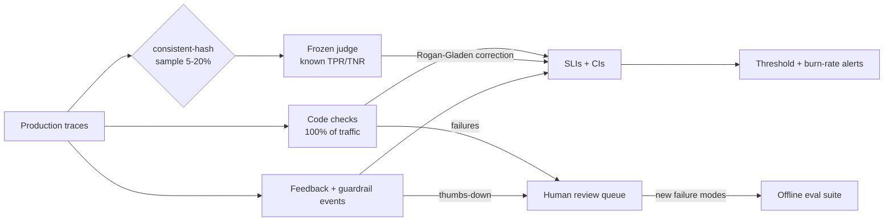

# 02: Online evals, guardrail metrics and feedback signals

## The idea
An **online eval** is your offline eval suite pointed at production traffic. A scheduled job reads recent traces, runs **code checks** on all of them, runs a **calibrated LLM judge** on a sample, and turns the results into **SLIs with confidence intervals**. Alerting rules then read those SLIs.

Alongside the evals you collect three cheaper signals:
- **guardrail metrics**: how often your input and output guards fire
- **explicit feedback**: thumbs up or down, edits, regenerate clicks
- **implicit feedback**: the user's next message says "that's wrong", they abandon the session, or they escalate to a human

None of these signals is the truth. Each one is a noisy, biased detector, and the work is in knowing how each is biased.



## Why it matters
Offline suites only cover the inputs you thought of. Anthropic's postmortem commits to running evals "continuously on true production systems" because its regular evaluations missed a load-balancer bug that only showed up under real traffic ([Anthropic, 2025-09-17](https://www.anthropic.com/engineering/a-postmortem-of-three-recent-issues)). Anthropic's evals guidance describes a "Swiss-cheese" model in which automated evals, production monitoring, A/B tests, user feedback, transcript review and human studies each catch what the others miss ([Anthropic, "Demystifying evals for AI agents"](https://www.anthropic.com/engineering/demystifying-evals-for-ai-agents)). Hamel Husain and Shreya Shankar's evals course teaches the production half as: code checks on all traffic, frozen judges on a sample, and dashboards that show **corrected prevalence** ([Maven, AI Evals for Engineers & PMs](https://maven.com/parlance-labs/evals)).

## How it works

### 1. Code checks on everything
These are deterministic, cost microseconds and have no false positives you didn't write yourself. For a feature that turns an alert into a JSON triage note, the checks in `code/online_eval.py` are:

| Check | Catches | Returns `None` (not applicable) when |
|---|---|---|
| `schema_valid` | Non-JSON, missing keys, out-of-enum severity | never |
| `grounded_service` | The note names a service that isn't in the alert | output did not parse (`schema_valid` already counts that failure) |
| `no_secret_in_output` | `sk-ant-...` or `AKIA...` in the output | never |
| `no_negative_followup` | User's next message matches `wrong`, `useless`, `again` | no follow-up |

The `None` return matters. A check that is not applicable must drop out of the denominator. Otherwise one root cause shows up as failures in three SLIs, or a rare check reports 100% on a denominator padded with irrelevant traces.

### 2. Judges on a consistent-hash sample
Judges cost money and need calibration ([Module 11](../11-llm-as-judge/README.md)). Sample with a **hash of the trace ID**, not `random()`:

```python
def in_sample(trace_id: str, rate: float, salt: str = "judge-v1") -> bool:
    h = int(hashlib.sha256(f"{salt}:{trace_id}".encode()).hexdigest()[:8], 16)
    return h / 0xFFFFFFFF < rate
```

You get the same properties you rely on in consistent tail sampling. Reruns are reproducible. Two independent jobs, such as the judge and the human annotation queue, agree on the sample without coordinating. Changing the salt draws a fresh, independent sample.

**Keep the judge sample uniform.** It is tempting to "always judge the thumbs-down traces". That biases the SLI, because you are oversampling failures. Route those traces to a **human review queue** instead, and keep the SLI sample clean.

### 3. Correct the judge's pass rate
A judge with TPR 0.95 and TNR 0.95 that reports 94.9% pass is not telling you the system passes 94.9%. If θ is the true pass rate:

```
observed = TPR·θ + (1 − TNR)·(1 − θ)
θ        = (observed + TNR − 1) / (TPR + TNR − 1)       # Rogan–Gladen
```

`corrected_pass_rate()` implements this. It raises if `TPR + TNR ≤ 1`, because a judge that is no better than a coin flip cannot be corrected. Apply the same correction to the Wilson interval endpoints, which works because the mapping is monotone. To be fully rigorous you would also propagate the uncertainty in TPR and TNR themselves, usually with a bootstrap over the calibration set. Treat the corrected interval as optimistic.

### 4. Guardrail metrics
Every guardrail (input classifier, PII filter, output schema validator, secret scanner; see [Module 14](../14-steering-and-guardrails/README.md)) emits a span with `blocked: bool`. Track three numbers per guardrail:
- **block rate**: a sudden rise means an input shift or an attack, and a sudden drop means the guard broke
- **false-block rate**: from human review of a sample of blocks. This is the user-visible cost of the guard
- **added latency**: blocking guards sit on the critical path. Parallel guards save latency but may let the expensive call start before the trip fires, a trade-off the OpenAI Agents SDK makes explicit with `run_in_parallel` ([OpenAI Agents SDK guardrails](https://openai.github.io/openai-agents-python/guardrails/))

### 5. Feedback and sentiment
| Signal | Volume | Bias | Use it for |
|---|---|---|---|
| Thumbs down | Low (usually a few % of sessions) | Angry users click. Happy users don't | Trend and review queue, never as an absolute quality number |
| Thumbs up | Lower | Rewards agreeable answers (see the sycophancy lesson in [03](03-drift.md)) | Almost nothing on its own. **Never as a reward or promotion signal alone** |
| Regenerate / edit-before-send | Medium | Cleanest implicit signal for drafting features | Online SLI with a stable baseline |
| Negative follow-up ("that's wrong") | Medium | Regex misses sarcasm. A classifier adds cost | Implicit SLI. Calibrate a small judge if regex recall is poor |
| Escalation to a human | Low | Depends on UI friction | Hard business SLI for support features |

Track feedback **rate per 1,000 sessions, sliced by prompt version and model**. An absolute thumbs-down rate is uninterpretable. A step change that coincides with a deploy is the signal.

### 6. A/B tests
For product-level questions ("does the new summarizer reduce time-to-ack?"), randomize at the **user or session** level, not per request. Per-request randomization leaks across turns, because one conversation can see both arms. Choose the primary metric and the stopping rule in advance. The same non-inferiority framing as canaries applies ([05](05-changes-as-deploys.md)). The sycophancy postmortem is a warning here as well: OpenAI's A/B test "seemed to indicate that the small number of users who tried the model liked it" ([quoted by Simon Willison](https://simonwillison.net/2025/May/2/what-we-missed-with-sycophancy/)). User approval is a metric users can be made to want too much of.

## Worked example
**Bad version.** A nightly job picks 50 random traces and asks a judge "Rate this summary 1–10". It averages the scores and posts "Quality: 8.7" to Slack. Here is why that fails:
- A 1–10 scale has no calibration target, so you cannot measure the judge's TPR or TNR.
- n=50 gives a ±0.1-ish interval on a pass rate that nobody computes.
- `random()` makes the number irreproducible, so you cannot re-judge the same traces after fixing the rubric.
- Nobody alerts on it, so it becomes wallpaper.

**Good version.** Run `python online_eval.py` over 300 synthetic production traces from `prod_fixtures.py`. The traces are generated, and the numbers below are the script's real output:

```text
grounded_service             0.9763 [0.952, 0.988]  n=295
no_negative_followup         0.0000 [0.000, 0.562]  n=3
no_secret_in_output          0.9833 [0.962, 0.993]  n=300
schema_valid                 0.9800 [0.957, 0.991]  n=300
judge_faithful               0.9986 [0.947, 1.000]  n=156  (raw judge pass rate 0.949)
latency_p95_s                2.6485  n=300
cost_per_request_usd         0.0070  n=300
cache_hit_rate               0.9067  n=300
cached_input_share           0.7160  n=300
thumbs_down_rate             0.0333  n=300
guardrail_block_rate         0.0167  n=300
review queue: 24 traces
```

How to read it:
- `grounded_service` has n=295, not 300, because five outputs did not parse and dropped out as `None`.
- `no_negative_followup` is 0/3 with an interval of [0, 0.56]. That is a real signal, since every follow-up was negative, but n=3 is below any sane `min_n`, so `evaluate_thresholds` will not page on it. That is by design.
- The **raw** judge rate is 0.949. Corrected for TPR = TNR = 0.95 it becomes 0.999. The true rate in this sample, which we know because the data is synthetic, is 154/156 = 0.987, and that sits inside the corrected interval [0.947, 1.000]. A dashboard showing the raw 94.9% would have understated quality by about 4 points and sent someone chasing a problem that doesn't exist. The point estimate is still off by a point, so read the interval, not the number.
- `cache_hit_rate` (reads ÷ cache-eligible tokens) is 0.907, while `cached_input_share` (reads ÷ all input) is 0.716. Alert on the first. The second is capped by how much of your prompt is a stable prefix (see [04](04-cost-and-latency-engineering.md)).
- The 24 traces in the review queue are every thumbs-down, guardrail block or failed check. A human reads them this week. New failure modes go into the offline suite ([Module 10](../10-evals-fundamentals/README.md)).

The alert rule config that sits beside the job:

```python
rules = [
    Threshold("schema_valid",   ">=", 0.97, "page"),                     # compares the CI upper bound
    Threshold("cache_hit_rate", ">=", 0.85, "ticket", use_bound=False),
    Threshold("latency_p95_s",  "<=", 3.0,  "ticket", use_bound=False),
]
```

The `schema_valid` rule pages only when even the **upper** confidence bound is below 0.97. In other words, it pages only when the system is confidently bad, not when the point estimate wobbles. For sustained degradation, use the burn-rate alerts in [07](07-slos-for-ai-features.md).

## Pitfalls
- **Judging with the production model.** If the judge shares the generator's blind spots, its errors correlate with the failures it is meant to catch. Use a different model or family, and freeze its version (judge drift is covered in [03](03-drift.md)). *Detect:* re-run the calibration set whenever either model changes.
- **Denominator games.** Leaving "not applicable" in the denominator inflates pass rates. *Detect:* `n` varies across checks for the same window. That is expected, so print it next to every SLI.
- **Alerting on n=12.** Small windows produce false pages and teach on-call to ignore them. Set `min_n` per rule.
- **Using feedback as ground truth.** Thumbs-down rates move with UI changes, user mix and time of day. *Detect:* a feedback shift with no change in code checks or judge scores. Investigate the product surface first.
- **Online evals that never feed back.** If failures found in production don't become offline test cases within a week, you are just watching. Track "review-queue items converted to eval cases".
- **Reading content you aren't allowed to read.** Online judges and review queues read content, so they inherit the opt-in, redaction and retention rules from [01](01-tracing-for-llm-systems.md). Get the policy approved before you build the queue.

## In your day job
- Start with code checks on 100% of traffic. You probably already have four you could write today: schema, groundedness of IDs, secret scan, length.
- Add one judge for the most important subjective failure mode, calibrate it on 100–200 labelled traces, store its TPR and TNR beside its prompt version, and report the corrected rate only.
- Put thumbs-down and negative follow-ups into a review queue that a human empties every week, and count how many items became regression tests.
- Slice every SLI by `gen_ai.prompt.version` and `gen_ai.response.model`. That makes deploy-correlated regressions obvious.
