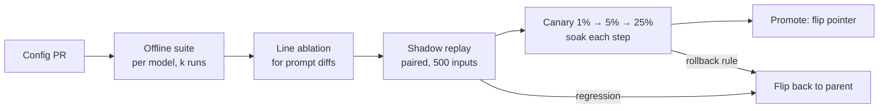

# 05: Prompt and model changes as deploys

## The idea
For an LLM feature, the "code" that decides behaviour includes things your CI never sees: the system prompt, few-shot examples, tool descriptions, the model snapshot, effort and sampling parameters, the retrieval index, the harness and SDK version, and the judge that grades it all. **Each one is a deploy.** Each needs what you would demand for a binary: a version, a pre-merge gate, a staged rollout with a soak period, an automated rollback trigger, and an audit trail.

The practical shape is a **versioned feature config**. Every behaviour-relevant setting lives in one immutable, content-addressed artifact. Production points at a version, a rollout moves traffic between two versions, and a rollback flips the pointer back. You rebuild nothing.

## Why it matters
Anthropic's April 2026 postmortem is about exactly this. One line added to the system prompt, "Keep final responses to ≤100 words unless the task requires more detail", cost about 3% on a broader eval for two models and was only caught by ablations. A default-effort change shipped as a product decision and turned out to be "the wrong tradeoff". The fixes Anthropic committed to read like a deploy policy: per-model eval suites for every system-prompt change, with ongoing ablations; gating model-specific prompt changes to their target model; and **soak periods, a broader eval suite and gradual rollouts** for changes that might trade off intelligence ([Anthropic, 2026-04-23](https://www.anthropic.com/engineering/april-23-postmortem)).

Model changes are deploys even when someone else ships them. If you call an alias, you have handed your deploy schedule to the provider ([03-drift](03-drift.md)).

## How it works

### 1. The versioned config
```yaml
# configs/alert-summarizer/v15.yaml  (immutable; id = content hash)
feature: alert-summarizer
version: v15
parent: v14
model: claude-sonnet-5-5          # pinned, never an alias
effort: low
max_tokens: 600
prompt_file: prompts/alert-summarizer/v15.md      # sha256 recorded at build time
tools: [get_runbook@3]
judge_id: faithful-judge@haiku-5-5/r4             # graded by, frozen
change_note: "Add k8s alert examples; labels.app is the service name"
gates:
  offline_suite: evals/alert-summarizer/regression.jsonl   # must not regress
  non_inferiority_margin: 0.02
  guardrails: {no_secret_in_output: 1.0, cost_per_request_usd_max: 0.009}
```
The serving path reads `current → v14` and `canary → v15 @ 5%` from your flag system and stamps `gen_ai.prompt.version` on every span. Tag every trace with the config version, not just the prompt version, because model and effort are part of the same deploy.

### 2. The gates, cheapest first

1. **Offline suite** ([Module 10](../10-evals-fundamentals/README.md)). The regression suite must not regress and the capability suite should move as intended. Run it k times. A single run is mostly noise ([Module 12](../12-hill-climbing/README.md)).
2. **Ablation for prompt diffs.** If the diff touches several lines, evaluate each line's removal. This is how Anthropic caught the verbosity line.
3. **Shadow replay (paired).** Replay yesterday's sampled production inputs through both configs offline and grade them with the same checks and judge. Because the inputs are identical, compare with **exact McNemar** on the discordant pairs. It needs far fewer samples than a live split.
4. **Live canary.** Route 1%, then 5%, then 25% of sessions (randomize per *session*, not per request) to the new config, and soak at each step for at least one full daily traffic cycle. Compare quality SLIs with a **non-inferiority** rule, and check guardrails (cost, secret leaks, latency) as hard limits.
5. **Promote** by flipping the pointer. Keep the parent warm for a week. Rollback is the same flip.

### 3. The decision rule: non-inferiority
"No statistically significant difference" is the wrong promotion rule. At small n, every regression is "not significant". Instead:
- **ROLLBACK** if the canary is significantly *worse* (one-sided p < α), or a guardrail is breached.
- **PROMOTE** when both arms have at least `min_n` and the **lower confidence bound on (canary − control)** is above `−margin`.
- **CONTINUE** otherwise, which means keep soaking.

Pick the margin *before* starting, in the units the business cares about ("we accept at most a 2-point drop in schema validity"). Then size the canary. `required_n_per_arm(0.95, 0.02)` returns **1,469 sessions per arm** to rule out a 2-point drop at a 95% base rate with α = 0.05 and 80% power. A 1-point margin needs four times as many. If your feature serves 300 sessions a day at 5% canary, you cannot meet that, so use a paired shadow replay for the quality gate and the live canary for cost, latency and guardrails.

**Peeking.** If you check the canary three times during the soak, each look is another chance of a false alarm. `decide(..., looks=3)` splits α across the looks (Bonferroni). That is conservative, but you cannot get it wrong. Sequential tests (alpha-spending, SPRT) are more efficient if you want to invest in them.

## Worked example
**Bad version.** An engineer edits the prompt string in `summarizer.py`, and it ships with Tuesday's service deploy. On Wednesday someone runs 200 traces through the judge, sees 94% against last week's 95%, finds that "not significant", and moves on. On Friday the thumbs-down rate has doubled. There is no `prompt_version` on the spans, so nobody can tell which traces used the new prompt. The rollback reverts six unrelated commits.

**Good version.** v15 goes through the gates. `python canary.py` prints these real results for the inputs shown:

```text
n per arm to rule out a 2-pt drop at 95% pass: 1469

# live canary after 3 days: control 1172/1240 (94.5%), canary 1150/1236 (93.0%), 3 planned looks
Decision(action='CONTINUE', reason='inconclusive: lower bound -0.0354 <= -0.02', ...
         'p_worse': 0.0644, 'alpha_per_look': 0.0167)

# a worse canary: 1102/1236 (89.2%)
Decision(action='ROLLBACK', reason='canary significantly worse (p=0.0000 < 0.0167)', ...)

# paired shadow replay, 500 identical inputs: 19 regressions, 6 fixes
Decision(action='ROLLBACK', reason='19 regressions vs 6 fixes on the same inputs (p=0.0073)', ...)
```

Read the first case carefully. The canary is 1.5 points lower, p = 0.064, which is "not significant". The naive rule would promote it. The non-inferiority rule says the data cannot rule out a 3.5-point drop, so it keeps soaking. The third case shows why pairing matters: the same 2.6-point marginal difference is decisive when you can see *which* inputs flipped. `test_canary.py::test_paired_detects_what_unpaired_misses` builds a case (14 regressions against 3 fixes) where the paired test rolls back and the unpaired test on the same marginals cannot tell.

The rollback itself is one command, because the config is a pointer:

```bash
flagctl set alert-summarizer.current v14 && flagctl set alert-summarizer.canary none
```

## Pitfalls
- **Prompts in code.** If the prompt ships with the binary, a prompt rollback is a code rollback. *Detect:* `git log -S "You are"` across service repos.
- **Aliases in config.** `model: claude-sonnet-latest` means the provider controls your deploys. Pin snapshots. Treat an upgrade as a config PR with the full gate.
- **Per-request randomization.** A conversation that flips between configs mid-session contaminates both arms and can break prompt-cache prefixes. Randomize on session or user ID with a consistent hash.
- **Ungated "model-specific" prompt tweaks.** A line tuned for one model can hurt another. Anthropic now gates model-specific changes to their target model. *Detect:* a config that changes both `model` and `prompt_file` in one version. Split it into two deploys.
- **Soak shorter than one traffic cycle.** Input mix varies by hour and weekday. A 2-hour canary at 3 a.m. samples a different population.
- **Promoting on "not significant".** Use the non-inferiority bound. Print it in the deploy log.
- **Forgetting the judge is a deploy too.** Changing the judge mid-canary changes the measurement, not the system. Freeze `judge_id` for the duration.

## In your day job
- Move every prompt into a versioned config file with a pinned model, and stamp the version on every span. This is the change with the best return in the module.
- Write the deploy policy down: which gates run for a prompt change, a model change, a judge change. Copy Anthropic's list (per-model evals, ablations, gating, soak, gradual rollout) as a starting point.
- Choose a non-inferiority margin for your main quality SLI with your product owner. Compute the canary size it implies and decide whether you need a paired shadow replay instead.
- Practice the rollback. Time it. If it takes more than one command or more than five minutes, fix that before the next change ships.
