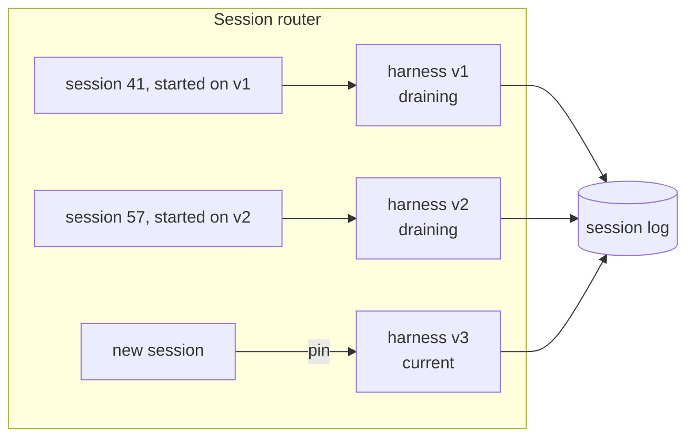

# 06: Durable agent infrastructure

## The idea
A production agent run is a **long-lived, stateful job**. It runs for minutes to hours, makes dozens of tool calls with side effects, and has to survive what any long-lived job has to survive: process crashes, node drains, deploys, and dependency failures. The design that works treats it like one, with three parts virtualized separately:

| Part | What it is | Durability |
|---|---|---|
| **Session** | An append-only event log of everything that happened: user turns, model outputs, tool calls, tool results | Durable. The source of truth |
| **Harness** | The loop that reads the log, calls the model, routes tool calls and appends events | **Stateless.** Any instance can resume any session |
| **Sandbox** | Where code runs and files change | **Disposable** ("cattle"). Re-provisioned on failure |

That is the architecture Anthropic describes for Managed Agents ([Anthropic, "Scaling Managed Agents: Decoupling the brain from the hands", 2026-04-08](https://www.anthropic.com/engineering/managed-agents)). It is event sourcing plus stateless workers plus immutable infrastructure, all of which you already know.

## Why it matters
Anthropic's first Managed Agents design ran session, harness and sandbox in one container, which made the server a "pet". When a container failed the session was lost, and unresponsive containers had to be nursed back to health. After decoupling, "the container became cattle": a sandbox failure surfaces to Claude as a tool-call error, and a fresh container is provisioned. Provisioning containers only when they were needed also cut time-to-first-token by roughly 60% at p50 and over 90% at p95 (same source).

The multi-agent research system makes the same point from the failure side. Agents run for long periods, "maintaining state across many tool calls", and "minor system failures can be catastrophic for agents". So Anthropic built systems that "resume from where the agent was when the errors occurred" rather than restarting, and used **rainbow deployments** "to avoid disrupting running agents, by gradually shifting traffic from old to new versions" ([Anthropic, "How we built our multi-agent research system"](https://www.anthropic.com/engineering/multi-agent-research-system)).

## How it works

### The interfaces
Managed Agents names a small set of primitives:
- `execute(name, input) → string`: a uniform interface for every "hand" (sandbox, custom tool, MCP server)
- `provision({resources})`: start a fresh container from a standard recipe
- `emitEvent(id, event)`: the harness writes durable records to the session
- `getSession(id)`, and `getEvents()` for positional slices of the event stream
- `wake(sessionId)`: start a new harness that loads the log and resumes from the last event

Because the log lives outside the harness, a harness crash loses nothing. Because the log is queryable, compaction does not have to make irreversible choices about what to forget: the full history is still there to re-read ([Module 03](../03-context-engineering/README.md) covers the context side of this).

### Write-ahead ordering and idempotent side effects
Resuming from a log means replaying. Replay means **at-least-once** execution of anything that was in flight when the crash happened. You already know the fix:

1. **Append `tool_call_started{call_id, idempotency_key}` before executing.**
2. Execute with the idempotency key passed to the downstream system (payment API, ticketing system, `git push` to a deterministic branch).
3. **Append `tool_call_finished{call_id, result}`.**
4. On `wake`, a call that has `started` but not `finished` is re-executed *with the same key*. A downstream system that honours the key makes the retry safe. For tools that cannot be made idempotent (sending an email, posting to Slack), check whether the effect already happened before redoing it. Anthropic gives the same advice for scheduled agents: check whether today's post already exists before posting it ([Anthropic, "Building effective agent automations"](https://claude.dev/blog/building-effective-agent-automations/)).

### Sandboxes as cattle
- Treat sandbox death as a normal tool error that the model can see and retry. Don't treat it as a session failure.
- Keep **credentials out of the sandbox**. In Managed Agents, the Git token is used at sandbox setup to clone and configure the remote, so the agent pushes and pulls without ever handling it. MCP OAuth tokens sit in a vault behind a proxy, and the harness never sees them. Prompt-injected code in a sandbox therefore has nothing to steal ([Module 16](../16-security-and-containment/README.md)).
- Rebuild the sandbox's state from the session log and the repository, never from the sandbox itself.

### Rainbow deploys
A blue/green cutover kills every in-flight run on blue. A rainbow deploy keeps **several harness versions live at once**, pins each session to the version it started on, sends new sessions to the newest version, and retires an old version when its last session finishes or hits a maximum age:



Two rules make this safe:
- **Log schema compatibility.** Any harness version must be able to *read* every event version still in flight. Version the event schema and only make additive changes, the same discipline as Kafka topic schemas.
- **Bounded drain.** Choose a maximum session age (say 24 hours). After it, a session is checkpointed and woken on the current version, accepting a one-time behaviour change at a turn boundary.

### What to observe
On top of the per-call spans from [01](01-tracing-for-llm-systems.md), track session-level metrics:
- `sessions_resumed / sessions_total` and `resume_success_rate`
- `tool_calls_replayed` (started but not finished at the time of a crash). Each one is a potential duplicate side effect, so audit them
- `sandbox_reprovisions per session`
- the version histogram of live sessions, to see how drained the old harnesses are
- time from a harness crash to the next event on that session (time-to-recover)

## Worked example
**Situation.** An incident-remediation agent investigates an alert, opens a Jira ticket, runs diagnostics in a sandbox, and opens a PR. Runs take 10–40 minutes. The harness is a Python process in a Kubernetes Deployment.

**Bad version.**
```python
# loop state lives in process memory; sandbox is a sidecar in the same pod
messages = [user_turn]
while True:
    resp = client.complete(messages, tools=TOOLS)
    for call in resp.tool_calls:
        result = TOOLS_IMPL[call.name](**call.input)      # create_ticket(), run_in_sandbox(), open_pr()
        messages.append(tool_result(call.id, result))
```
A routine deploy rolls the Deployment. Every in-flight run dies. On-call restarts them from scratch, and the restarted runs create a **second Jira ticket and a second PR** for 14 alerts. Nobody can say which runs were mid-`open_pr`, because the only record was in memory.

**Good version.** Session events are appended to a durable log (Postgres, a Kafka topic, or the Managed Agents session store). Here is an excerpt of one session, with illustrative content:

```jsonl
{"seq":17,"type":"model_output","harness":"v2","tool_calls":[{"id":"toolu_9","name":"create_ticket","input":{"summary":"ledger lag"}}]}
{"seq":18,"type":"tool_call_started","call_id":"toolu_9","idempotency_key":"sess-41:toolu_9"}
{"seq":19,"type":"tool_call_finished","call_id":"toolu_9","result":"OPS-8812"}
{"seq":20,"type":"model_output","harness":"v2","tool_calls":[{"id":"toolu_10","name":"open_pr","input":{"branch":"agent/sess-41"}}]}
{"seq":21,"type":"tool_call_started","call_id":"toolu_10","idempotency_key":"sess-41:toolu_10"}
```

The pod dies after event 21. `wake("sess-41")` on any v2 replica loads the log and sees `toolu_10` started but not finished. It re-executes `open_pr` with the same key. The PR tool is idempotent on branch name (`agent/sess-41`), so it returns the existing PR, the harness appends event 22, and the loop continues. Because the deploy was rainbow, session 41 stayed on v2 while new sessions went to v3, and nothing was cut off mid-run.

Sketch of the resume logic:
```python
def wake(session_id: str) -> None:
    events = log.get_events(session_id)
    in_flight = started_not_finished(events)            # at most one per call_id
    for call in in_flight:
        result = execute(call.name, call.input, idempotency_key=call.key)
        log.emit(session_id, {"type": "tool_call_finished", "call_id": call.id, "result": result})
    run_loop(session_id, messages=rebuild_messages(log.get_events(session_id)))
```

## Pitfalls
- **Non-idempotent tools behind a replaying harness.** *Detect:* audit `tool_calls_replayed` against downstream duplicates (two tickets with the same summary within a minute).
- **Credentials in the sandbox "just for now".** Any prompt injection that reaches code execution can read them. *Detect:* `env | grep -i token` inside a sandbox should return nothing.
- **Log schema breaking changes.** A v3 harness that cannot parse v2 events turns a rainbow deploy into an outage. Use contract tests that replay real v(n−1) logs through the v(n) parser.
- **Resuming into a changed prompt.** If a woken session silently switches prompt or model, its later turns may contradict its earlier ones, and the prefix cache is gone. Pin the config version in the session's first event.
- **Rebuilding context from the sandbox.** Files in a sandbox are a cache, not the record. If a fresh sandbox cannot be rebuilt from repo plus log, you have a pet again.
- **No maximum age.** Old harness versions linger for weeks because one session never ends. Enforce a drain deadline.

## In your day job
- Write down where each agent's loop state lives today. If the answer is "in the process", schedule the session-log work before the next feature.
- Give every side-effecting tool an idempotency key derived from `session_id:tool_call_id`, and test the resume path by killing the harness mid-call in CI.
- Pin each session to its harness and config version, and deploy harness changes as rainbows with a drain deadline.
- Compare with what your framework already gives you. LangGraph checkpointers, for example, implement much of this ([Module 09](../09-frameworks-langchain-langgraph/README.md)). Then decide whether to buy or build ([Module 06](../06-agent-architectures/README.md)).
