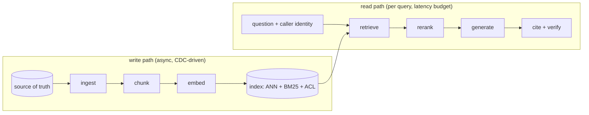

# 01: The RAG pipeline as a system

## The idea

Retrieval-augmented generation is a read path over a derived index. A document is written to a source of truth (a git repo, Confluence, a postmortem tool). A pipeline chunks it, embeds it and indexes it. At query time, the system retrieves candidates, reranks them, puts the best few in the prompt, and asks a model to answer with citations. Eight stages, two of them online:



[Module 03, file 06](../03-context-engineering/06-retrieval-agentic-search-vs-rag.md) covered the choice between agentic search and vector RAG, the Contextual Retrieval numbers, and a tiered eval. This module assumes you've read it. Here we treat RAG the way you'd treat any read-heavy system with a derived store: what each stage owns, how it fails, how you observe it, and when you shouldn't build it.

Jason Liu's framing is the right lens for failures. RAG has three objects, the **Q**uestion, the retrieved **C**ontext and the **A**nswer, and every failure is one of their conditional relationships breaking: context relevance (C|Q), faithfulness (A|C), answer relevance (A|Q), and three subtler ones ([Liu, "There are only 6 RAG evals"](https://jxnl.co/writing/2025/05/19/there-are-only-6-rag-evals/)). His diagnostic shortcut: "Answer seems wrong? Check faithfulness (A|C)."

## Why it matters

The demo version of RAG is three lines: embed the question, take the nearest chunks, stuff the prompt. Liu called that pattern "demoware" back in 2023. It assumes the query embedding and the answer's embedding are close, and that one search backend is enough. Both assumptions fail on real questions such as "what did we fix last week" ([Liu, "RAG is more than just embedding search"](https://python.useinstructor.com/blog/2023/09/17/rag-is-more-than-just-embedding-search/)).

This module's running example makes the cost concrete. The corpus is 48 synthetic docs (runbooks, ADRs, postmortems, guides) for an engineering org, with per-team ACLs and 44 labeled questions. When the extractive stand-in generator answers with a loose abstention threshold, it passes the deterministic grounding check on every answer it gives. It still answers 2 of the 6 questions it should refuse:

```text
q33 (platform): how did private signing key material end up in logs
  -> "Signing key rotation must keep the old public key in JWKS until all tokens
      signed with it expire. [adr-024-token-format#consequences]"
```

The citation is real and the sentence is in the cited chunk, so faithfulness (A|C) passes. Answer relevance (A|Q) fails. The answer actually lives in a restricted postmortem that the platform team can't see. "Grounded" is necessary, and it isn't sufficient. Every stage needs its own check.

## How it works

### Stage by stage: what it owns, how it fails, what to log

| Stage | Owns | Typical failure | Symptom (Q/C/A) | What to log per request |
|---|---|---|---|---|
| Ingest | Freshness, deletes, ACL propagation | Stale doc, deleted doc still served, ACL change not applied | Wrong C; leaked C | source version, indexed version, lag |
| Chunk | The unit of retrieval | Answer split across chunks; chunk lost its context | C\|Q low even with the right doc | chunker version, chunk ids |
| Embed | The similarity function | Domain vocabulary mismatch; mixed model versions | C\|Q low on paraphrases | embedding model id |
| Index | Recall vs latency vs memory | ANN misses; filter starves results | C\|Q low only on filtered queries | ef/probes, filter selectivity, result count |
| Retrieve | Candidate generation | Lexical miss (identifiers) or semantic miss (synonyms) | C\|Q | per-retriever ranks |
| Rerank | Precision at the top | Reranker timeout, fail-closed to nothing | C\|Q at k=5 but fine at k=50 | rerank latency, fallbacks |
| Generate | Synthesis from C | Hallucinated detail, ignored context, answered the unanswerable | A\|C, A\|Q | prompt hash, model, tokens |
| Cite + verify | Checkability | Citation to an unseen chunk; claim not in cited chunk | A\|C | citation precision, grounding verdict |

Two things from the table are worth internalising:

1. **Most "the model is wrong" bugs are retrieval bugs.** Diagnose in pipeline order: was the answer-bearing chunk in the index, was it in the top 50, was it in the top 5, did the model use it? That's four counters, and [07](07-evaluating-and-hill-climbing-rag.md) shows how to compute each one.
2. **The write path has distributed-systems failure modes** (stale reads, resurrection after delete, permission propagation lag), and they show up as answer-quality bugs. [06](06-ingestion-freshness-and-correctness.md) is about this.

### Latency budget

A typical interactive budget, *course synthesis* (your numbers will vary, so measure them):

| Step | Budget | Notes |
|---|---|---|
| Query rewrite (optional LLM call) | 200 to 800 ms | Skip for identifier-heavy queries |
| BM25 + ANN in parallel | 10 to 50 ms | ANN cost grows with ef_search; filters add work |
| Rerank top 50 to 150 | 50 to 300 ms | Cross-encoders score in parallel; Anthropic notes reranking "inevitably adds a small amount of latency" |
| Generate | 1 to 10 s | Dominates; stream it |

Generation dominates, so spend retrieval budget freely (more candidates, a reranker) before you trim it.

### When not to build RAG

RAG is an index. An index is a cache of a query plan, and like every cache it costs you invalidation. Before you build one, rule out these alternatives:

- **The whole corpus fits in context.** Anthropic's guidance is that a knowledge base under 200,000 tokens (about 500 pages) can go straight into the prompt. Prompt caching cuts latency by more than 2x and cost by up to 90% for that approach ([Anthropic, "Introducing Contextual Retrieval"](https://www.anthropic.com/engineering/contextual-retrieval)). Put long documents at the top of the prompt and the question at the end. Anthropic reports queries at the end "can improve response quality by up to 30 percent in tests, especially with complex, multidocument inputs" ([Anthropic, prompting best practices, long-context section](https://platform.claude.com/docs/en/build-with-claude/prompt-engineering/claude-prompting-best-practices)).
- **But "fits" isn't "works".** Chroma tested 18 models and found that "model performance varies significantly as input length changes, even on simple tasks". "Even a single distractor reduces performance relative to the baseline." On LongMemEval, focused prompts of about 300 tokens beat full prompts of about 113k tokens across all models ([Chroma, "Context Rot", 2025-07-14](https://www.trychroma.com/research/context-rot)). So long context is a hypothesis to test against RAG on your eval, not a free win.
- **The corpus is code, or changes hourly.** Use agentic search (grep, glob, read) with no index to keep fresh. That's the course stance from [Module 03](../03-context-engineering/06-retrieval-agentic-search-vs-rag.md). Anthropic notes the trade-off plainly: "runtime exploration is slower than retrieving pre-computed data" ([Anthropic, "Effective context engineering"](https://www.anthropic.com/engineering/effective-context-engineering-for-ai-agents)).
- **The question is structured.** "How many SEV1s did payments have in Q2" is SQL over the incident tracker, not a similarity search. Route it ([05](05-query-side-techniques-and-agentic-rag.md)).

| Corpus | Size | Change rate | Default |
|---|---|---|---|
| Team runbooks | < 200k tokens | weekly | Long context + caching; measure against RAG |
| Org-wide docs + postmortems | 1M to 100M tokens | daily | Hybrid RAG with ACLs (this module) |
| Code repo | any | hourly | Agentic search |
| Tickets / incidents with fields | any | continuous | Structured query + RAG over text fields |

## Worked example: one question through every stage

The code in [code/](code/README.md) implements each stage as a swappable part (`chunking.py`, `embed.py`, `hnsw_lite.py`, `hybrid.py`, `rag_pipeline.py`). Here's q14 run as two different teams. It's the same question, and the answer should differ by permission.

**Bad version.** A single global index with no ACLs, and a prompt of "answer the question using these docs." The payments engineer asks how long the old signing key stays in JWKS and gets the restricted identity runbook's "24 hours". The answer is correct, and it's also a data leak. Nothing in the answer reveals that it came from a doc the asker can't open.

**Good version.** The ACL is a filter inside retrieval, the generator sees only permitted chunks, and every sentence cites a chunk id. Real output:

```text
$ PYTHONPATH=shared .venv/bin/python 18-rag-systems/code/rag_pipeline.py \
    "how long do we keep the old signing key in JWKS after promoting a new one" --team payments
retrieved: ['adr-024-token-format#consequences', 'pm-2025-031-double-charge#summary', ...]
answer: Signing key rotation must keep the old public key in JWKS until all tokens signed
        with it expire. [adr-024-token-format#consequences]

$ ... --team identity
retrieved: ['rb-signing-key-rotation#procedure', 'adr-024-token-format#consequences', ...]
answer: Signing key rotation must keep the old public key in JWKS until all tokens signed
        with it expire. [adr-024-token-format#consequences]
```

Read the second run carefully. For the identity engineer, the restricted runbook ranked first, yet the extractive generator still picked the vaguer public sentence. Retrieval did its job and generation chose badly. That's why q13 is scored "wrong" in the eval, and why you score retrieval and generation separately. If you only had an end-to-end score, you'd go and tune the retriever, and that's the one stage that worked.

The prompt itself follows the long-context guidance: documents first, each in `<document id=...>` with a `<source>`, and the question last.

```text
<documents>
<document id="adr-024-token-format#consequences">
<source>ADR-024: Short-lived access tokens (adr, owner identity) > Consequences</source>
<document_content>
Signing key rotation must keep the old public key in JWKS until all tokens signed with it expire.
</document_content>
</document>
...
</documents>

<question>how long do we keep the old signing key in JWKS after promoting a new one</question>
```

## Pitfalls

- **Tuning the generator for a retrieval miss.** Detect it: log whether any answer-bearing chunk was in the top k. If it wasn't, no prompt will help.
- **One end-to-end score.** Detect it: you can't say which stage regressed after a change. Keep per-stage metrics ([07](07-evaluating-and-hill-climbing-rag.md)).
- **Building RAG for a corpus that fits in context.** Detect it: corpus token count under ~200k and nobody has run the long-context baseline. Run it first.
- **Treating "grounded" as "correct".** Detect it: answers that cite real chunks but don't address the question (the q33 pattern). Add an answer-relevance check.
- **No identity on the read path.** Detect it: your retrieval function signature has no caller parameter. Every query must carry verified identity ([06](06-ingestion-freshness-and-correctness.md)).

## In your day job

- Draw your RAG system as the eight-stage diagram above and write, for each stage, the one metric you'd look at first in an incident.
- Before approving a new RAG project, ask for the token count of the corpus and the result of a long-context-plus-caching baseline on 30 labeled questions.
- Add `retrieved_ids`, `embedding_model_id`, `index_version` and `caller_teams` to every RAG trace span ([Module 15](../15-observability-and-production/README.md)).
- When an answer is wrong, walk the pipeline in order: indexed? top 50? top 5? used?
