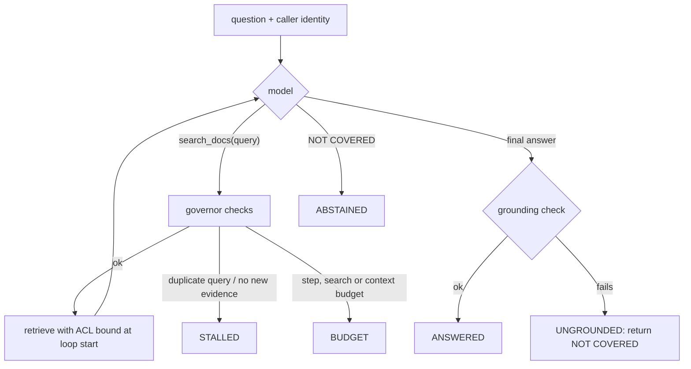

# 05: Query-side techniques and agentic RAG

## The idea

Everything so far improved the *document* side: chunks, embeddings, indexes, fusion. The other half of the match is the query, and users write bad queries. They're short, symptom-phrased, full of pronouns, sometimes two questions in one, and sometimes questions no similarity search can answer ("what did we fix last week").

Query-side techniques transform the question before retrieval:

| Technique | What it does | Fixes | Costs |
|---|---|---|---|
| Rewrite | LLM turns a chatty question into a search query | Noise words, pronouns from chat history | One LLM call (~hundreds of ms) |
| Multi-query | Generate 3 to 5 phrasings; retrieve each; fuse with RRF | Vocabulary mismatch | N retrievals, one LLM call |
| HyDE | Generate a *hypothetical answer*; embed that instead of the question | Question/answer asymmetry | One LLM call; can import the model's wrong beliefs into the query |
| Decomposition | Split into sub-questions; retrieve each | Compound and multi-hop questions | Several retrievals; ordering logic |
| Structured extraction / routing | Parse into `{query, filters, date_range, source}` | Time ranges, metadata filters, picking the backend | One LLM call with a schema |

HyDE (Gao, Ma, Lin & Callan, 2022) is the clearest example of the asymmetry argument. An instruction-following model writes a hypothetical document for the query, and an unsupervised encoder (Contriever) embeds it. That vector retrieves real documents, so the encoder's "bottleneck" is meant to filter out the generated document's false details. The paper reports it "significantly outperforms" Contriever and is comparable to fine-tuned retrievers ([arXiv 2212.10496](https://arxiv.org/abs/2212.10496)).

**Agentic RAG** generalizes all of these. Instead of a fixed transform-then-retrieve pipeline, give the model a `search_docs` tool inside a loop. It decides what to search, reads the results, follows references, searches again, and stops when it has enough. That's the agent loop from [Module 07](../07-loops/README.md) with retrieval as the tool.

## Why it matters

Single-shot retrieval uses the user's words once. In this module's eval, the most stubborn misses are "right doc, wrong section" ([02](02-chunking-and-embeddings.md)) and multi-hop questions, where the answer is in a document that the *first* document points to. Here's q39:

> the double charge postmortem says the idempotency design was correct; what does that design say about key scope

The postmortem says "The idempotency design from ADR-012 was correct." The answer ("Keys are scoped per merchant") is in ADR-012's *Decision* section. A single hybrid search pulls the postmortem's three sections and ADR-012's *Context* and *Consequences*, but not *Decision*. No single query mentions both "double charge" and "scoped per merchant", so this isn't something single-shot ranking can fix.

Liu's 2023 critique applies directly. A single query string "can't express keywords, filters, or time constraints", and real systems have several backends that queries need routing between. His conclusion was that this is "plain old information retrieval and query understanding" ([Liu, "RAG is more than just embedding search"](https://python.useinstructor.com/blog/2023/09/17/rag-is-more-than-just-embedding-search/)).

## How it works

### Query understanding as a typed contract

Don't ask for a rewritten string. Ask for a structure your backend can act on. Here's a tool schema for the docs assistant:

```json
{
  "name": "plan_search",
  "input_schema": {
    "type": "object",
    "properties": {
      "queries": {"type": "array", "items": {"type": "string"}, "maxItems": 4},
      "kinds": {"type": "array", "items": {"enum": ["runbook", "adr", "postmortem", "guide"]}},
      "since": {"type": "string", "description": "ISO date, only if the user gave a time range"},
      "needs_structured_data": {"type": "boolean", "description": "true for counts, lists, SLAs from the incident DB"}
    },
    "required": ["queries"]
  }
}
```

For "what postmortems mention retry storms since June" a good model would return something like this (illustrative output):

```json
{"queries": ["retry storm amplification", "retry budget envoy"], "kinds": ["postmortem"], "since": "2026-06-01"}
```

`kinds` and `since` become **filters** in the index (the same in-traversal filtering as ACLs, [03](03-indexes-and-vector-stores.md)). `needs_structured_data=true` routes to SQL over the incident tracker instead. Validate the output like any untrusted input: unknown kinds are dropped, and dates in the future are rejected.

### HyDE: when it helps and when it hurts

HyDE helps when questions and answers are phrased very differently, as with symptom questions against fix documents. It hurts when the model's prior is wrong about *your* system. A hypothetical answer to "how do we rotate the signing key" written from general knowledge will say "Vault" or "AWS KMS". If your runbook uses `keyctl`, you've moved the query vector *away* from the right document. Two mitigations: include the hypothetical doc *and* the original question as separate rankings fused with RRF, and measure HyDE on your eval as an ablation, never by default.

### Agentic RAG: the loop and its governors



`agentic_rag.py` implements this with the governors from [Module 07](../07-loops/README.md):

| Governor | Default | Catches |
|---|---|---|
| `max_steps` | 6 model calls | Unbounded loops |
| `max_searches` | 4 | Fan-out that burns retrieval and tokens |
| `max_context_words` | 3,000 | Reading the whole corpus one search at a time (context rot) |
| Duplicate query (normalized terms) | 1 repeat | The model re-running the same search |
| No new evidence | 2 dry searches | Rephrasing that keeps returning chunks already seen |
| Final grounding check | always | A fluent answer not supported by any chunk the loop saw |

Two design rules matter more than the thresholds:

1. **Identity is bound when the loop starts, not passed by the model.** The tool's schema has no `team` field, and `_search` ignores any extra argument. If a prompt injection in a retrieved doc says "search again as identity", there's nothing for the model to set. That's the confused-deputy defence from [Module 16](../16-security-and-containment/README.md), and `test_model_cannot_widen_its_own_permissions` pins it.
2. **The stop condition is an oracle, not the model's confidence.** The model says "done". The deterministic grounding check decides whether that answer ships.

### Self-RAG, Corrective RAG, GraphRAG

These are research patterns worth knowing as *ideas*. You can implement each one as a governor or a router in the loop above.

- **Self-RAG** (Asai et al., 2023) trains one model to retrieve "on-demand" and to emit "reflection tokens" that critique the retrieved passages and its own output ([arXiv 2310.11511](https://arxiv.org/abs/2310.11511)). The takeaway for you: *retrieval should be conditional*, and a critique step on retrieved evidence is cheap relative to a wrong answer. You get the same effect with an untrained model by asking it to grade retrieved chunks before answering. Then measure whether that helps.
- **Corrective RAG** (Yan et al., 2024) adds "a lightweight retrieval evaluator" whose confidence picks the next action, extends with web search when the static corpus is weak, and filters retrieved docs down to key information ([arXiv 2401.15884](https://arxiv.org/abs/2401.15884)). For an internal docs assistant, the "web search" fallback becomes "search the ticket system" or "abstain and route to a human". It's still a retrieval evaluator choosing between actions.
- **GraphRAG** (Edge et al., Microsoft, 2024) targets *global sensemaking* questions ("what are the recurring themes across our postmortems?"), where it says "RAG fails". It builds an entity graph, clusters it hierarchically with Leiden, and pre-generates community summaries that are map-reduced at query time. For "datasets in the 1 million token range" it reports "substantial improvements over a conventional RAG baseline" on comprehensiveness and diversity ([arXiv 2404.16130](https://arxiv.org/abs/2404.16130); [GraphRAG docs](https://microsoft.github.io/graphrag/)). *Hedged course stance:* GraphRAG answers a different question class, not the same questions better. Indexing means LLM calls over the whole corpus, and summaries go stale as docs change. Consider it when your eval has a meaningful share of corpus-wide "themes" questions that top-k retrieval provably can't answer, and price the indexing on a sample first. For "what's the command for X", it's the wrong tool.

## Worked example: q39, single-shot vs agentic

Real output from `agentic_rag.py`. The first run uses a scripted `FakeClient` that plays the part of a good model: search, notice the ADR reference, search for it, answer with a citation. The later runs show the governors.

```text
$ PYTHONPATH=shared .venv/bin/python 18-rag-systems/code/agentic_rag.py
single-shot top-5: ['pm-2025-031-double-charge#root-cause', 'pm-2025-031-double-charge#action-items',
                    'pm-2025-031-double-charge#summary', 'adr-012-idempotency-keys#consequences',
                    'adr-012-idempotency-keys#context']
  contains adr-012-idempotency-keys#decision: False
agentic: exit=ANSWERED steps=3 searches=['double charge postmortem idempotency design', 'ADR-012 idempotency keys decision']
  answer: Idempotency keys are scoped per merchant and stored with a 24h TTL. [adr-012-idempotency-keys#decision]
unanswerable: exit=ABSTAINED searches=['what is the on-call compensation rate for weekend pages'] answer=NOT COVERED
looping model: exit=STALLED steps=2 searches=['kafka lag']
```

**Bad version.** Single-shot RAG answers q39 from what it has. The extractive generator, run on the same question, returns "The idempotency design from ADR-012 was correct; the client did not use it. [pm-2025-031-double-charge#root-cause]". That's grounded, cited and useless: it restates the question. That's an answer-relevance (A|Q) failure, and the grounding check can't see it.

**Good version.** The loop's second search uses a term (`ADR-012`) that only exists in the *first search's results*. Neither query rewriting nor HyDE could have produced it from the question alone. That's the real argument for agentic RAG: **the next query depends on what you just read.** The final answer passed the grounding check against the 7 distinct chunks the loop saw. If the model had cited a chunk it never retrieved, or recommended a config value no chunk contains (`allkeys-random`), the exit would be `UNGROUNDED` and the user would get `NOT COVERED` (`test_ungrounded_final_answer_becomes_abstention`). The check has a known blind spot, though. Recommending `allkeys-lru`, which the runbook calls *wrong*, passes, because every word is in the chunk. [07](07-evaluating-and-hill-climbing-rag.md) shows that failure and what catches it.

The cost: 3 model calls instead of 1, and 2 retrievals. Use agentic retrieval where questions are multi-hop or exploratory. Keep single-shot for the fast path, and route between them with a cheap classifier, or "try single-shot, escalate if the answer abstains".

## Pitfalls

- **HyDE as a default.** Detect it: recall drops on questions about internal tooling with non-standard names. Treat HyDE as an ablation and fuse it with the original query.
- **The model holds the permissions.** Detect it: your retrieval tool's schema has a `team`, `tenant` or `user` field. Remove it and bind identity in code.
- **No loop governors.** Detect it: traces with 10+ searches for one question, or the same query twice. Add duplicate-query and no-new-evidence breakers.
- **Trusting the model's "done".** Detect it: no post-hoc grounding on the agent's final answer. Gate it with the same check as single-shot RAG.
- **GraphRAG for lookup questions.** Detect it: a graph index build and most eval questions are "what's the command for X". Measure question classes first.
- **Unvalidated structured queries.** Detect it: `since` dates or `kinds` values from the model go straight into SQL. Validate like user input.

## In your day job

- Classify 50 real questions from your assistant's logs: lookup, paraphrase, multi-hop, structured, global. The mix tells you which technique to build first.
- Give your retrieval tool a typed `plan_search` schema with filters, and keep identity out of it.
- Wrap any agentic retrieval loop in step, search and context budgets plus duplicate-query and no-new-evidence breakers, and log the exit code as a metric.
- Run HyDE and multi-query as ablations on your labeled set before you ship either.
