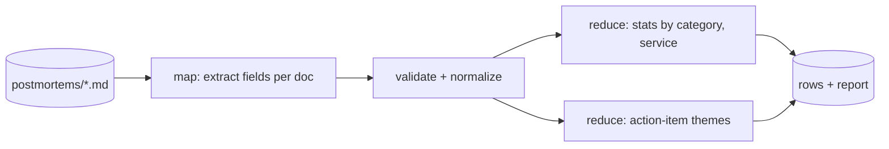

# Variant B: Hill-climb an LLM data pipeline
> Turn a one-prompt extraction job over incident postmortems into a measured, cost-aware pipeline with per-field quality numbers, a CI gate and a drift alarm.

## The system under test
A batch job reads postmortem documents and emits one structured row per incident, plus fleet-level aggregates for a reliability review:



This is the shape DocETL formalizes: operators such as map, reduce, filter and resolve over documents, with an optimizer that rewrites the pipeline (decomposing operations, swapping models, replacing steps with code) and scores each candidate on accuracy and cost ([DocETL repo](https://github.com/ucbepic/docetl); [DocETL paper, VLDB 2025](https://arxiv.org/abs/2410.12189); optimizer paper: [arXiv 2512.02289](https://arxiv.org/abs/2512.02289)). In this variant you do the optimizer's job by hand first, so that you understand what it is searching over. Automating it is a stretch goal.

No agent is required. That is a feature: a fixed workflow is easier to verify than an agent, and most production LLM work looks like this ([06-agent-architectures](../../06-agent-architectures/README.md): workflows vs agents).

## The data
[`../code/data/`](../code/data/) holds 20 synthetic postmortems and `labels.jsonl`, produced by [`make_postmortems.py`](../code/make_postmortems.py) (deterministic, seed 99). Each document is rendered from a hidden ground-truth record, then written the way real postmortems are, with traps tagged in `hard_features`:

| Hard feature | What the document does | Which field it attacks |
|---|---|---|
| `sev_upgrade` | No severity header; declared SEV3, upgraded later in the timeline | severity |
| `decoy_service` | "We initially suspected search… it was not affected" | services_affected |
| `duration_prose` | No duration header; must be computed from the timeline | duration_minutes |
| `detection_in_prose` | Impact start is not in the timeline; it is in a later paragraph | detection_minutes |
| `no_customer_impact` | "No customer-facing impact" (the word *customer* still appears) | customer_impact |
| `long_appendix` | Runbook excerpt mentioning SEV1 and other services; log noise | severity, services |

Scored fields (code): `severity`, `root_cause_category`, `services_affected`, `detection_minutes`, `duration_minutes`, `customer_impact`. Judged fields (M5): `summary`, `action_items`, and the reduce step's themes.

Twenty documents is enough to run and to learn the loop. It is *not* enough for tight CIs, which is deliberate: M2 asks you to grow the set to 60+, including documents not from the generator.

## Baseline
The offline "model" is a regex extractor with realistic blind spots (first severity mentioned wins, every service name mentioned counts, header-only duration). Measured, offline, 2026-10-19:

```text
$ AINATIVE_FAKE=1 python pipeline_v0.py --out runs/preds_v0.jsonl && python score.py runs/preds_v0.jsonl
micro  P 0.619  R 0.836  F1 0.711
severity            P 0.65  R 0.65
root_cause_category P 1.00  R 1.00
detection_minutes   P 0.65  R 0.65
duration_minutes    P 1.00  R 0.70
customer_impact     P 0.85  R 0.85
services_affected   P 0.42  R 1.00
```

Read the shape, not the level: `services_affected` has perfect recall and terrible precision (decoys and appendix mentions leak in), `duration_minutes` has perfect precision and missing recall (it abstains when the header is absent). Those two shapes need different fixes. A real model will have a different profile; you measure it in M1.

## Milestones
| # | Milestone | Weekend | Key deliverable |
|---|---|---|---|
| [M1](M1-pipeline-v0.md) | Pipeline v0 (map/reduce over docs) | 1 | Real-model run; labeling guide |
| [M2](M2-labels-and-metrics.md) | Labels and metrics | 1 | 60+ labeled docs; field-level P/R with CIs |
| [M3](M3-error-analysis.md) | Error analysis | 2 | Error taxonomy per field; spec fixes |
| [M4](M4-hill-climb.md) | Hill-climb: decomposition, chunking, model/effort, cost frontier | 2 | Experiment log; frontier plot |
| [M5](M5-judge-free-text.md) | Judge for free-text fields | 3 | Calibrated judge, TPR/TNR |
| [M6](M6-ci-gate-and-drift.md) | CI gate and drift monitoring | 3 | Gate tested against seeded regressions |

Rubric: [../rubric.md](../rubric.md#variant-b-llm-data-pipeline).

## The distributed-systems lens
- A pipeline run is a **batch job with a nondeterministic transform**. Cache LLM responses keyed on (prompt hash, doc hash, model, params) with `RecordingClient`/`ReplayClient` so reruns of unchanged stages are free and reproducible.
- Per-field P/R is a **data-quality SLI**. A drop in `services_affected` precision corrupts the downstream "impact minutes by service" report exactly like a bad join would.
- A prompt change is a **schema migration of the transform**: version it, gate it, backfill under the new version, keep the old output to diff against.
